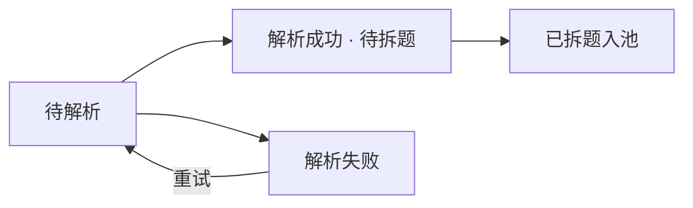
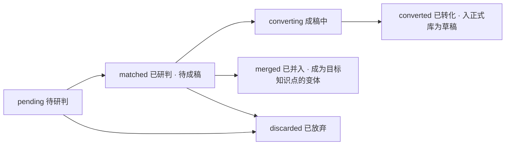

# 知己 · B 端管理台 PRD

> 上游产物是 [核心模块定义](核心模块定义.md)（模块边界、表归属与枚举契约）与 [知识库PRD](知识库PRD.md)（内容资产要求与生产管道七环节）。知识库PRD 说清了"内容怎么生产出来"，这份文档说清"人在哪个页面、点什么按钮把这件事做完"——B 端九个页面的功能详设。字段定义与接口清单仍不在此展开：表归属与枚举以核心模块定义附录 A 为准，字段级 DDL 以各模块落 `schema.sql` 时为准。

## 一、需求背景

### 1.1 B 端是生产端，页面就是生产线

C 端六功能消费知识库，B 端负责让知识库存在并且可信。知识库PRD 把内容质量的上限押在管道上（"知识库不会自己长出来"），而管道的每个环节都对应 B 端的一个操作面：素材要有人导、解析要有人确认、候选要有人研判、成稿要有人校、上线内容要有人复核。没有这些页面，管道只是文档里的流程图。

### 1.2 不是 ERP，但运营量是真实的

定位是小规模公开服务（决策清单 D16），B 端运营者是几个人：你（管理员）加几位参与题库维护的同事（内容维护者 editor，决策清单 D17）。仍然不做可配置的角色体系——员工与客户双表分立（D18）加后台两值角色就够，但运营者的操作量是真实的：GitHub 题库一次导入几十上百个文件；批量成稿前要估 LLM 成本；"校四样"是内容质量的底线流程。B 端页面按"小团队高效干活"设计——认证带来的只有双表会话隔离与一个账号管理页（见第十一节），砍掉的是可配置 RBAC（审核流、审批人、权限矩阵），不是工作台本身。

### 1.3 运营者小团队的两种节奏

B 端用户是你（管理员）加几位参与题库维护的同事（D17）：管理员管账号、配置与终审，维护者分担导入、研判、校对——校对队列天然支持多人并行消费，各领各的，SQLite 写串行下无并发冲突；员工账号与客户账号两套互不相通（D18），同事要试用 C 端就另行注册客户账号。两种工作节奏：

- **批量生产期**：导入素材 → 确认解析 → 研判候选 → 触发成稿 → 集中校对，一坐几小时，需要批量操作与进度面板；
- **日常维护期**：清校对队列、处理复核到期与判定申诉，每天十几分钟，需要待办集中一页清。

页面设计服务这两种节奏：批量环节成组给操作，维护环节收敛为队列。

## 二、页面总览与路由口径

B 端九个页面，全部挂在 `/admin` 路由树下（与 C 端同一构建产物，靠路由区分）：

| 页面 | 路由 | 数据来源（后端包） | 一句话职责 |
|---|---|---|---|
| 概览 | /admin/dashboard | 聚合 kb / pipeline / llm api | 内容资产统计、管道漏斗、待办积压、LLM 用量 |
| 技能库 | /admin/skills | skill | 技能域字典的维护：新增、编辑、排序、停用 |
| 知识点管理 | /admin/kp | kb | 知识点与主题簇的维护中心（题卡的库侧实体在这里） |
| 素材库 | /admin/docs | pipeline | 批量导入、解析状态跟踪、拆题确认 |
| 候选池 | /admin/candidates | pipeline | 候选题研判：匹配归并、分簇、触发成稿 |
| 知识地图 | /admin/knowledge-map | pipeline | 语料聚合视图：同题归一、语料簇确认、覆盖率统计与按簇批量建设（决策清单 D21） |
| 校对流转 | /admin/review-flow | 聚合 pipeline / kb / judge api | 统一待办中心：成稿校对、复核到期、申诉复核 |
| 账号管理 | /admin/accounts | account | 后台人员管理（sys_staff）：新增、停用/启用、口令重置；客户账号不在后台管理（决策清单 D18） |
| 系统配置 | /admin/settings | llm | LLM 限额、模型路由、连通性自检 |

**路由口径拍板（2026-09-23）**：内容管道的前端入口按环节拆成素材库、候选池、校对流转三页，不再用单一 `/admin/pipeline`——三个环节的工作节奏不同（导入是批次制、研判是逐条过、校对是队列清账），拆开后每页职责单一，也避免单页多 tab 的信息密度问题。核心模块定义总览表已同步此口径。

**菜单分组与落位规则（2026-09-23，决策清单 D20）**：侧边导航按四组组织，菜单是页面总览表的镜像——看菜单即知全部功能：

| 分组 | 页面 | 可见角色 |
|---|---|---|
| 概览（单页） | 概览 | admin / editor |
| 内容资产 | 技能库、知识点管理 | admin / editor |
| 内容生产 | 素材库、候选池、知识地图、校对流转 | admin / editor |
| 系统 | 账号管理、系统配置 | 仅 admin |

新功能页面的落位规则四条：①先在本 PRD 页面总览表登记（名称 / 路由 / 数据来源 / 一句话职责），总览表是功能唯一清单；②按归属落入内容资产（库表维护）/ 内容生产（管道流动）/ 系统（账号与配置）三组之一，概览组不收子页；③开新分组属于信息架构变更，需拍板并回改本节；④菜单实现收口在 AdminLayout 的菜单注册表数组，每项带可见角色字段，editor 登录时隐藏"系统"组（随 account 模块接线生效）。

**关于"题卡"**：C 端渲染的题卡（正面题面 / 背面三档样例 / 追问入口 / 从零讲）没有独立的库侧实体，它的数据源就是知识点（kp_main）。维护题卡 = 维护知识点，`/admin/kp` 就是题卡的维护页面，不另设"题卡管理"。C 端怎么渲染题卡见核心模块定义 2.3 的题卡内容映射。

## 三、概览

概览页无独立后端模块，数据从各模块 api 聚合，回答四个问题：

| 区块 | 内容 | 对应验收口径 |
|---|---|---|
| 内容资产 | 知识点总数与状态分布（draft/reviewed/active/retired）、主题簇数、技能域数、难度 1~5 分布 | 知识库PRD 12.1 阶段验收"难度分布检查"的日常视图 |
| 管道漏斗 | 环节转化量：素材文件数 → 拆出候选数 → 已研判数 → 已成稿数 → 已上线数；复盘录题回流的新增单独一行 | 知识库PRD 产品目标"库能生长：每环转化量可查" |
| 待办积压 | 校对队列、复核到期队列、申诉复核队列三条待办的条数，点击跳转对应队列 | — |
| LLM 用量 | B 端人工触发类（拆题兜底 / 聚类去重 / AI 成稿）与全站调用量近 7 天计数，对照各限额与全站每日熔断状态（决策清单 D16 防滥用） | 核心模块定义 4.2 成本治理与 D16 防滥用的视图 |

## 四、技能库

技能域字典是三处消费的全局字典（建档画像候选项、知识点分域归属、简历授权锚点），C 端只读，B 端维护（核心模块定义 3.1）。

- **列表**：域名、描述、排序值、状态（启用/停用）、域下知识点计数。
- **新增 / 编辑**：域名（唯一）、描述、排序值。排序决定建档候选清单与关卡组默认序的展示次序。
- **停用，不提供删除**：域一旦被知识点归属或画像条目引用，物理删除会留下悬空引用。停用后不可再被新建内容归属，已有引用与历史数据原样保留。域的身份是引用锚点，改名不影响引用。
- **前置引导**：建簇、建知识点都要先选域；字典为空时引导先建域。

## 五、知识点管理（题卡维护中心）

### 5.1 列表与检索

- 检索：题面模糊搜索。复盘录题"匹配已有知识点"的 C 端搜索复用这一能力（核心模块定义 2.6 的搜索接口同源）。
- 筛选：技能域 / 主簇 / sub_type / 内容状态 / 难度 / 是否已标职级基线 / 复核是否到期。复核到期筛选与校对流转页的复核队列互跳。
- 列表列：题面、技能域、主簇、sub_type、难度五色、状态、最近校对时间、复核到期时间。

### 5.2 新建的两个入口

1. **手工新建**：不走管道，直接在管理页填全部结构。这是知识库PRD 九"v1 极简实现（手工录题 + AI 辅助成稿）"的另一半，适合单条补题。
2. **从候选条目转化**：候选池研判确认新建后，带着素材上下文进入成稿（见第六、七节）。

### 5.3 编辑与编辑约束

编辑表单按知识点内容结构分区块：题面与变体、追问链、评分要点与三档样例、职级要求、难度与前置、主簇归属、频率信号。

- **追问链**：改层文本、层间排序随时允许；层的增减只走「新增层 / 停用层」，停用层的 layer_key 不得再分配给新层（核心模块定义 3.2 红线的操作化）；每层可编辑方向 dir，主问题层固定 main。
- **评分要点**：按层组织、带三级分级（basic/mid/senior），保存前系统做结构校验（键名、层级归属完整）；"要点可判定性"是人工校对的事，结构完整性是系统的事。
- **职级要求**：五档分别设置是否必问（required）与下钻停止层（stop_layer）。这里是"漏题风险的真实所在"（核心模块定义第七节待办），编辑保存后自动进入人工校对清单的完整性检查项。
- **前置依赖**：从知识点列表多选挂载，保存时做环检测（见 5.6）。
- **变体**：预存 2~3 条，可增删改与排序；变体是同一知识点的其他问法，不是独立知识点（知识库PRD 4.4）。
- **已上线（active）内容的修订**：原地保存，状态不变，复核到期重置——编辑者即校对者，"不校不上线"由编辑动作本身满足。历史判定不受影响：判定引用的是全量要点快照（知识库PRD 6.5）。保存时明确提示"本次改动影响未来判定，历史判定已快照"。

### 5.4 下线与合并，不提供物理删除

- 知识点没有"删除"按钮，只有**下线（retired）**：answer_log 的判定快照、user_kp_state 的个人进度都引用知识点身份，物理删除会把历史数据变成悬空。下线时必须填写去向：废弃，或合并到某个知识点。
- **合并语义**：并入目标知识点后本条转 retired 并保留指向（content_status 枚举的既有语义）；变体清单迁入目标；追问链与评分要点**不自动迁移**——两套结构机械合并必出错，列出双方差异清单供人工比对后手动处理。
- **合并前置检查**：本条或目标存在个人态引用（user_kp_state / user_kp_signal）时，v1 阻止合并并给出引用清单。知识库PRD 8.1 说的"在途用户迁移"需要逐条确认，等真实存量出现再做；现阶段量级不值得。
- **可以物理删的只有两类**：未入库的候选条目（终态与待研判），以及素材文档（连同解析文本一起删，版权红线要求过程材料可清理，见 6.4）。

### 5.5 主题簇管理

- **建簇 / 改簇**：簇名、所属技能域、描述。簇先于知识点存在（kp_main 挂且只挂一个主簇，外键决定建簇在前，核心模块定义 3.2）。
- **合并簇**：目标簇保留，被并簇转 retired 保留指向；簇下知识点的主簇归属整体迁移。簇合并只改归属不改内容，比知识点合并轻。
- **簇级内容编辑**：从零讲、完整参考方案两个编辑区，用 Markdown 编辑器（带实时预览：代码高亮、表格、Mermaid 流程图，知识库PRD 4.7），Mermaid 语法校验进结构校验；与知识点走同一套状态机（draft → reviewed → active）。从零讲按簇生产、簇内共享（知识库PRD 4.5），编辑页展示簇下知识点清单作为共享范围提示。图片仅支持 B 端上传自制图（AI 不产图，原文图片不搬运）。

### 5.6 前置依赖防环

前置依赖是学习路径拓扑排序的输入，成环 = 排序失败。保存知识点时对全库前置关系做环检测，成环则拒绝保存并展示环路径（A → B → C → A），要求先解开。B 端编辑与管道转化入库两个写入口都执行。

### 5.7 频率信号人工标定

库级频率信号两个来源里的人工标定入口（知识库PRD 8.4）：在知识点编辑页内标定档位与一句理由；面经信号由管道采集环节写入，此处只读展示。聚合分不落库、消费时推导，标定动作只写信号记录。

## 六、素材库与批量导入（多源素材入库专项）

### 6.1 使用场景与形态路由

场景：收集到的题源五花八门——已拆分的面试题库（GitHub 仓库为主）、官方文档与教程等学习资料、面经帖，格式 md / pdf / word 混杂。系统按**内容形态**路由加工（决策清单 D22）：题库型做题-答配对拆分；资料型按章节切分后 AI 反推出题；面经型抽题贡献频次信号。三条路径汇成同一种候选题条目进归一与地图——原文不直接进库（版权红线与质量红线同前）。

v1 提供两种导入方式：

- **多文件上传**：文件多选或整文件夹拖入；
- **zip 包导入**：单包上传，后端解包入库，保留解包后的目录结构作为来源线索。

GitHub 仓库 URL 直接拉取不做进 v1：用户本地 git clone 后上传是等价路径，还天然规避网络、大仓库与私有仓库问题；URL 拉取列为后续增强。

### 6.2 导入批次与素材文档状态机

一次导入操作生成一个**批次**，批次是进度与失败重试的单位。批次面板展示文件数、各状态计数与失败清单。

素材文档状态机：

- 解析失败显式落状态并展示原因：扫描件（图片型 pdf 无文本层）、加密文档、格式损坏、超出大小上限。扫描件明确报错不静默（核心模块定义 4.2 既有口径），批量场景下更要一眼看清哪些文件废了、为什么。
- 单文件可重试解析，失败文件可移除出批次。
- 拆题完成后素材文档进入"已拆题"，与候选池条目保持溯源关系（候选条目可回跳原文件与解析文本）。

### 6.3 解析预览与拆题

- **逐文件确认解析预览**（知识库PRD 九-2 "人先看解析预览确认没抽错"）：左侧解析文本、右侧拆题结果，支持删噪（剔除目录、导航、页眉页脚、非题目段落）与手动调整题目边界。
- **批量确认策略**：拆题命中标题层级或题号正则且置信度达标的文件允许批量确认进池；低置信与存疑的逐个人工看。批量确认不违反"不校不上线"——拆题产物只是候选池条目，距离用户路径还隔着研判、成稿、校对三道关。
- **解析预览按内容形态路由**（决策清单 D22）：题库型走题-答配对拆题（标题层级 → 题号正则 → LLM 兜底三档，md 标题策略是主力）；资料型走章节切分 + AI 反推出题——对值得出题的知识片段生成面试问法与答案要点，预览确认后才进池（反推是 B 端 LLM 成本大头，按片段勾选触发，不默认全量跑）；面经型走题目抽取（贡献频次信号）。混合文档按文件级形态默认路由，片段级标签可人工修正。

### 6.4 来源记录与合规

- 每个素材文件登记**来源出处**：GitHub 仓库 / CSDN 帖子记链接，官方手册与书籍记名称与章节（决策清单 D17）；出处随管道向下传递，知识点入库时标注参考来源——"不搬运独创性表达 + 保留出处"红线的落点。
- 上传入口固定展示**出处提示**：各来源协议与授权各异，维护者只作参考输入，成品一律走"AI 参考重写 + 人工审核"管道；docs/题库源/ 下的仓库素材仅限本地使用，随开源或共享分发前必须移出（企划书 §七 既有红线）。
- **素材文档删除**：连带解析文本一起删；名下候选条目全部处于终态（已转化 / 已并入 / 已放弃）或尚未研判时才允许删，有在途候选的先处理完候选。

## 七、候选池

### 7.1 候选条目状态机

候选条目有两个来源：管道拆题入池、复盘录题回流（对不上已有知识点的题，知识库PRD 九-7）。状态机如下（枚举 candidate_status 已入核心模块定义附录 A）：

> 同题候选会先被知识地图（第九节）的自动归一吸收，进入本页的多为低置信散题与新建确认项——两页共享同一套状态机。

- **研判动作在 pending 上做**：AI 先给语义匹配建议（映射到已有知识点，或判定为新题），人工确认三种去向——并入已有知识点（归一为问法变体）、新建知识点（进分簇）、放弃（重复 / 无价值 / 不可判定，记原因）。
- 确认并入的执行合并动作（写变体）；确认新建的先完成分簇（归入已有簇或新建簇，簇是入库前置），再触发 AI 成稿。
- **成稿**按固定模板生成全部结构，过结构校验防键名漂移；校验失败自动重试一次，再失败停在 converting 并报错供人工查看。成稿产物永远先落为知识点草稿（draft），不直接上线。
- 三个终态（converted / merged / discarded）的条目出工作流，保留记录供漏斗统计与溯源。

### 7.2 批量操作与成本预估

- 列表支持按批次、来源仓库、匹配建议（疑似重复 / 疑似新题）过滤；**同题多来源的重复项聚合展示**——GitHub 题库之间重复率极高，去重是生命线（知识库PRD 8.5），研判页要把"同一知识点的 N 种来源问法"摆在一起确认。
- 触发批量成稿前显示**成本预估**（预计 LLM 调用次数，与近 7 天 B 端用量对照）——决策清单 D12.2 提的"批量操作预估成本提示"在批量场景落地。
- 未入库候选条目（终态与 pending）可物理删除。

## 八、校对流转（统一待办中心）

三个队列一页清账。本页是跨模块聚合页，数据从 pipeline / kb / judge 各 api 取：

| 队列 | 来源 | 处理动作 |
|---|---|---|
| 成稿校对 | 知识点与簇级草稿（管道成稿、手工新建） | 按"校四样"清单核对：技术正确性、评分要点可判定性、变体覆盖面、从零讲比喻（知识库PRD 九-5）；通过 → reviewed，或直接"通过并上线" → active |
| 复核到期 | scheduler 扫描推入（核心模块定义 4.2） | 进知识点编辑页复核内容是否过期：更新内容（复核到期重置）或确认仍有效（到期顺延）；确实废弃的走下线 |
| 申诉复核 | C 端判定申诉（决策清单 D6） | 查看判定引用的用户原话与要点快照，人工确认后改判"不计入档位"（appeal_status → excluded）或维持原判 |

- 校对页提供知识点在 **C 端的卡面预览**（题面 / 背面三档样例 / 追问链逐层 / 从零讲）——校对者要看到用户会看到什么；目标刻度按五个职级档位切换预览。
- **上线动作支持批量**：勾选多条 reviewed 内容一次上线。reviewed 与 active 分成两个动作，校对完成与上线时点解耦（批量校对后择时统一上线）。
- 每队列的进出条数落可查统计，作为管道漏斗"人工校对"环节的数据源。
- 多人协作（决策清单 D17）：队列支持多人并行消费，条目被处理后他人刷新即见，不做任务分配与认领机制——队列本身就是分工。

## 九、知识地图（语料归一与按簇建设）

候选池解决"单条候选怎么研判"，本页解决"全量语料怎么组织"——语料先行管道的阶段②③承载（决策清单 D21，三阶段定义见知识库PRD 九）。归一题与语料簇是工作草稿层，距离用户路径仍隔着成稿与校对，聚合策略可以激进。

- **三层视图**：技能域 → 语料簇 → 归一题。每个归一题显示归一题面、覆盖源数、状态（canonical_status：待审 / 已确认 / 已建设）、向下展开 N 条源候选（各源问法与答案预览，可回跳素材原文）。默认按覆盖源数倒序——被最多题库收录的题最先进入视野。
- **归一确认**：高置信自动归并的归一题默认就绪（人工抽检即可）；低置信聚合建议逐条确认——确认同题 / 拆分为两题 / 调整簇归属。误归并的拆分把候选条目退回候选池重新研判。
- **簇操作**：语料簇的合并 / 拆分 / 改名 / 归属域调整；AI 的簇命名与域归属建议可一键采纳。确认后推进为正式主题簇（draft 态落定，从零讲与按簇成稿以此为起点）。
- **按簇批量建设**：簇内勾选归一题批量触发成稿（走候选池状态机的 converting，产物落知识点草稿），触发前显示成本预估（同 7.2）；整簇成稿完成后整簇进入校对流转队列——"建完一个簇，清一批校对"。
- **覆盖率统计**：页头统计条——域数、簇数、归一题数、已建设数、待确认数；按覆盖源数排行决定建设顺序，这就是"按目录、按簇建设"的排队依据。
- **增量吸收**：新题库导入后增量归一，地图自动更新；已建设知识点吸收新来源——新问法进变体候选、答案与既有内容冲突的进复核队列。地图是持续资产，不是一次性产物。
- **与候选池的分工**：候选池管单条候选的研判工作流（状态机、成稿触发），本页管全量聚合视图与簇级操作；两页共享同一套状态机，入口不同、数据同源。

## 十、系统配置

沿用核心模块定义 4.2 既有设计：LLM 限额（按入口 × 天）、模型路由（按用途选模型档）、超限降级动作，全部为运行参数，存配置表，改动即生效。B 端页面在此之上补两件小事：

- **模型连通性自检**：对当前路由的各模型档各发一次最小请求，验证 key 与网络，失败给出可读原因——配置改完当场可验证，不等业务调用时才发现。
- **LLM 用量对照**：各入口当日计数与限额并排展示（与概览页用量区块同源）。

Prompt 模板不做在线编辑：模板文本归各业务模块 resources 管理（核心模块定义 4.2 既有口径），改 prompt 是发版行为，不是运行参数。

## 十一、账号管理（/admin/accounts）

定位调整（决策清单 D16）后产品以小规模公开服务运行；同事以 editor 参与题库维护（D17）让认证成为内部协作的前置，公网开放时它同时是开放注册的基础。账号结构为完全双表双入口（D18）：本页是认证的 B 端侧承载，管理的是后台人员（sys_staff）。

- **双表双入口**：后台人员（sys_staff）与客户（sys_customer）分表，后台登录页（/admin/login）独立于 C 端登录 / 注册，两套会话互不通用——客户 token 进不了 /admin 接口，员工 token 进不了 C 端 /api 接口（决策清单 D18）。
- **后台人员列表**：用户名、角色（admin / editor）、创建时间、最近登录、状态。
- **新增账号**：管理员为同事创建员工账号，指定初始口令与角色（admin / editor）——员工账号不经公开路径产生，初始口令线下交付。
- **停用 / 启用**：停用即后台会话失效并拒绝后台登录——处理滥用与离职同事账号的第一个动作；启用恢复。
- **口令重置**：v1 无找回密码（不接邮箱 / 短信服务），忘记口令走管理员重置（员工与客户两侧同此口径）。
- **边界**：客户账号不在本页管理（防滥用走概览页用量监控；客户简历与作答记录一律不看）；不做账号删除（停用即可）；角色仅 admin / editor 两值固定，不做可配置 RBAC。

## 十二、红线与数据边界

B 端全部操作受四条领域红线约束（核心模块定义第五节），其中三条在操作面上最容易踩：

1. **不校不上线**：管道产物到用户路径之间隔着研判、成稿、校对三道人工关。批量操作（批量确认拆题、批量上线）省的是重复点击，不省任何一道关。
2. **库校对不碰用户进度**：B 端所有写操作只落 kp_* 与素材侧表；知识点合并这类涉及个人态的场景，v1 直接阻止而不是绕道修改（5.4）。
3. **版权**：素材解析文本是过程材料，只留在素材文档内；成品必经 AI 重写加人工校对，参考出处全程可溯（6.4）。

## 十三、范围外

- **操作审计与 RBAC**：B 端现为 editor 多人协作（D17），但操作审计、可配置 RBAC / 角色管理仍不做——admin / editor 两值角色加双表会话隔离已覆盖"谁能进后台、谁能动账号与配置"的区分；操作审计挂 D19 触发条件①（出现内容追责需求再加操作人字段与日志）。
- **素材在线抓取**：GitHub 仓库 URL 拉取、网页面经爬取不做进 v1（6.1）。
- **Prompt 在线编辑与 A/B**：见第十节。
- **知识点版本管理与回滚**：历史判定的可解释性靠要点快照保证（知识库PRD 6.5），不为内容本身建版本表；确有回滚诉求时再议。
- **自由富文本编辑器**：知识点结构字段（层、要点、题面）仍是结构化表单；仅白名单讲解字段（从零讲、参考方案、叙述框架、三档样例）用受控 Markdown 编辑器（知识库PRD 4.7），结构校验落在字段白名单与 Markdown 语法上。AI 生成图片、LaTeX 公式不做。

## 十四、落地与验收

与 kb / pipeline / account 模块的开发节奏对齐，分四段：

1. **随 kb 模块（10 样板期）**：技能库页 + 知识点管理页（列表 / 新建 / 编辑 / 簇 / 前置防环 / 状态流转）。验收：10 个样板知识点全部经 B 端页面完成建簇、录题、标停止点、走完 draft → active；从零讲与参考方案的 Markdown 渲染（代码高亮、表格、Mermaid 流程图）在 C 端卡面与详情页验收通过。
2. **随 pipeline 模块（50 知识点批量期）**：素材库（批量导入 + zip + 解析状态机）+ 候选池（研判状态机 + 批量成稿成本预估）+ 知识地图（同题归一 + 语料簇确认 + 按簇建设）+ 校对流转（成稿校对队列）。验收：一批 GitHub 题库素材（≥30 个文件）从导入到批量上线全程走 B 端页面完成；同题归一的自动聚合准确率抽检 ≥85%、误归并可拆分回退；拆题准确率抽检 ≥90%、校对返工率 ≤30%（知识库PRD 12.1 既有口径）。
3. **收尾**：概览页统计 + 复核到期队列（scheduler 联动）+ 申诉复核队列。验收：产品目标"每环转化量可查"在概览页有数；一次判定申诉从标记到改判全流程可走通。
4. **随 account 模块（内部协作启动前）**：C 端登录 / 注册页 + 后台登录页 + 账号管理页 + 双表会话隔离。验收：陌生客户可注册 → 建档 → 闯关全链路在客户会话下跑通；未登录访问 C 端被引导至登录页；同事以 editor 从后台入口登录可完成导入 → 研判 → 校对全流程，但客户 token 访问 /admin 接口被拒、员工 token 访问 C 端 /api 接口被拒；停用员工账号即时失效。

## Tags

- tags: [产品, 面试, 管理台, prd]
- date: 2026-09-23
- source: ai-conversation
- project: 知己
