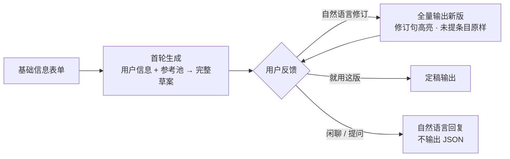
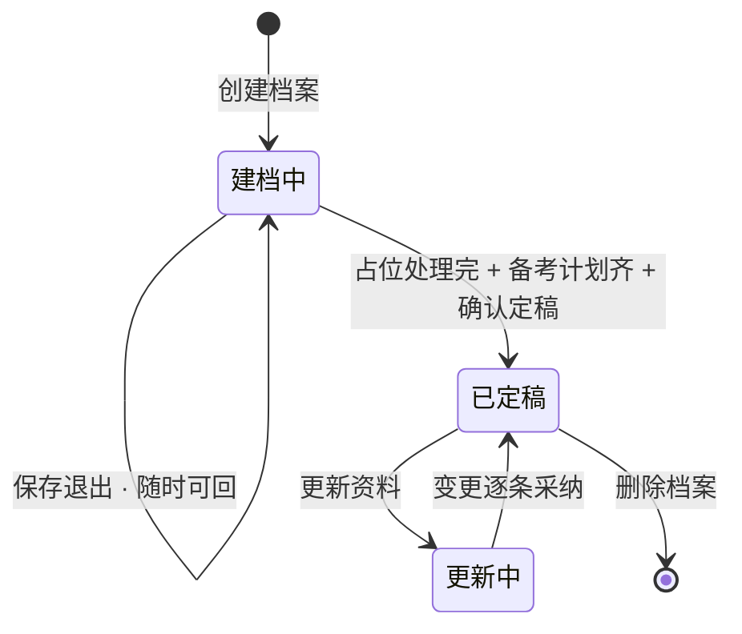

# 知己与知彼 · 个人档案（建档）PRD v2

> 上游依据：《核心模块定义》4.1 个人档案、6.4 AI 边界、6.5 命名真相源；配套提示词见《PROMPT-技能条起草》（对话版 v1），交互原型见《原型-技能条起草.html》（已验证流程手感）。
>
> v2 变更：建档主交互从 v1 的"骨架选择 → 编辑器逐条拍板"改为**对话头脑风暴**（表单 → 首轮草案 → 多轮修订 → 定稿导出，经原型验证）；骨架槽位、事实清单页、句级编辑器不再是用户操作步骤，退为内部机制与升级路径；新增定稿导出（Markdown）。冲突时以《核心模块定义》红线为准。

## 一、背景与目标

### 1.1 模块位置

个人档案是用户进入产品的第一站，产出物（技能条 + 备考计划）是后续一切模块的输入源头：学习路径按技能条锚定知识点生成、模拟考按技能条考存活率、今日复习按锚定知识点推新题。本模块做不好，"精准复习"就无从谈起——推送失去 targeting 信号，产品退化为通用题库。

输入：一个 30 秒能填完的表单（可被简历解析预填），加一段对话；输出：定稿的画像（技能条清单 + 备考计划），及可导出的简历技能段文本。

### 1.2 用户问题

- 8 年经验的人写不好技能条：做的东西不少，写出来要么是大白话，要么是空话，自己都觉得拿不出手。
- 想复习的人不知道从哪开始：技术栈一大片，全量过一遍不现实，又不清楚"我的经历对应哪些题、练到多深"。
- 没有简历的人缺少起点：还没到写简历的阶段，但复习需求已经存在。

### 1.3 模块目标（可度量）

| 目标 | 度量 | 参考值 |
|---|---|---|
| 用户能走完建档 | 定稿完成率（开始建档 → 定稿） | ≥ 60% [假设·待确认] |
| 首轮就够好 | 一轮通过率（首轮草案后直接"就用这版"的比例） | ≥ 40% [假设·待确认] |
| 建档足够快 | 定稿耗时：纯表单路径 ≤ 8 分钟，含对话修订 ≤ 12 分钟 [假设·待确认] | 上线后按真实数据修订 |
| 起草可信 | 数字违规率 = 0（抽查回查用户输入）；占位率（含【】的条目占比）≤ 30% | 违规即修提示词 |
| 产出能驱动后续 | 定稿 → 7 日内开始练习的转化 | ≥ 50% [假设·待确认] |

## 二、用户与场景

### 2.1 用户画像

| 画像 | 熟练度 | 使用频率 | 痛点强度 | 对本模块的期待 |
|---|---|---|---|---|
| 资深备考者（8 年，ES/搜索方向） | 高，对简历质量挑剔 | 一次性建档，后续偶尔更新 | 高：技能条写不出水平 | 首轮草案就要够专业，别让我大改 |
| 业务后端（3 年，CRUD 为主） | 中，不清楚面试考察什么 | 一次性建档 | 中：不知道该写什么、练什么 | AI 主动给我起稿，我补充经历它就改对 |
| 转方向者（Java 转 Go，或在职准备跳槽） | 中高 | 可能建 2 份档案 | 中：两套方向要分开准备 | 档案隔离干净，别互相污染 |

### 2.2 使用前提

- 注册登录（注册成功即创建默认档案，直接落入基础信息表单）。
- 题库侧 Java 方向至少三个领域有有效覆盖——锚定映射的前提是"对得上有东西"。

## 三、核心设计：对话即控制

### 3.1 设计张力与解法转变

生成类功能的常见死法：模板锁死，用户填得痛苦；完全放开，AI 自由发挥收不回来。v1 的解法是前置结构锁定（骨架槽位 + 占位策略 + 事实清单），原型验证后的结论是：**这套机制把复杂度堆在了用户面前，而对话修订能以低得多的认知成本达到同等的控制力**——用户不满意直接说人话，AI 全量重写，口述的事实立刻进草案。

v2 的控制模型因此从"前置闸门"转为"生成后修正"：

| 防线 | 机制 | 防什么 |
|---|---|---|
| 来源白名单（提示词铁律） | 经历、数字只能来自表单与对话原话；技术名词只能来自用户技术栈 + 对话提到 + 机制描述；措辞强度跟信息走（主导 > 负责 > 参与 > 熟悉 > 了解） | 编造数字与经历、无中生有的技术栈、夸大 |
| 参考池风格锚 | 按岗位方向打标过滤后注入参考技能条池（几十条），只学句式与密度，池中经历数字一个字不许搬 | 措辞不专业、结构跑偏 |
| 映射闸门（后置） | 定稿后条目映射题库知识点，低置信确认、零命中三选一 | 写得漂亮但空无一物 |
| 定稿核对 | 未处理占位逐个填值或删除 + 备考计划确认 | 主张里留着没兑现的空白 |

用户的控制权全程用自然语言行使：修订协议保证"用户没提到的条目保持原样"，AI 不自作主张全面重写；用户要求"更有气势"时，AI 索要事实而不是编造。结构不再前置锁定——条目数量与划分由 AI 参照参考池惯例决定，用户用对话把它拉回。

### 3.2 设计不变式

1. **AI 只加速，不阻塞**：AI 服务全挂时，提供手写模式（自由文本技能条），建档仍能走完。
2. **数字只搬运**：AI 永远不产生新数字，数值只能来自表单或对话原话；用户对话里亲口说的经历与数字视同有效信息——对话本身是事实采集的主通道。
3. **建档不摸底**：入口没有考试、没有测试题。信任顺序是先服务后检验。
4. **修订有边界**：每次修订全量替换，但用户未提到的条目保持原样；已定稿内容不被静默覆盖（更新资料走 diff 采纳）。
5. **每一步可离开、可回来**：会话与表单状态持久化；定稿前不产生任何下游影响。
6. **导出干净**：占位符是编辑期标记，定稿核对时必须处理完毕（填值或删除），导出文本不带任何内部标记。

## 四、功能需求

### Part 1 功能总览

| # | 模块 | 功能描述 |
|---|---|---|
| 1 | 档案列表 | 用户全部档案的入口：卡片展示档案名、目标岗位、职级、定稿状态、技能条数、学习进度摘要；支持新建（上限 3 份）、重命名、删除（二次确认，明示连带删除该档案全部学习数据）。定稿档案主按钮"进入学习"，草稿档案主按钮"继续建档" |
| 2 | 基础信息表单 | 必填仅两项：工作年限、技术栈（预置标签点选 + 自由输入添加，列表外技术不遗漏）；选填：当前岗位描述、目标岗位 / JD、想突出的擅长的，全部带示例 placeholder。每项配一句引导说明该字段如何影响生成 |
| 3 | 简历上传与解析（可选加速器） | pdf / docx / txt / md ≤ 10MB；解析后预填表单字段，用户确认修改即可；解析失败或过少时引导手填 / 对话，不死路。v0 spike 可先不做解析 |
| 4 | 对话头脑风暴 | 核心。进入即出首轮完整草案（4-8 条），用户自然语言反馈修订，每轮全量输出新版；用户口述的经历与数字直接写入；轮次上限 5，常驻"就用这版"；预置快捷反馈降低首次使用门槛；修订句高亮标注"来自你的反馈" |
| 5 | 定稿输出 | 未处理占位逐个填值或删除（一个核对清单）；备考计划区（目标职级预填可改、每日可投入、备考周期）；渲染为简历可粘贴的 Markdown，一键复制 |
| 6 | 锚定映射（定稿后） | 定稿后后台执行：条目语义映射题库知识点。高置信自动锚定；低置信在档案总览出候选确认；零命中三选一（回到对话改写 / 拆成两条 / 保留为"不驱动练习"并记题库缺口信号） |
| 7 | 档案总览与更新 | 定稿后档案总览展示技能条（含锚定知识点）、备考计划、简历导出入口；"更新资料"支持上传新简历或继续对话，变更建议逐条采纳，已定稿内容不被静默覆盖 |

### Part 2 模块详设

#### 4.1 档案列表

P0 业务与交互：登录后进入档案列表；卡片点击即切换当前档案。新建按钮满 3 份置灰。删除走二次确认，文案明确"该档案的技能条、学习记录、作答历史将一并删除，不可恢复"。

P1 规则：档案名默认"岗位方向 + 序号"（如"Java 后端 1"），可改名；档案间数据完全隔离。

P2 边界：全部为草稿时顶部给引导文案（"完成建档后，这里会告诉你每天该练什么"）。

#### 4.2 基础信息表单

| 字段 | 类型 | 必填 | 引导设计 |
|---|---|---|---|
| 工作年限 | 数字（0-30） | 是 | 引导："决定措辞强度基线——3 年不会出现「主导」级别的口径" |
| 技术栈 | 标签多选 + 自定义输入（回车添加） | 是（≥1） | 预置常见项（MySQL / Redis / ES / RocketMQ / Spring…）；引导："AI 只会写这里出现的技术——这是防编造的第一道闸"；自定义项若命中题库领域自动归一 |
| 当前岗位描述 | 长文本 | 否 | placeholder："如：负责电商订单系统，日订单 50 万" |
| 目标岗位描述 / JD | 长文本 | 否 | 标注"填了会向目标岗位倾斜"；可贴 JD 原文 |
| 想突出的 / 擅长的 | 长文本 | 否 | placeholder："如：搜索性能调优、带过 3 人小组、主导过分库分表" |
| 上传简历 | 文件 | 否 | 加速器入口与表单同级展示（"有简历？直接丢进来"），解析后预填全部字段 |

设计原则：必填只有两项，30 秒填完进对话；选填全部带示例；每个字段配一句"这个字段如何影响生成"的引导——引导讲的是机制带来的好处，不是表单填写说明。不做"年龄"字段：简历场景年限才有效，年龄敏感且无用。

P2 边界：目标岗位 / JD 与"想突出的"在定稿前随时可改，改动在下一轮对话生效。

#### 4.3 简历上传与解析（可选加速器）

P0 业务与交互：上传 → 解析中（进度反馈，超时 60 秒提示）→ 成功后预填表单（年限、技术栈、当前岗位、想突出的按技能与项目段抽取），用户确认修改后进对话。解析区间限定技能与项目段落，自我评价、证书等噪声过滤。

P1 规则：格式 pdf / docx / txt / md，≤ 10MB；解析推断类内容进"补充背景"参与首轮生成，但界面注明来源是简历解析。

P2 边界与降级：扫描件 / 图片 PDF 不做 OCR（v1 范围同前），提示转手填或对话；解析失败或内容过少时保留已读部分，引导手填——任何情况不死路。原文保留供溯源，可在档案设置删除。

#### 4.4 对话头脑风暴（核心）

##### 4.4.1 会话结构

一个会话走完起草与修订：System（固定，含三条铁律与修订协议）+ 首轮 User（用户信息 + 参考池）+ 若干轮自然语言往来。首轮即产出完整草案（4-8 条），不是先访谈后出稿——先给东西再收集反馈，符合"先服务后检验"。

##### 4.4.2 修订协议（System Prompt 中的硬规则）

1. 每次修订输出完整版技能条（全量替换），用户不需要脑内合并两版差异。
2. 用户没提到的条目保持原样，不自作主张全面重写。
3. 用户口述的经历、数字、项目细节视同有效信息，直接写入——对话即事实采集的主通道。
4. 用户要求"更厉害"时通过句式升级实现，真缺事实就一句话问用户要，不凭空加码。
5. 用户提问 / 闲聊时正常对话，不输出技能条 JSON。

界面配合：修订版中变化的句子高亮并标"来自你的反馈"（悬停可见出处）；提供"查看本轮输出 JSON"折叠（面向工程向用户的透明化）；预置 2-3 条快捷反馈示例降低首次反馈门槛。

##### 4.4.3 参考池注入

按用户岗位方向打标过滤后注入（Java 后端池约 50-100 条）；默认常驻 System，成本敏感时首轮后可省略（风格已被首轮输出锚定）。起步不做向量检索，池子数千条后再上。池中一切经历与数字是别人的，铁律禁止搬用。

##### 4.4.4 轮次与收尾

轮次上限 5，界面显示"ROUND n/5"，常驻"就用这版"按钮。设计意图：超 5 轮说明首轮跑偏或用户没想清楚，引导手写编辑比继续拉扯划算。会话状态持久化，随时退出回来接着聊。

P2 边界与降级：AI 服务异常时提供手写模式（自由文本技能条输入框，占位符约定同样生效）；对话中途补充简历走 4.3 解析并入用户信息。

#### 4.5 定稿输出

P0 业务与交互：用户点"就用这版"后进入定稿页，三块内容一站式收尾：

1. **占位核对清单**：列出全部未处理的【】占位，逐个填值（inline 输入）或删除（删除 = 此处不需要）；处理完毕即从清单消失。
2. **备考计划**：目标职级（五档，按年限预填，标注"按年限推测，可改"；v1 常量：0-2 初级 / 3-5 中级 / 6-8 高级 / 9-12 资深 / 13+ 专家，标定后置）、每日可投入（15 分钟 / 30 分钟 / 1 小时 / 2 小时+，决定今日清单体量）、备考周期（选填）。
3. **简历技能段导出**：代码渲染为 Markdown（"## 个人能力" + 各条目），一键复制；导出 Word 预留。

定稿门槛：≥ 1 条技能条、无未处理占位、备考计划必填项齐备。定稿确认文案："定稿后学习路径将按这份画像生成；技能条之后仍可随时修改。"

#### 4.6 锚定映射（定稿后后台执行）

P0 业务与规则：定稿触发映射——条目语义映射到题库知识点集合（不要求与领域命名字面对应）。三态处理：

| 状态 | 表现 | 用户动作 |
|---|---|---|
| 高置信 | 档案总览条目下直接展示锚定 chips | 可展开移除；不处理默认通过 |
| 低置信 | 总览出提示，展示 top-5 候选 + 搜索 | 点选或搜索后确认 |
| 零命中 | 警示："这条对不上任何考点" | 三选一：回对话改写 / 拆成两条 / 保留为"不驱动练习"（不进入学习与复习信号；同时向 B 端记题库缺口信号） |

设计意图：映射从 v1 的起草期前置检查改为定稿后执行——对话流里用户不该被打断去做确认，锚定是"用这版去学习"之前的最后一步质检。

#### 4.7 档案总览与更新资料

档案总览（定稿后主视图）：技能条卡片（含锚定知识点 chips）、备考计划、简历技能段复制入口、"更新资料"按钮。

更新资料（已定稿档案）：上传新简历或继续对话 → 新信息与既有画像比对 → 变更建议列表 → 逐条采纳。任何已定稿内容不被静默覆盖。

项目素材：简历项目段与对话中的项目细节按项目分卡沉淀（背景、角色、动作、技术、数字、结果六要素预填），不卡定稿，消费方是叙事练习与模拟考追问——建档时一句轻提示即可。

#### 4.8 档案状态机

## 五、AI 能力与质量体系

### 5.1 能力清单（对齐《核心模块定义》6.4 登记）

| # | 用途 | 触发 | 输入 | 输出去向 | 失败降级 |
|---|---|---|---|---|---|
| 1 | 简历解析预填 | 上传后自动 | 简历文件 | 表单字段预填 | 引导手填 / 对话（4.3） |
| 2 | 对话起草与修订（会话级，含参考池注入） | 进对话自动 + 每轮 | 用户信息 + 参考池 + 对话历史 | 对话流 JSON | 手写模式（4.4.4） |
| 3 | 锚定映射 | 定稿后自动 | 最终技能条 | 档案总览 chips | 标"待映射"，稍后重试 |
| 4 | JD 抽取 | 目标岗位字段填写后 | JD 文本 | 学习路径 JD 信号 | 仅存原文 |
| 5 | 项目素材六要素预填 | 建档内自动 | 项目相关信息 | 项目素材卡 | 空白卡手填 |
| 6 | 职级推测 | 规则计算（非 AI） | 工作年限 | 职级预填值 | — |

### 5.2 生成质量评估

自动检查：输出 JSON 可解析；占位符格式合法；输出技术名词 ⊆ 用户技术栈 ∪ 对话提及 ∪ 机制描述白名单（工程侧可做词典级抽查）。

软评维度（人工，spike 与迭代期）：首轮措辞专业度、与参考池风格一致性、条目划分合理性、信息密度。

**上线 go/no-go（spike 阶段执行）**：取 10 份真实背景（作者本人 + 同事朋友）全流程走通，人工评审——一轮通过率 ≥ 40%、修订轮次中位数 ≤ 2、数字违规 = 0（逐数字回查用户输入）、评审者主观"可直接定稿"比例 ≥ 60%。四项全过则上线，否则走风险阶梯 [假设·待确认]。

### 5.3 风险应对阶梯

- **L0 参考池迭代**：改池子条目质量与构成（成本最低，先做）。
- **L1 首轮与反馈调优**：强化首轮提示词、更新快捷反馈预置项、调整条目数量与划分惯例。
- **L2 恢复结构化前置**：对话流解决不了时，恢复 v1 机制（骨架槽位 + 占位策略 + 事实清单）作为生成前的输入加工——对话流保留，前面加一道结构化。
- **L3 模式降级**：AI 退为"改写助手"——用户口述初稿，AI 负责结构化与润色，不做从零起草。

### 5.4 参考库：风格与结构的供给

**技能条参考库**：从公开渠道的优秀简历（简历模板站、社区分享、面经贴）收集的优秀技能条目，目标 300 条起步、按岗位方向与技术栈打标。入库标准：脱敏（别人的简历原文不入库）、去"精通"式夸大、每条按方向打标。

注入方式：按用户岗位方向过滤后整池注入（不做向量检索）；冷启动 50-100 条精加工条目即可支撑 spike，质量优先于数量。参考库决定这套流程的上限——它是风格锚，也是条目组织惯例的来源。

## 六、边界与红线

承接《核心模块定义》6.2 全局红线：库 / 态分离（简历、技能条、项目素材、复盘信号绝不进公共题库）；原文隔离；AI 永不做终局裁决（草案是草稿、修订由用户驱动、映射可增删、定稿在人）。

本模块边界：

1. 档案状态机：建档中 → 已定稿；定稿门槛 = ≥ 1 条技能条 + 无未处理占位 + 备考计划齐备；未定稿画像不参与学习路径生成。
2. 对话轮次上限 5 轮。
3. 数字与经历只来自用户（表单 + 对话原话），AI 不发明；技术名词白名单（用户技术栈 + 对话提及 + 机制描述）。
4. 措辞强度不超信息支持（主导 > 负责 > 参与 > 熟悉 > 了解）。
5. 修订全量替换但未提条目原样；已定稿内容不被静默覆盖。
6. 每用户最多 3 份档案，档案间进度完全隔离。
7. 建档不答题、不摸底。
8. 简历原文可随时删除，删除后不影响档案其余功能。
9. 占位符是编辑期标记，定稿核对后导出文本不带任何内部标记。
10. 零命中条目保留时带"不驱动练习"标记，并产出题库缺口信号。

## 七、数据与埋点

| 组 | 指标 | 定义与参考目标 | 服务的决策 |
|---|---|---|---|
| 过程 | 表单完成率 | 填完必填项进对话的比例 | 表单引导与必填项取舍 |
| 过程 | 简历上传占比 | 走解析加速器的比例 | 解析能力投入优先级 |
| 过程 | 对话轮次分布 | 定稿时实际轮次（目标中位数 ≤ 2） | 首轮质量与轮次上限修订 |
| 过程 | 一轮通过率 | 首轮后直接定稿的比例（目标 ≥ 40%） | 首轮质量的核心信号 |
| 过程 | 定稿耗时 | 分路径统计（目标见 1.3） | 步骤删减与引导优化 |
| 质量 | 数字违规率 | 抽查输出数字能否在用户输入中找到（目标 = 0） | 提示词铁律有效性 |
| 质量 | 占位处理构成 | 补值率 vs 删除率 | 占位策略与引导文案校准 |
| 质量 | 映射零命中率 | 零命中条目 ÷ 总条目 | 题库覆盖缺口 |
| 下游 | 建档 → 7 日学习转化 | 定稿后 7 日内开始练习的比例 | 模块间衔接 |

关键事件：建档开始、表单完成、自定义技术栈添加、上传成功 / 失败、首轮输出、每轮修订、快捷反馈点击、就用这版、占位补值 / 删除、定稿、映射确认 / 零命中三选一、更新资料采纳。事件名与属性在开发计划阶段定稿。

## 八、一期范围与验收

### 8.1 范围

一期做：本文第四章全部功能（表单 + 自定义技术栈、简历解析预填、对话头脑风暴、定稿导出、锚定映射、档案总览与更新）；移动端适配（表单、对话、定稿核对在移动端可完成）。

一期不做：图片简历 OCR、英文简历、Word 导出（先 Markdown 复制）、第三方登录、跨档案复制、语音对话、AI 摸底测试、多语言输出。

### 8.2 依赖

- 技能条参考库首批 50-100 条精加工条目（Java 后端方向优先）[待确认：入库标准执行与首批清单]。
- 题库 Java 方向 ≥ 3 领域有效覆盖（锚定映射有意义的前提）。
- 账号体系（注册即建默认档案）。
- AI 服务接入与用量计数（归账号与体系配置模块）。

### 8.3 验收走查用例

| # | 用例 | 通过标准 |
|---|---|---|
| 1 | 3 年后端纯表单建档（无简历无对话补充） | 首轮 4-8 条；无编造数字；缺事实处为【】占位或定性表述；可定稿导出 |
| 2 | 对话修订（"我主导过分库分表，拆了 32 个分片"） | 新版写入用户口述事实；未提条目原样；修订句有"来自你的反馈"标注 |
| 3 | 8 年专家上传简历 | 表单被预填；首轮数字来自简历原文；条目划分覆盖其主要方向 |
| 4 | 技术栈自定义添加（预置列表没有的，如 OceanBase） | 添加后参与生成且出现在输出；未添加的技术不出现 |
| 5 | 扫描件 PDF 上传 | 提示不可识别并引导手填 / 对话，不死路 |
| 6 | 用户要求"更有气势" | AI 句式升级并索要事实，不编造 |
| 7 | 定稿占位核对 | 填值 / 删除均生效；导出文本无残留【】 |
| 8 | 零命中条目 | 三选一可用；保留后不进入学习信号且产出缺口信号 |
| 9 | AI 服务全挂 | 手写模式可完成定稿，流程不死 |
| 10 | 更新资料（换新简历） | 变更建议逐条采纳；已定稿内容无静默改动 |

### 8.4 移动端验收

按工作区规则执行：1024px 断点自适应；表单、对话、定稿核对在 iPhone SE / 15 Pro Max 模拟下核心操作可完成；对话输入框避让软键盘；弹窗小屏绑 fullscreen；窗口拖过 1024px 导航形态切换正常；PC 全宽走查一遍。

## 附录 · 命名补充（待并入《核心模块定义》6.5）

| 标准命名 | 参考英文 | 一句话定义 |
|---|---|---|
| 建档对话 | Intake Brainstorm | 头脑风暴式建档对话：首轮草案 + 多轮修订，口述事实视同有效来源 |
| 技能条参考库 | Claim Reference Library | 从优秀简历收集、脱敏打标后的技能条池，按方向过滤注入作风格锚 |
| 待填占位 | Placeholder | 对话与定稿期内的【】标记：用户未提供的事实留白，填值或删除后处理完毕 |
| 定稿核对 | Finalize Check | 定稿前最后一道核对：占位清零 + 备考计划确认，之后渲染导出 |
| 锚定集合 | Anchored Set | 技能条映射到的知识点集合，个人化推导的源头 |
| 更新资料 | Profile Update | 已定稿档案的增量更新：新信息比对、变更建议、逐条采纳 |

v1 中的"事实清单 / 骨架槽位 / 自检提示"随对话流停用为用户可见概念：事实采集并入对话，结构惯例由参考池承载，诚实检查由提示词铁律承担。三者作为内部机制保留在升级路径（5.3 L2）。

## Tags

- tags: [产品, PRD, 个人档案, 建档, v2]
- date: 2026-10-12
- source: ai-conversation
- project: 知己与知彼
