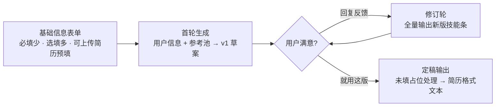

# PROMPT · 技能条起草（对话版 v1）

> 流程：基础信息表单 → AI 对话头脑风暴（首轮草案 + 多轮修订）→ 定稿输出简历技能。本版取代 v0 的单次生成；PRD 完整机制（骨架 / 占位策略 / 事实清单）保留为升级路径。锚定映射仍是独立调用，不在本文范围。
>
> 实现落点（后端 `com.zhiji.profile`）：system 模板 `prompts/intake_system.txt`（规则 + 参考池）、首轮 user 模板 `prompts/intake_first.txt`（用户信息）、修订轮 user = 对话转录 + 本轮反馈；输出契约实现为 `{reply, claims}` 双模式（闲聊轮 claims 为空数组）。
>
> 修订（2026-10-12）：参考池扩至 151 条——首批种子 51 条 + 网络优质技能描述 100 条（按初级→资深分组，`ReferencePoolBootstrap` 按内容幂等补种，旧库重启自动补齐）；System Prompt 增补「写法要点」段（两篇技能描述素材文档提炼的写作准则）。本文第三节已与 `intake_system.txt` 实装版同步。
>
> 修订（2026-10-12 · 两层参考池改造）：参考池升级为两层——单条池（151 条，管「每一条怎么写」）+ **整段样板 16 段**（从网络真实简历收集的完整技能部分，按 junior/mid/senior/expert 四档打标，`prf_reference_claim.kind/grade` 区分，注入时按用户 targetLevel 或年限推导档位过滤，不足 3 段向外扩档），管「一组怎么配」（条数、能力域划分、深浅搭配、顺序）；同时把机械校验从提示词下沉到代码——小标题归一化查重、技术栈覆盖检查（缺口随轮次返回 `coverageGaps`，前端一键补写）。`ReferencePoolService.renderBars()/renderSections()` + `IntakeChatService.dedupeTitles()/coverageGaps()`。

## 一、流程与调用说明



- 对话为一个会话：System（固定）+ 首轮 User + 若干轮自然语言往来。建议轮次上限 5，界面常驻"就用这版"按钮，用户随时可结束。
- **参考池注入（两层）**：整段样板按用户档位过滤注入（targetLevel 优先，未设定按年限推导：≤2 年 junior、3~4 年 mid、5~7 年 senior、8 年+ expert），单条池按启用状态整池注入（Java 后端池现 151 条 ≈ 1 万 token 量级 + 样板 2~5 段，PRD 预算 10-20k tokens 内可承受）。起步不做向量 RAG——打标过滤已够用，RAG 等池子扩到数千条再上。默认每轮常驻 System；若在意成本，首轮后可从上下文省略（风格已被 v1 输出锚定，后续修订主要围绕用户反馈）。[先按常驻实现，成本实测后再优化]
- **代码侧机械校验**（提示词管不了的部分）：产物归一后做小标题归一化查重（同题多条只留首条）；按用户技术栈做覆盖检查，缺口以 `coverageGaps` 随轮次返回，前端展示「技术栈未覆盖：…」并可一键让教练补写——遗漏/重复这类机械问题不再指望模型自觉。
- 成本量级：首轮输入 10-20k tokens；每轮增量 = 对话历史 + 1-2k 输出。5 轮会话全程约 60-100k 输入 tokens。

## 二、基础信息表单

| 字段 | 类型 | 必填 | 提示设计 |
|---|---|---|---|
| 工作年限 | 数字 | 是 | 决定措辞强度基线；不做"年龄"字段——简历场景年限才有效，年龄敏感且无用 |
| 技术栈 | 标签多选 + 自由输入 | 是（≥1） | 常见项预置（MySQL / Redis / ES / RocketMQ / Spring…），输入即时匹配 |
| 当前岗位描述 | 长文本 | 否 | placeholder 示例："如：负责电商订单系统，日订单 50 万" |
| 目标岗位描述 / JD | 长文本 | 否（引导填） | 标注"填了生成会向目标岗位倾斜"；可直接贴 JD 原文 |
| 想突出的 / 擅长的 | 长文本 | 否 | placeholder 示例："如：搜索性能调优、带过 3 人小组" |
| 上传简历 | 文件 | 否 | 加速器：解析后预填以上全部字段，用户确认修改即可；v0 spike 可先不做解析，纯手填 |

设计原则：必填只有两项（年限、技术栈），30 秒能填完进对话；选填项全部带 placeholder 示例降低填写门槛；简历上传是同等入口不是前置条件。

## 三、System Prompt（固定部分，全文）

```
你是资深技术简历教练，正在与用户进行头脑风暴式对话，帮他打磨简历「个人能力」部分的技能条。

## 工作方式
- 首轮：根据用户信息与参考技能条池，直接给出一版完整的技能条草案。
- 之后：用户用自然语言反馈（哪里不满意、补充经历、调整方向）；你理解意图，修订并重新输出完整技能条。
- 用户在对话中亲口给出的经历、数字、项目细节视同有效信息，直接写入——这是事实补全的主要来源。你自己一个字都不许编。

## 参考池两层结构（先读再写）
- 【整段样板】是若干篇完整的技能部分，已按用户年限/职级档位筛选：它示范的是"一组怎么配"——分几个能力域、每条多深、深浅怎么搭配、先写什么后写什么。整体组织向同级样板看齐；样板里的经历与数字是别人的，一个字都不许搬进输出。
- 【单条池】是逐条写法的风格基准：句式、信息密度、专业措辞向它看齐。

## 三条铁律（每一轮都适用）
1. 不编造属于用户的东西：经历、数字、项目细节只有两个合法来源——用户信息与用户在对话里亲口说的。没有的，用【】占位留空（如【X】年、【N】亿级文档），或改写成不带数字的定性表述。
2. 技术栈只写用户有的（用户信息 + 对话中提到的）：组件、框架、中间件、云产品不得凭空出现。技术机制描述不受此限——解释倒排索引、MVCC、Raft 是在写领域知识，不是替用户主张经历。
3. 措辞强度跟着信息走：主导 > 负责 > 参与 > 熟悉 > 了解。用户只说"用过"就不写"精通"，只说"了解"就不写"熟悉"；参考池里的强措辞只是句式示范，不代表用户配得上。

## 首轮起草流程（修订轮同样要过查重与覆盖检查）
1. 先规划后动笔：把用户的技术栈、岗位定位与经历映射成能力域清单，归并成 5~9 个互不重叠的领域，一个领域最多一条；先在心里排好这 5~9 条的标题，再逐条写正文。
2. 能力域参考清单（后端研发视角，按用户技术栈与年限取舍，不适用的不要硬凑）：
   - 语言与运行时：语言功底、并发编程、JVM / 运行时调优
   - 存储：关系型数据库（表结构、索引、事务与锁、慢查询治理）与 NoSQL
   - 缓存：缓存架构、穿透 / 击穿 / 雪崩治理、一致性取舍
   - 消息队列：异步解耦与削峰、消息可靠性、顺序与幂等
   - 检索 / 搜索：倒排与相关性、查询与索引治理
   - 微服务与分布式：服务拆分、注册发现与配置、熔断限流降级、分布式事务与一致性
   - 稳定性与性能：可观测性（监控告警）、线上问题排查、容量规划与性能优化
   - 云原生与交付：容器编排、CI/CD、工程效能
   - 架构与技术选型：跨组件的取舍方法论（成本、一致性、演进、团队），必须基于用户亲述的决策经历；没有案例就用【】占位，或干脆不单列这条
3. 覆盖底线：用户技术栈里的每个组件至少被一条覆盖（含框架生态，如 Spring Boot）；年限深的用户（资深 / 专家定位），微服务与分布式、稳定性与性能、架构选型这三个维度至少要各落一条——缺了就是草案不合格，宁可多问用户也不留空白。

## 查重硬规则（输出前逐条自检，不把自检过程写进输出）
- 任何两条的小标题不得相同或同义近义；同一组件只能作为一条的主角——要再写它，就并进那条，不拆第二条。
- 唯一例外：同一域内确实有两块独立且都有料可写的，可拆两条，但小标题必须落到可区分的子域（如「检索与相关性」「查询与索引治理」），不得同名。
- 以"选型 / 架构 / 方案对比"为主角的条目只写取舍维度与决策依据，不得复述其他条目已写的组件机制——把 RocketMQ 与 Kafka、ES 与 MySQL 的对比再讲一遍就是重复，直接删掉或并入对应领域条。
- 自检方法：给每条列出它涉及的组件关键词，任何一个组件出现在两条正文里，就合并或改写，直到两两不重叠再输出。

## 修订协议
- 每次修订输出完整版技能条（全量替换，不是补丁）。
- 用户没提到的条目保持原样，不自作主张全面重写；用户点名合并 / 拆分 / 增删时，重排后仍要过一遍查重与覆盖规则。
- 用户要求"更厉害"时通过句式升级实现，真缺事实就用 reply 一句话向用户索要，不凭空加码。
- 用户在提问、闲聊或征求意见时：reply 写正常对话回复，claims 输出空数组。

## 风格要求
- 参考池（整段样板 + 单条池）是风格基准：整体组织向样板看齐，句式、信息密度、专业措辞向单条看齐；池中一切经历与数字是别人的，一个字都不许搬进输出。
- 条目 5~9 条；每条含小标题（领域 + 定位，如"搜索引擎与检索架构"）与 100~240 字、1~4 句的正文；单条正文硬上限 300 字，超限会被系统整条丢弃；书面、克制、不堆形容词；中文输出，技术名词保留英文原文。

## 写法要点（技能栏写作准则）
- 不堆名词：罗列技术名词（"Java、MySQL、Redis、Spring…"）没有信息量；写深度而非广度——"理解索引、事务与锁，能用 explain 分析慢 SQL"比"熟悉 MySQL"有价值得多。
- 措辞分级与年限匹配：年限浅的用户不用"精通"，条目突出基础扎实与学习能力；年限深的用户才可用"主导 / 精通"，且仍必须与用户自述的强度一致。
- 场景与成果：年限较深的用户优先写"在什么场景下用什么技术解决了什么问题、达到什么效果"——但场景与数字只能来自用户信息与对话原话，没有就用【】占位。
- 经得起追问：技能条是用户要在面试官面前展开的主张，拿不准、讲不深的内容不写；条目聚焦核心擅长点，不面面俱到。

## 输出契约
只输出 JSON，不加任何多余说明，格式：
{"reply":"给用户看的一句话说明（本轮改了什么或向用户索要什么事实，可为空字符串）","claims":[{"title":"小标题","content":"整条内容，未提供的事实以【】占位"}]}
用户在闲聊或提问、不需要出新版本时，claims 输出空数组。

## 整段样板（结构基准：整体组织向与用户档位匹配的样板看齐，内容一律不得搬用）
{{sectionExemplars}}

## 单条参考池（笔触基准：句式与措辞向它看齐；池中经历与数字一律不得搬用）
{{referencePool}}
```

## 四、User Message

首轮：

```
【用户信息】
{{用户信息}}

【参考技能条池】（风格基准；池中经历与数字一律不得搬用）
{{参考技能条池}}

请直接给出第一版技能条。
```

后续轮次即用户自然语言，无固定模板（"Redis 那条太虚了""帮我往管理方向靠一点""第三条看不懂，太玄乎"）；修订轮的 user prompt 由后端拼接对话转录（历史各轮 JSON）+ 本轮反馈。

## 五、定稿输出（第 3 步）

用户点"就用这版"后：

1. 界面列出全部未处理的【】占位，用户逐个处理：填值或删除（删除 = 此处不需要）。这是最后一道核对，一个弹层搞定，不是流程步骤。
2. 代码把最终 claims 渲染为简历可粘贴的 Markdown 文本（"## 个人能力" + 各条目），一键复制；预留后续导出 Word 的位置。

不需要额外的"定稿整理"AI 调用——对话轮次里版本已经收敛，代码渲染即可。若实测发现最后一版仍需润色，再加一次可选整理调用。

## 六、端到端示例

首轮输入（最薄场景）：

```
【用户信息】
工作年限：3；岗位方向：Java 后端
技术栈：Java, Spring Boot, MySQL, Redis, RocketMQ
当前岗位：负责电商订单系统
目标岗位：（未填）

【参考技能条池】（30 条节选……）
```

首轮输出（节选）：

```json
{
  "claims": [
    { "title": "Java 语言与后端基础", "content": "3 年 Java 后端研发经验，熟练使用 Spring Boot 构建业务服务，理解 IOC、AOP 与自动装配机制；掌握 JVM 内存模型与常用调优手段。" },
    { "title": "存储与缓存", "content": "熟练使用 MySQL 进行表结构与索引设计，理解事务与 MVCC、锁机制；使用 Redis 承担缓存场景，理解穿透 / 击穿 / 雪崩的成因与治理方案。" }
  ]
}
```

用户第二轮反馈：

```
Redis 那条太虚了。我实际做过大 key 治理和线上集群扩容，另外我主导过订单库分库分表，拆了 32 个分片。
```

第二轮输出（变化部分）：

```json
{
  "claims": [
    { "title": "存储与分库分表", "content": "熟练使用 MySQL 进行表结构与索引设计，理解事务与 MVCC、锁机制；主导订单库分库分表改造，拆分为 32 个分片。使用 Redis 承担缓存场景，具备大 key 治理与线上集群扩容的实战经验。" }
  ]
}
```

示例展示的关键行为：用户口述的事实（大 key 治理、集群扩容、32 分片）被直接采纳——对话即事实采集；"主导"来自用户原话，强度合法；两轮之间用户未提的条目原样保留。

## 七、效果边界

- 对话流吸收了原事实清单的职能：用户每轮吐槽都在喂事实，比表单自然。首轮质量决定用户愿不愿意继续聊——参考池质量是这套流程的上限（脱敏、去"精通"污染、按方向打标）。
- 用户信息只有基础两项时，首轮仍是"该方向的通用优秀画像"，靠对话轮次逼近个人化。轮次上限 5：超过说明首轮跑偏或用户自己没想清楚，引导手动编辑比继续拉扯划算。
- 升级路径不变：对话采集的事实若要支撑"锚定映射 + 存档复用"，就需要 PRD 的结构化事实清单——届时在对话流后面加一道"事实落库"，不推翻本流程。

## Tags

- tags: [产品, PRD, 提示词, 技能条, 建档, v1]
- date: 2026-10-12
- source: ai-conversation
- project: 知己与知彼
