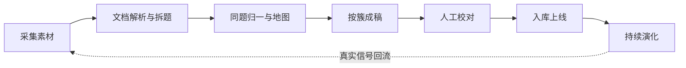

# 知己 · 知识库 PRD

> 上游产物是 [项目企划书](../项目企划书.md)。企划书把"核心资产是一个知识库"立为产品地基，这份文档说明这块资产要满足哪些要求：存什么、怎么问、怎么判、谁能看、怎么生产、怎么算做成了。字段定义、存储选型、接口契约与算法实现属于研发方案，本文不涉及。

## 一、需求背景

### 1.1 出题不难，跟练和修正才难

市面上的刷题网站和 AI 出题工具都能给出成批的问答对，但它们不知道用户哪会哪不会，练完也不更新。备考的人真正缺的不是题目数量，是一个知道进度、能跟着练六周的教练。知识库因此不能是一堆孤立的题目，它要能被路径排序消费、被练习判定消费、被复盘信号更新。

### 1.2 内容错了比没有更糟

面试考察的内容有客观对错，而且会随技术版本过期。JVM 参数写错一个，用户照着背就是害人。所以内容进用户视野之前必须有人兜底，且要有机制发现"这条结论过期了"。

### 1.3 内容从哪来：八类问法与五把尺子

面试官问一道题时到底在筛什么，决定了知识库该存哪些信息。真实面试的提问方式收敛为八类：

| 问法 | 例子 | 他在筛什么 |
|---|---|---|
| 概念题 | "ES 为什么是近实时的？" | 概念边界清不清楚 |
| 原理题 | "MVCC 在 InnoDB 里怎么实现的？" | 懂不懂内部机制，还是只会用 |
| 参数 / 实践题 | "refresh_interval 你线上怎么定的？" | 有没有真的上过线，有没有数字 |
| 对比题 | "Redis 和 Tair 你为什么选了 Tair？" | 有没有做过技术选型，还是被动接活 |
| 场景题 | "缓存和 DB 不一致你们怎么办？" | 有没有系统性思路，能不能分主次 |
| 设计题 | "设计一个短链系统" | 架构能力、拆解过程 |
| 项目追问 | "这个项目你负责哪块？为什么不用 X？" | 简历是真的还是包装的 |
| 下钻追问 | 任何一题的"那…呢？再往深了说呢？" | 深度边界在哪 |

判断回答好坏，面试官心里用的也是五把尺子：对不对、全不全、深不深、实不实、条理清不清。

这八类问法和五把尺子推出知识库需要的全部内容单元：下钻需要追问链，答不出往往因为缺前置需要前置依赖，同主题问题要共享讲解需要主题簇，五把尺子需要评分要点，不同年限要求不同需要职级要求，哪些题高频需要频率信号，简历写了的必须能讲需要简历授权。

八类问法本身不直接变成分类。概念题、原理题、参数题、对比题的练习循环和内容结构高度重合，切成七个枚举值只增加维护成本。落到库里的分类按第四、五节的判据切。

### 1.4 一条贯穿全局的原则

库里存的是"面试怎么问、怎么判"的结构化知识，AI 只做对齐。凡是能预判的都不让 AI 现场编。

## 二、产品目标

| 目标 | 达成标准 |
|---|---|
| 一份内容支撑四类消费 | 一条知识点能同时喂饱路径排序、学习卡片、模拟考判定、知识卡分享，不需要临时改内容结构；三类题型各验一条 |
| 判定口径稳定可解释 | 同一份回答的档位由固定规则算出，不随模型波动；验收口径：固定样本集（样板知识点的三档标准回答样例 + 四答况用例）重复判定，档位一致；内容校对后，历史判定仍可解释、可比（依赖要点快照，见 6.5） |
| 内容可信 | 进入用户视野的内容全部经过人工校对；结论过期的内容能被发现（复核到期触发）并回到复核队列 |
| 数据边界清晰 | 公共内容与个人数据物理分表（kp_* / user_*），换档案、换目标岗位重开后逐表检查无跨档案串写 |
| 库能生长 | 复盘信号→候选池→校对→上线的回流链路有计数（每环转化量可查），库越用越准 |

## 三、用户与使用场景

目标用户画像是一位有明确跳槽诉求的社招候选人：5 年 Java 后端，粘了简历和一份目标岗位 JD，每天可投入约 2 小时，准备周期 6 周。也接受没有简历、只靠对话建档的用户（档案形态：一份不含简历原件的默认档案，其余流程相同，见核心模块定义 2.1）。职级标尺为五档：初级 / 中级 / 高级 / 资深 / 专家（建档时用户明确说了就采用，没说按工作年限推测缺省值，见核心模块定义 2.1）。

知识库在五个备考环节加一类分享消费里被这样消费（环节命名沿用企划书的五环节视角；C 端功能形态已演进为关卡制，见 [核心模块定义](../核心模块定义.md) 第六节对照表——开方与学练对应生成关卡、闯关与抽卡）：

| 环节 | 知识库提供什么 |
|---|---|
| 建档 | 技能域清单作为画像逐条拍板的候选项 |
| 开方 | 难度、前置依赖支撑从易到难的路径排序；三层结构决定哪些进路径、哪些放弃 |
| 学练 | 叙述框架、从零讲、追问链、真实案例支撑学习卡片；评分要点支撑合卷练判定 |
| 模拟考 | 追问链的方向分组支撑横向轮转组卷；评分要点与档位规则支撑逐问判定 |
| 复盘 | 真实被问到的题回流为频率信号，也作为新内容的来源 |
| 分享 | 知识卡分享：题面 + 难度 + 技能域渲染成自包含卡图与公开链接，接收者经链接进站可翻面看答案（规则见 7.5） |

一个关键约束贯穿全部环节：入口不设考试，测量藏在日常练习里。知识库必须支持"只看不练不算过"和"自报会也要被低频抽查"这两类判断。

## 四、核心概念

这些概念两两长得像，逐对给出定义和判断标准，将来标定内容时按标准走，不靠感觉。

### 4.1 知识点与追问层

知识点是能独立成为一道面试题的原子知识单元。"ES 近实时写入"是知识点。追问层是同一知识点内的深度切片，主问题答完后的连续追问，离开主问题没有独立语境。

判断标准是：这条内容能不能脱离主问题单独被问出来。"translog 设 request 还是 async"单独问出来像一道题，但它只在主问题答完之后出现，所以是追问层；"倒排索引是什么"可以随时单独被问，所以是独立知识点。

把追问层拆成独立知识点会污染前置依赖关系，也会让路径生成把一条追问链排成三个知识点让用户重复练。追问层有序、整体读写、由主问题锚定，是知识点的内嵌结构。

追问层同时承载着产品的核心指标：用户练到哪个深度、面试官在哪一层问崩，判定、评分、报告、历史对比都指向"第几层"。因此追问层必须有一个不随内容校对而改变的身份：层序可以重排、内容可以修订，这个身份不变。

### 4.2 主题簇与前置依赖

两个维度完全正交。

主题簇是内容生产单位。"从零讲"按簇生产，RocketMQ 的题聚成十来个簇，每簇一篇讲解，簇内知识点共享，而不是一百个知识点写一百篇。

前置依赖是学习维度，即先懂什么才能懂这个。"分片规划"属于"分片与集群"簇，但前置是"倒排索引"，依赖可以跨簇。

类比：簇是包结构，前置是调用依赖。包内聚给生产和维护看，依赖关系给学习路径排序看。每个知识点挂且只挂一个主簇，真跨簇的题选主簇挂。这是有损取舍，跨域题的次要归属用前置跨域引用补偿。前置可以有零到多个，多数是零到二个，不硬凑链条。

主题簇还承载完整参考方案，供设计类知识点使用，是面试官手里那份理想答案的来源。

### 4.3 难度与职级要求

难度指这个东西学起来多难，决定学习路径里排在第几周。职级要求指面试官会问多深，决定追问下钻的停止点和判定标尺。

两者独立记录，互不推导。同一个知识点对三年候选人难度高、对八年候选人难度低，但面试官对八年的下钻也更深。混在一起，路径排序会被面试标准绑架，五年的人被按八年的深度排路径，前两周全是劝退题。

职级要求不逐级配一整套评分要点，只存每级的差异描述和下钻停止点，判定时与评分要点合并使用。下钻停止点必须对用户可见：用户不知道讲到什么程度算够，练的时候只有焦虑没有目标。学习卡片和模拟考报告都要把"你这个年限，讲到第几层算够"渲染出来，让它成为练习的目标刻度，而不是隐藏的评分标准。

### 4.4 题面与问法变体

题面是主问法，用户在卡片上看到的。问法变体是同一知识点的其他问法，预存两到三条，并允许 AI 在评分要点范围内现场改写。

追问链透明之后，背链子就能应付按原文提问的 AI。变体加现场改写，是"链子是骨架不是剧本"这条设计的两个支撑。

### 4.5 从零讲与叙述框架

叙述框架给"大概懂但讲不完整"的人做回忆结构，挂在知识点上。从零讲给完全没有底层的人从"这个技术为什么存在"讲起，几百字一篇，挂在主题簇上，簇内共享。

区别的本质是假设的读者起点不同，共享粒度也不同：框架必须逐知识点定制，讲解可以按簇量产。从零讲只有一个来源，即主题簇上的讲解内容；知识点确需补充时用独立名称，不与簇级讲解同名同源，避免一处内容两处维护。

完整参考方案的展示规则：学习态随时可看，知识点详情里有入口，点开摊开全部解法和伪代码，看的人自己决定看不看。进合卷练、复测、模拟考时随资料一并收起，闭卷机制不变。

### 4.6 题型划分的判据

分类必须有意义：展示交互上走得不是同一条流程，或者需要的内容结构不一样，满足其一才值得分一类。两条都不满足的分类是噪音。每个枚举值背后是一套新的练习循环、一套新的评分模板、一套新的界面，三倍维护成本。

给将来标题目的人一条防线：想标"记忆型 / 理解型 / 应用型"这类分类时，先过这两条门槛，结构一样、循环一样就不配成为题型，最多是一个标签，而标签也只在参与排序或筛选时才值得存。

### 4.7 内容格式与展示（Markdown 白名单）

技术面试知识天然富含代码、流程、参数与对比——纯文字表达这些是灾难，学习页的阅读体验直接决定"练得下去练不下去"。内容格式采用**受控 Markdown 白名单**：哪些字段是 Markdown、哪些是纯文本，白名单定死，不做自由富文本。

- **Markdown 字段（白名单）**：从零讲、完整参考方案、叙述框架、三档标准回答样例。支持语法：代码块（带语言高亮）、表格、Mermaid 流程图 / 架构图、行内代码、列表与标题。这些是学习页用户停留最久的内容，也是 AI 成稿的红利区——LLM 产出 Markdown 的可靠度远高于任何富文本格式，结构校验可解析 AST 落实（含 Mermaid 语法校验，防渲染失败）。
- **纯文本字段**：题面与变体（可含行内代码）、追问链各层文本、评分要点、职级要求。这些是卡面与判定链路——短句、可判定，富格式反而破坏结构。
- **图片边界**：Markdown 字段支持图片（B 端上传自制图）；AI 不产图；资料型反推时**原文图片不搬运**（版权红线），结构图用 Mermaid 重绘表达。
- **渲染约束**：C 端与 B 端共用同一渲染组件；渲染禁入 HTML 标签（防注入），仅 Markdown 语法。

扩展判断标准：出现 Markdown 承载不了的固定内容形态（如 LaTeX 公式）再议，不为想象中的需求预留。

## 五、题型

题型按练习循环和内容结构切分：类型（type）收敛为一个知识点，差异下沉到 sub_type 枚举——**default（默认八股）/ design_chain（设计演进链）/ narrative（项目叙事）**（枚举口径见核心模块定义附录 A）。

| 题型 | 练习循环 | 内容结构 | 评分标尺 |
|---|---|---|---|
| 默认八股 | 看资料 → 追问 → 合卷练 → 隔天复测 | 追问链 + 分级评分要点 | 四档规则 |
| 设计演进链 | 同上，追问链语义为条件升级 | 各层要点 + 主题簇级完整参考方案 | 按层命中加深度分布定位 |
| 项目叙事 | 看标准故事 → 合卷讲 3 分钟 → 隔天复测 | 标准故事 + 个人实例故事 | 指标清单全命中 |

八类面试问法与题型的对应：概念题、原理题、参数题、对比题、线上小场景、下钻追问全部走默认八股的循环和结构，它们影响的是内容而不是结构。设计题走设计演进链，项目追问走项目叙事。"场景题"与"设计题"的边界判据：有少数标准机制或排查路径、一层能讲清的走八股；需要条件升级多层方案、每层逼出不同技术决策的走演进链。本文统一用"线上小场景"指前者、"设计题"指后者。

### 5.1 设计演进链

场景设计题不单立题型，用追问链的结构承载，追问链的语义从深度下钻变为条件升级。以"设计一个百万并发商品详情系统"为例：

主问题是最简版，一台 DB 一台缓存跑起来，动手前先问约束，考的是不过度设计的判断力。第二到第五层逐层条件升级：QPS 十万哪里先崩，逼出量级估算、CDN、多级缓存、静动态分离；大促热点打满单分片，逼出热点探测与散片；改价五秒可见，逼出订阅失效链路；缓存集群整体不可用，逼出有损降级。第六层复盘取舍，为什么不用某个方案，理由必须成立。

这样做的收益：场景题获得渐进式练习，每层五分钟、从最简版起步，新手也能下嘴；评分回归统一规则，按层要点命中即可，不需要单独一套维度换算；从零讲有位置，即"最简版为什么扛不住"。连续作答的耐力训练转给合卷练的全链连讲和模拟考，平行方向的拟真转给模拟考的乱序抽层。

### 5.2 项目叙事

叙事的标准故事由 AI 根据建档对话收集的项目素材起草，按六要素组织：背景、目标、方案、冲突、结果带数字、复盘。

一条红线：AI 只组织不编造，故事里的每个数字和事实都要逐条经用户确认后才生效。事实确认有独立的确认状态和记录，未确认的故事不生效。

用户的实例故事和事实确认记录属于个人数据，不进公共内容库。公共库里只放六要素模板这个组织骨架，全局一份。这样"每个用户内容都独一无二、无法预制"的这一类题型才有诚实的落地方式。

确认之后，练习循环完全复用默认八股的模式，评分退化为一张简单指标清单：数字给没给、冲突讲没讲、三分钟收没收住，全部必须命中。叙事的定位是打磨工具而非训练系统：AI 负责组织故事、磨话术、提醒补数字，用户负责确认事实、练熟、内化。

## 六、评分与判定

### 6.1 判定原则

自然语言回答不能用关键词或相似度判对错，说反了概念照样可能高分。判定原则是 LLM 只做对齐判断、不做知识判断：评分要点预制在知识库里，LLM 只把用户的自由回答对齐到这把预制的尺子上，输出结构化判定，分数由固定公式算出。

三条硬规则：

- 引用强制：每个判定为命中的要点必须附用户原话的引用，引不出来算未命中。这一条挡掉大部分"答非所问但模型客气放水"。
- 每答一问判一次，判定驱动追问：答况分四类，对则下钻，缺则继续钻，错则纠正后再问，空则切题。
- 分是公式算的，LLM 从不碰分数。

### 6.2 答况四分流

| 答况 | 含义 | 动作 |
|---|---|---|
| 对 | 答到点上 | 下钻下一层 |
| 缺 | 对但浅，缺数字缺案例 | 继续钻，追问本身在给补证据的机会 |
| 错 | 概念反了或混了 | 停止下钻，温和教练纠正后同层换角度再问一次，压力面短纠正直接切题 |
| 空 | 没答上来 | 标记并切题 |

错和空不硬钻。追问链的层级是前置依赖，第一层崩了第二层的回答和判定都是噪音。练习时卡壳往回退前置知识点，模拟考崩了切走，是同一个依赖关系的两种出口。

答况的"空"要单独记成一类，不能靠用空内容代替，否则历史数据里无法区分"没答"和"答了但为空"。

### 6.3 评分要点分级制

八股题有客观对错，必须命中加加分项就够用。但设计演进链的很多要点没有银弹，本地缓存选 Caffeine 还是 Guava、静动态分离切在哪里，都是取舍不是对错，硬套必须命中会变成背答案。

评分要点因此分三级（注意与目标职级五档"初级/中级/高级/资深/专家"是两套刻度：本分级描述**单层回答内要点的深度级别**，职级档位描述**用户练到哪一层算够**，互不换算，映射关系见 6.3 末段）：

- 基础：答出算撑住这一层；
- 中级：想到算良好；
- 资深：想到加分、不想到不扣，没有银弹的取舍全放这一级。

档位由命中要点的深度分布决定：基础全中算及格，加上中级算良好，加上资深算优秀。从命中率变成深度定位，用户在参考方案的坐标系里被定位，而不是被一张标准答案的清单打叉。

这个分级是职级要求的评分化：职级要求说"资深要能拿压测数据讲"，分级制把它落成"带压测数字的要点属于资深级，命中即加分"，两者在判定时一次对齐。判定范围以目标职级的停止点为界：档位判定只统计当前停止点及以上的层，停止点之下的更深追问层可见（学无止境）但不参与该用户的档位计算（见核心模块定义 2.3"相同题目、不同尺子"）。

评分要点必须可判定。"讲得有条理"判不出来，"给出参数名"判得出来。不可判定的要点在校对环节必须改写成可判定的表述，这是校对里最容易漏的一环。

### 6.4 档位规则

| 档位 | 规则 |
|---|---|
| 优秀 | 必须要点命中 100% + 至少 1 个加分项 + 扛住全部追问层 |
| 良好 | 必须要点命中 100%，或 ≥80% 且全场无"错" |
| 及格 | 必须要点命中 ≥60% 且无"错" |
| 不及格 | 出现"错"，或命中 <60% |

"错"是硬否决项，面试里说反概念的挂、讲得浅的过，规则要和现实一致。设计演进链的档位改用命中要点的深度分布来定位，项目叙事的要求全部必须命中。

### 6.5 判定结果的稳定性

评分要点会被校对改写，判定历史引用的必须是"当时的尺子"。所以每次判定要留下**该次判定所用评分要点集的全量快照**（layer_key + level + 要点文本 + 命中与否 + 引用原话），不只存命中要点——档位公式吃的是命中分布（优秀要求必须要点 100%、及格要求 ≥60%），只存命中项，改版后无法重算历史档位，"资深级要点从没命中到命中"的演变曲线也画不出来。快照要能标明命中的是哪一层、属于哪一级。这样内容改版只影响未来判定，历史判定始终可解释、可比。

三个核心指标都依赖这一点：断在第几层、扛了几层追问、深度分布如何演变。没有稳定的层身份和快照，内容一校对，这些跨场趋势就会漂移，产品最值钱的跨场曲线就不可信。

### 6.6 单知识点与模拟考的差异

单知识点规则里出现"错"即不及格，这是一条硬否决。但模拟考流程又允许温和教练纠正后同层换角度再问一次。两者需要划清边界：

- 硬否决的错：概念反了或混了，照旧判死；
- 可纠正的：表达瑕疵、口误、语音转写错误，用户可申诉，申诉通过后该次判定降级为"不计入档位"。申诉是判定结果的标配动作：每个"错/空"判定旁固定提供"我有异议"入口，点开可见该次判定引用的用户原话（引用强制的现成数据），一句话提交标记。v1 落地为"标记申诉"折中方案（决策清单 D6 已拍板）：标记后进人工复核队列，复核确认后手动改判为"不计入"，不做 AI 自动改判——救济通道从第一天存在，改判权留在人手里；
- 模拟考里同层变体再问一次的结果覆盖原判定，而不是并列两条不及格。

### 6.7 追问方向的覆盖保证

一个答案之后常有几个平级方向，比如容量、一致性、容灾。追问链的线性排列会丢掉"这是三个平行方向"的信息，也引出一个真问题：模拟考抽了热点方向，一致性和容灾这次没问到，是不是遗漏了。

机制定死三条：

1. 每一层标明所属方向，同方向的层按序排列，方向之间平级；
2. 模拟考横向轮转遍历，第一轮每个方向问一层扫广度，判定发现缺或错的方向第二轮纵向加深，先横切再纵深，这正是真实面试官的行为；
3. 覆盖保证：时间不够没扫到的方向标为未覆盖，进下次抽查优先队列。任何方向都不会因为这次选了别的方向而丢失，只会在时间窗口内延后，覆盖度进模拟考报告。

这套机制需要记住"每个用户在每个知识点的每个方向上的覆盖状态"，覆盖状态属于个人数据。

## 七、内容资产与用户数据的边界

### 7.1 两条线

公共内容是全局资产，一份，人工校准，所有用户共用。个人数据是每个用户各自的状态，随练习持续变化。两条线各有生命周期，必须分开存放。

### 7.2 各自承载

公共内容一侧承载：技能域字典、主题簇及其讲解与参考方案、知识点及其追问链与评分要点、前置依赖、库级频率信号、素材文档与候选题。

个人数据一侧承载：技能画像、备考计划、路径骨架、练习状态与复测调度、个人备注与案例、项目叙事实例故事与事实确认、方向覆盖状态、作答与判定历史、个人复盘信号。

### 7.3 为什么必须分开

复用：公开服务早期（几个到几十个用户）公共内容只有一份，每人各自的个人数据。混在一起，第二个用户进来就得洗数据。

更新安全：内容校对、加变体是内容操作，不该碰用户进度；用户练到掌握也不该锁死内容更新。

隐私与备份策略不同：作答留档、个人案例、复盘信号是隐私资产，内容资产是可公开的库，将来若考虑商业化，这一步决定数据能不能放心用。

重置语义清晰：换目标岗位重开画像，个人数据按授权来源重建，公共内容原地不动。

### 7.4 两条硬约束

- 库级频率信号只含面经信号与人工标定，个人复盘信号单独存放。两者分开是这套分离的一部分，不是遗漏。
- 每个用户独一无二的内容绝不进公共库。项目叙事的用户实例故事放在个人数据侧，公共库只放六要素模板。

### 7.5 分享的内容边界（知识卡分享）

用户可以把看到的任何一道题（闯关卡面、抽卡结果、模拟考报告三处出口）做成一张**可分享的知识卡**发给别人，让别人也来烧脑一下。分享是库内容的第四类消费方，规则如下：

**两种形态，一次生成**：

- **卡图**：前端把知识卡渲染成自包含图片（题面 + 难度五色 + 技能域标签 + "还有 N 层追问"提示 + 产品水印），可直接保存/转发到任意渠道；
- **公开链接**：`/share/{kpId}` 公开只读页（无需登录），接收者点开可**翻面看答案**——按既有题卡结构（背面 = 标准回答样例，默认及格档，良好/优秀可展开）、追问链逐层展开、看不懂展开从零讲。卡图上附该链接，"看答案"动作引导回站内。

**"找回来"语义**：分享者本人换设备或日后想回看，通过链接即可回到该知识点的公开页——库内容是公共资产，链接长期有效；公开页提供"用知己练这道题"入口跳转产品首页。v1 不做"把分享的知识点加入我的关卡组"（涉及个人态写入与重开方，留待后续）。

**内容边界（红线）**：

1. **只含库内容，绝不含个人数据**——卡图与公开页不出现任何档案、作答记录、成绩、简历主张（库/态分离红线在分享场景的直接应用）；
2. **只分享 active 状态的知识点**——不校不上线红线延伸到分享：公开接口只输出已上线内容；
3. **公开页不渲染目标刻度**——"讲到第 N 层算够"依赖个人目标职级，公开访客没有档案，显示全部追问层并标注"在知己中会按你的目标职级标出停止点"；
4. 完整参考方案与从零讲在公开页按学习态规则可见（同 4.5），但**不出现在卡图上**（卡图只带题面钩子，答案引导回站内）。

**成本与实现约束**：纯前端渲染 + 一个无鉴权只读接口（输出 active 知识点的公开视图），**零 LLM 调用**（不占 D12 限额）；不新增表，v1 不做分享计数与接收端答题互动。

## 八、内容治理

### 8.1 内容状态流转

内容从 AI 生成进入草稿，人工校对后进入已校对，再进已上线。已上线的内容如需废弃或合并，转入已下线并保留历史，同时标明被合并到哪条，供在途用户迁移。

主题簇级的内容，包括讲解和参考方案，同样要走这套状态流转，因为它们直接给用户看。安全线不能只覆盖知识点而漏掉簇。

### 8.2 不校不上线

没经过人工校对的内容不许进用户路径。AI 生成的技术内容没有人工兜底，参数错一个就是害人。

### 8.3 内容复核

技术结论会过期，ES 和 JVM 的版本变了，老答案就不再成立。只有"最后更新时间"无法触发复核，需要为内容设置复核到期，到期内容进人工复核队列，避免用户一直练过时答案。

### 8.4 频率信号

"这题高频吗"不是一个数字，是多个来源的证据。

| 来源 | 归属 | 说明 |
|---|---|---|
| 面经信号 | 公共 | 记录出现次数、来源岗位、有无追问记录，只取信号不抄正文 |
| 题库覆盖 | 公共 | 被多少个独立题库收录（语料归一的覆盖源数，语料先行管道自动产生） |
| 人工标定 | 公共 | AI 判断不了的，手动定 |
| 复盘信号 | 个人 | 用户真实被问到的题，权重最高，随面试次数累积，是"知彼"个人化的核心资产 |

聚合分不写进知识点本身，先按需实时算；规模变大、聚合成为高频路径时再单独维护一份汇总。理由是聚合分一旦丢了来源，就无法解释"为什么这题排前面"，而复盘信号的时间序列本身就有价值，比如目标公司最近在问什么。

### 8.5 去重是生命线

同一知识点重复入库，会稀释练习时间、分裂判定数据、让前置依赖冗余。去重有三道防线：语料层同题归一（高置信自动聚合、低置信人工确认，见九-3）、入库前全局唯一性检查兜底，外加多源答案冲突检测（同一题不同源答案相互矛盾的标记人工裁决）。

## 九、内容生产管道

内容质量的上限在管道，不在内容模型本身。管道按**语料先行**组织为三个阶段：**① 全量入库**——所有题库源批量解析拆题，先落成语料层，不急着逐题处理；**② 地图归一**——对语料做同题归一与簇聚类，形成知识地图（哪些域、哪些簇、每道题被多少个源覆盖）；**③ 按簇建设**——以簇为单位批量成稿、校对、上线，建完一个簇再建下一个。七个环节是横向工序，三阶段是纵向节奏：环节定义不变，改变的是顺序——先有地图、再建内容，"建什么、先建哪个"由语料覆盖度决定，而不是逐题线性推进。

三阶段与七环节的映射：环节 1~2 属阶段①，环节 3 属阶段②，环节 4~6 属阶段③，环节 7 横跨全程。

1. 采集素材：面经、GitHub 仓库、CSDN 帖子、官方技术手册、书籍等公共资源（决策清单 D17），上传解析后双轨取用——"哪些题被反复问、问到什么深度"沉淀为频次信号，正文作为 AI 重写的参考输入（合规边界见本节末段）。素材以 pdf、doc、docx、md、txt 形式上传并记录为素材文档。
2. 文档解析与拆题（形态路由）：文件先经解析抽成纯文本并还原标题树，AI 识别**内容形态**并路由到不同拆分路径——① **题库型**（已拆分问答）：沿用标题层级 / 题号正则 / LLM 兜底三档策略，做题-答配对；② **资料型**（官方文档、教程等连续讲解，不拆题）：按章节树切成知识片段，AI **反推出题**——对值得出题的片段生成一到几个面试问法（按 1.3 的八类问法）并从原文提炼答案要点，是"为内容出题"而不是"为问题找答案"；③ **面经型**（叙事嵌题）：抽取被问到的题目与追问记录，贡献频次信号。混合文档按文件级形态默认路由，片段级类型标签允许人工修正。三条路径汇成同一种中间产物——候选题条目（题面 + 答案证据 + 章节路径 + 来源形态 + 溯源），全部进同题归一与地图；题库贡献问法与高频证据，资料贡献深度答案，两者在归一层互补。解析质量差的片段在归一层自然沉底，不阻塞高质量片段。人先看解析预览确认没抽错，候选记录可溯源回原文件。
3. 同题归一与知识地图：同一问题常被多个题库覆盖，先做**同题归一**。归一判定是三层漏斗——①结构信号免费先行：源分类路径投票、同源标题结构先聚出粗簇；②语义向量召回：题面 embedding 后算余弦相似度，语料量级在万级以内，进程内向量 + 暴力余弦即可（毫秒级），**刻意不引专用向量库**，向量只做进程内缓存不落专用存储；③LLM 精判：向量相似只做召回不做事判定（"HashMap 扩容机制"与"HashMap 树化阈值"很相似但不是同一题），中间相似带的对交 LLM 对比题面与答案要点做最终判定，仅极高相似的对跳过 LLM 直接归并，人工抽检兜底。聚合结果为**归一题**（语料层的聚合节点，量级超限（>10 万条）或出现在线语义检索需求时再评估向量库）。归一题聚合四样东西：N 种源问法（直接成为问法变体的候选，比 AI 编造的变体真实）、N 份答案（交叉验证的成稿原料）、N 条源分类路径（簇归属的投票依据）、覆盖源数（入库即转频率信号——被多少个独立题库收录，是最硬的高频证据）。聚合策略：高置信自动归并，低置信进人工确认队列——语料层是工作草稿不是正式库，允许激进聚合、人工抽检兜底；这与复盘录题"不做 AI 静默归并"不冲突，那条红线保护个人信号，这里是生产侧草稿。归一题同时向已有知识点映射：已上线知识点吸收新来源，新问法进变体候选、答案与既有内容冲突的进复核队列。归一题再按源分类路径投票加语义聚类聚成**语料簇**（正式主题簇的草稿态），AI 给簇命名与归属域建议，人工确认合并 / 拆分 / 命名后推进为正式簇——簇是知识点入库的前置，从零讲按簇生产以此为起点。知识地图同时产出覆盖率视图：每个域 / 簇下多少归一题、多少源覆盖、是否已建设，这是"按目录、按簇建设"的排队依据（页面见 B端管理台PRD 第九节）。
4. 按簇成稿：以簇为单位批量触发 AI 成稿。多源聚合让成稿质量上一个台阶——N 份答案交叉验证，多数一致的参数与结论直接采用，相互矛盾的标记冲突供人工裁决（多源矛盾检测本身就是事实核查）；追问链优先收割源题库自带的递进设计（进阶 / 深挖小节），缺失的由 AI 基于 N 份答案的深度差合成；变体从 N 种源问法收敛。AI 按固定模板生成题面、变体、叙述框架、追问链（每层带层身份、方向、期望、停止条件）、评分要点（带层身份与分级）、该簇的从零讲（设计链簇加完整参考方案）、职级差异。成稿必须过固定的结构校验，防止内容结构漂移，产物落为知识点草稿。
5. 人工校对：校四样东西，技术正确性（参数、数字、因果链顺序；多源冲突的裁决在这里收口）、评分要点的可判定性、变体是否覆盖面经主要问法、从零讲有没有讲错比喻。校对通过后写校对时间与复核到期，状态推进到已校对、已上线。
6. 入库上线：状态流转，同时把采集阶段的频次信号写入库级频率信号——含覆盖源数（被多少个独立题库收录）。
7. 持续演化：复盘录题的真实信号回流为个人复盘信号，权重最高；判定数据反过来暴露评分要点的质量问题；新题库与新真题增量进入归一与地图，已建设知识点自动吸收新来源。知识库不是建完的，是长出来的，复盘信号与新增语料是它的两个生长点。

关于合规：题源取自 GitHub 仓库、CSDN 帖子、官方技术手册、书籍等公共资源（决策清单 D17），在管道里只作参考——AI 参考重写、人工审核后成稿，这正是第九节管道的既定流程。这套做法能成立的依据：技术事实与参数本身不受版权保护，受保护的是独创性表达；重写加人工审核使成品独立成文，不构成对原文的复制。两条边界要守住：不搬运独创性表达（图表、例题、独创口诀、连续段落结构）；保留参考出处（链接或书名 / 手册章节）。素材解析文本只作过程材料留在素材文档里，不进知识点内容，任何页面不输出原文。对外输出层面（D16 后为现实）：知识库每条内容都经过重写加人工校对，"不校不上线"红线同时是版权防线；GitHub 仓库与 CSDN 帖子逐源看协议，协议明确禁转的只取"哪些题高频"的频次信号、不拆正文；将来若商业化或整体分发，逐源复核一遍再上路。

## 十、真实面试场景承接

拿真实面试场景逐个过一遍，每个场景都要有明确的承接机制。

| 真实面试场景 | 承接机制 |
|---|---|
| "你简历写的 X，讲讲" | 项目叙事题型，路径授权的来源标为简历 |
| "为什么不用 X 而用 Y？" | 追问链里的取舍方向层，加评分要点加分项 |
| "线上出过什么事故？" | 个人案例，由建档或复盘入口产生，属个人数据 |
| "你只说了一半，再想想" | 同层变体追问，答况为缺或错时的既定动作，AI 在评分要点范围内改写 |
| "你没实际用过吧？"（试探虚报） | 抽查池机制，自报跳过的知识点低频抽验，虚报反复出现 |
| 被问到库里没有的题 | 复盘录题进候选题池，成为知识库生长点 |
| 跨域题 | 只挂主簇加前置跨域引用，不复制知识点，用依赖表达 |
| 同一技术不同深度 | 各自独立知识点加前置关系，能单独成题的不合并 |
| 面试官层层下钻到答不出 | 追问层停止条件加职级停止点，记录断在第几层 |
| 反问环节 / HR 面 / 行为面 | 显式范围外，不假装能承接 |

八类问法全部有承接机制，个人案例的采集与挂载、断在第几层的记录都有明确落点。

## 十一、范围外

- 算法手撕：显式进放弃层，写明原因和替代方案（如 LeetCode），不让它沉默缺席。
- 行为面与 HR 面：八类问法里没有它，当前内容结构不为它预留。
- 多语言知识点：先跑通 Java 后端一个域，技能域字典天然支持扩展，不提前设计。

范围外的意义：内容结构里没有它们的承载，将来加回来也不需要改结构，题型是可扩展的枚举加可扩展的结构化内容，这正是选择这种内容组织方式的原因之一。

## 十二、落地与验收

### 12.1 分阶段

1. 落地内容结构与前置依赖关系，先跑通内容模型的可用性。
2. 先标 10 个知识点走通全流程，不是 50 个：8 个默认八股（选 ES 写入链路簇做样板，每条标明难度、评分要点带层身份与分级、三档标准回答样例、两到三个问法变体、追问链带停止条件），1 条项目叙事（验证六要素模板与事实确认），1 条设计演进链（验证按层判分）。全部走完草稿到已上线，同时验证判定口径。**每条知识点至少标定 2 个职级档位的停止点（stop_layer），基础关卡组按其中一个档位（建议中级）标定组成**——"同一道题、不同尺子"是核心主张，样板阶段就要能验证，不能等批量阶段。
3. 批量录入素材，把已收集的 pdf、doc、docx、md、txt 批量上传解析、拆题入候选池，先试跑一批看拆题效果，再走管道扩到 50 个知识点，AI 成稿加人工校对加结构校验，去重规则从第 2 步样本里沉淀成规范。阶段验收口径：覆盖至少 3 个技能域 / 5 个主题簇；难度 1~5 分布检查（不能全堆单一档）；校对返工率上限 30%；拆题准确率抽检 ≥90%；记录单知识点平均人工工时（用于反推"6 周备考一轮"所需内容产能）。
4. 复盘信号回流在第一次真实面试之后接入，它让内容生产这条链路真正转起来。

### 12.2 样板验收标准

一条知识点能同时喂饱三个核心消费方，不用改内容结构：路径排序（难度、前置依赖、层级）、学习卡片（叙述框架、从零讲、职级目标刻度）、模拟考判定（评分要点、变体、停止条件、层身份）。三类题型各验一条。判定稳定性的验收：用样板知识点的固定样本集（三档标准回答 + 四答况用例）重复判定，档位结果一致（对应第二节"判定口径稳定可解释"的验收口径）。知识卡分享为第四类消费方（7.5），随 kb 模块交付时用任一样板知识点验证卡图与公开链接。

### 12.3 一句话收束

库里存的是结构化的"怎么问、怎么判"，个人数据存的是"这个用户到哪了"，管道保证内容可信，信号让它越长越准。内容模型本身是简单的，难的是概念边界：追问层不是知识点、主题簇不是前置依赖、难度不是职级要求。边界守住了，后面的判定、路径、报告才有干净的数据可用。
