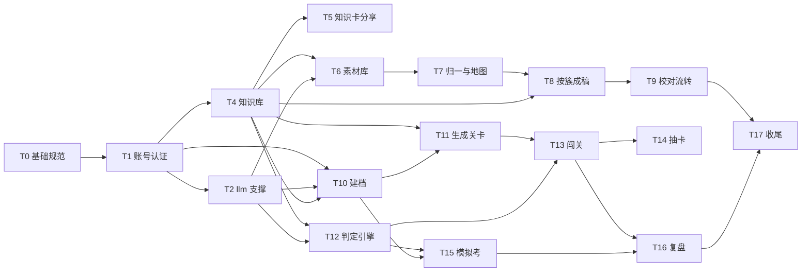

# 知己 · 开发计划（任务拆分与顺序）

> **定位声明（2026-09-23 拍板，决策清单 D24）**：本文是开发任务拆分与顺序的**真相源**。拍板口径：**B 端先行、C 端后置；B 端先做基础公共（账号、常量、权限、LLM 支撑），业务功能放基础之后**——地基打好了后面不返工。任务编号即执行顺序；每个任务按「先写 PRD（该域尚无 PRD 的先补）→ 建表 → 后端 → 前端 → 测试 → 验收」推进。表归属与枚举以[核心模块定义](核心模块定义.md)附录 A 为准，页面详设以各域 PRD 为准，任务顺序与边界以本文为准。

## 一、排序原则

1. **B 端先行**：知识库是产品的地基，先让内容生产跑起来，C 端才有内容可消费；B 端闭环（50 个知识点上线）本身就是第一个可用成果。
2. **基础公共最前置**：账号双表双入口、常量组、权限矩阵、统一响应与错误码——程序内的地基，所有任务都踩在上面，后补必返工；LLM 支撑同属地基，且是全计划唯一的外部服务依赖，早接入早暴露 API / 配额 / JSON 稳定性风险，因此编为 T2、与账号相邻，业务任务全部排在其后。
3. **每任务自带验收**：编译 + 构建 + 冒烟清单全绿才算完成，任务之间不传烂尾。
4. **C 端各域 PRD 前置**：C 端六功能尚无域 PRD，对应任务开工前先抽 PRD（工作流既定规则）。

## 二、基础决策点（T0 内定稿）

> ✅ **T0 已完成（2026-09-23）**：三项决策定稿，契约见 [基础架构PRD](prd/基础架构PRD.md)。

| 决策点 | 定稿结论 |
|---|---|
| 测试框架 | ✅ **Spring Boot Test**（spring-boot-starter-test：JUnit 5 + AssertJ + MockMvc）；SQLite 独立测试库，不 mock 数据层 |
| 常量系统 | ✅ **后端 `@ConstantGroup` 注解 + 启动扫描 + 内存注册表 + 公开接口下发**（`GET /api/constants`，按常量组名称取 code/name）；前端 constantsStore；types.ts 保留类型联合做编译期校验 |
| 权限系统 | ✅ **不引 Spring Security**：轻量拦截器 + JWT（每请求校验账号状态，停用即时失效）+ 当前用户上下文（AuthContext，写接口可取操作人）；矩阵见基础架构PRD 3.3 |

T0 产出：[基础架构PRD](prd/基础架构PRD.md)（统一响应与错误码、常量组规范、权限矩阵、会话方案边界、测试策略、日志约定）。

## 三、任务总览与里程碑

| 阶段 | 任务 | 里程碑标志 |
|---|---|---|
| M0 基础就绪 | T0 基础规范 · T1 账号认证 · T2 llm 支撑 | 双登录可用、权限矩阵生效、常量组就位、LLM 连通可用 |
| M1 内容生产闭环（B 端） | T4 知识库 · T5 知识卡分享 · T6 素材库 · T7 知识地图 · T8 按簇成稿 · T9 校对流转（T3 已缩编为设计任务，决策清单 D30） | 50 个知识点经 B 端批量建设上线 |
| M2 C 端练习闭环 | T10 建档 · T11 生成关卡 · T12 判定引擎 · T13 闯关 · T14 抽卡 | 自己完整练一轮（建档 → 关卡 → 闯关 → 抽卡） |
| M3 考试与复盘 | T15 模拟考 · T16 复盘 | 模拟考出报告、复盘信号回流 |
| M4 内测就绪 | T17 收尾 | 概览可查、内测观察清单就位 |

## 四、任务明细

> 每个任务的通用开工顺序：读设计文档 → 补域 PRD（若缺）→ 建表（追加 schema.sql，`CREATE TABLE IF NOT EXISTS` 幂等）→ 后端四层 → 接口自测 → 前端接线 → 测试 → 勾验收清单。分层与红线以 CLAUDE.md 第二节为准。

### T0 开发基础与规范（文档任务）✅ 已完成（2026-09-23）

- **目标**：定稿常量组、权限矩阵、测试策略、统一响应，产出 [基础架构PRD](prd/基础架构PRD.md)（本任务内新建）。
- **产出**：基础架构PRD（统一响应与错误码、常量组规范、权限矩阵表、会话方案边界、测试策略、日志约定）。
- **决策点**：测试框架引入与否；常量静态对齐 vs 接口下发。
- **设计文档**：核心模块定义附录 A（枚举真相源）、CLAUDE.md。

### T1 账号认证模块（account）——基础公共核心 ✅ 已完成（2026-09-23）

> 实现记录：account 四层 + common 基建（常量组注解扫描与下发 / 自研 HS256 token / PBKDF2 / AuthContext / 拦截器 / 自研 SVG 验证码 / admin 自举）；前端双登录页、账号管理页、路由守卫、菜单角色过滤接线。测试 4 类 9 用例全绿（注册登录闭环、admin 建 editor 与停用即时失效、双树 token 互拒、常量下发）。

- **目标**：双表双入口落地，权限矩阵生效，B 端账号管理可用。
- **前置**：T0。
- **建表**：sys_staff、sys_customer。
- **后端**：口令散列、客户注册（图形验证码）/登录、后台登录、两套会话；拦截器照权限矩阵实现（`/api` 认客户会话、`/admin` 认员工会话、账号管理与系统配置接口仅 admin）；账号管理接口（新增 / 停用 / 启用 / 口令重置）。
- **前端**：AuthView（客户登录 / 注册）、StaffLoginView（后台登录）、AccountsView 接线、菜单 roles 过滤接线、路由守卫（未登录跳登录）。
- **验收**：B端管理台PRD 十四-4 全条（客户 token 打不进 /admin、员工 token 打不进 /api、停用即时失效）。
- **设计文档**：核心模块定义 2.7 / 3.4、B端管理台PRD 第十一节、基础架构PRD（T0）、附录 A。

### T2 llm 支撑模块 ✅ 已完成（2026-09-23）

> 实现记录：引入 Spring AI 2.0.1（仅 openai starter，OpenAI 兼容适配器统一屏蔽 provider）；llm 四层（api/service/domain/repo）——LlmPurpose 入口枚举（常量组下发）、按 purpose 路由、chat 与 embedding 调用、强制 JSON 校验 + 失败重试一次、调用计数（入口 × 天）落 llm_usage_daily、按档案软硬限额与全站每日熔断（命中抛 SYS_RATE_LIMITED / SYS_CIRCUIT_OPEN）；建 sys_config 与 llm_usage_daily 两表；SettingsController（仅 admin）提供路由 / 限额读写、连通性自检、用量对照；前端 SettingsView 四块接线。密钥只走 yml / 环境变量，不进库不进设置页。测试 18 用例全绿（编排与 JSON 重试、限额熔断、计数聚合、设置页权限与读写）。

> 2026-09-24 修订（决策清单 D32）：全站每日总熔断取消——成本控制收敛到单用户维度（C 端按用途 × 用户限额 + 单用户合计硬熔断保留，限额维度为用户账号 sys_customer、名下全部档案共享配额），B 端生产类入口（拆题兜底 / 聚类去重 / AI 成稿 / embedding）不设限额不计熔断；已实现的全局开关降级为默认关闭的可选护栏（若启用仅统计 C 端消费类入口），实现调整随 T6（含限额聚合维度从档案改为用户）。

- **目标**：模型接入与成本治理地基（后续所有 AI 能力都踩在上面）。
- **前置**：T1。
- **建表**：sys_config、llm_usage_daily。
- **后端**：模型路由（按用途选档：判定便宜模型温度 0 / 总评好模型 / embedding）、chat 与 embedding 调用、JSON 校验与失败重试、调用计数（入口 × 天）、按档案限额与全站每日熔断。
- **前端**：SettingsView 接线（限额 / 模型路由 / 连通性自检 / 用量对照）。
- **验收**：限额生效、熔断触发走降级、连通性自检可用。
- **设计文档**：核心模块定义 4.2、B端管理台PRD 第十节、附录 A。

### T3 技能库模块（skill）——缩编为设计任务 ✅ 已完成（2026-09-24 设计落盘）

> 2026-09-24 拍板（决策清单 D30）：技能条（简历个人能力段落）改由 LLM 两阶段生成 + 考点 ID 直接锚定；B 端域字典管理页取消（域由种子维护 + kb meta 只读接口），skill 包解散、skill_domain 归并知识库（B9 收口）。原 T3 建表（skill_domain）已随 T4 落库，技能条生成实现并入 T10。

- **目标**：技能条生成模型定稿（两阶段生成、ID 菜单约束、0 锚定条、四信号并集口径、user_skill / user_skill_kp 模型、skill_draft 入口、域字典去留）。
- **产出**：[技能库PRD](prd/技能库PRD.md)（本任务内新建）。
- **设计文档**：核心模块定义 3.1（重定义）、2.1 / 2.2、技能库PRD。

### T4 知识库模块（kb）——知识点与簇 ✅ 已完成（2026-09-24）

- **目标**：知识库核心 CRUD 可用，10 个样板知识点上线，Markdown 渲染就位。
- **前置**：T3。
- **建表**：kp_cluster、kp_main、kp_prereq、kp_freq_signal。
- **后端**：知识点 CRUD（追问链新增 / 停用层、评分要点三级分级、职级要求 required + stop_layer、前置挂载与防环、下线 retired 与合并前置检查）、簇 CRUD / 合并、题面模糊搜索接口（复盘录题复用）。
- **前端**：KpManageView 全量接线；**Markdown 渲染组件**（代码高亮 / 表格 / Mermaid，C 端 B 端共用，知识库PRD 4.7）。
- **数据**：10 个样板知识点（知识库PRD 12.1 阶段 2，含 2 个职级档位停止点标定）。
- **验收**：B端管理台PRD 十四-1（含 Markdown 渲染验收）。
- **设计文档**：核心模块定义 3.2、知识库PRD 四 / 五 / 4.7、B端管理台PRD 第五节、附录 A。

### T5 知识卡分享（kb 小任务）

- **目标**：第四类消费方上线。
- **前置**：T4。
- **后端**：`GET /api/share/kp/{kpId}` 无鉴权公开接口（仅输出 active）。
- **前端**：ShareView 接线 + 卡图渲染。
- **验收**：知识库PRD 12.2 分享项（卡图 + 公开链接）。
- **设计文档**：核心模块定义 3.2（D14）、知识库PRD 7.5。

### T6 文档解析与素材库（pipeline 一）

- **目标**：多源素材批量入库（语料先行阶段①）。
- **前置**：T4、T2。
- **建表**：kp_source_doc、kp_candidate。
- **后端**：docparse（v1 仅 md / txt → 纯文本 + 标题树；docx / pdf 走管理员前置转换为 md 后导入，决策清单 D31）、形态识别路由（题库型 / 资料型 / 面经型）、三路拆分（题-答配对 / 章节切分 + 反推出题 / 抽题供信号）、导入批次与解析状态机。
- **前端**：DocView 接线（批量导入 / zip / 解析预览按形态路由 / 片段标签修正）。
- **验收**：B端管理台PRD 十四-2 之素材库部分（≥30 文件导入拆题）。
- **设计文档**：核心模块定义 3.3、4.2（docparse）、知识库PRD 九-1 / 九-2、B端管理台PRD 第六节。

### T7 同题归一与知识地图（pipeline 二）

- **目标**：全量语料聚合成知识地图（语料先行阶段②）。
- **前置**：T6。
- **建表**：kp_canonical。
- **后端**：三层归一漏斗（结构信号投票 → embedding 召回 → LLM 精判）、语料簇聚类与命名建议、归一确认 / 拆分回退接口、覆盖率统计。
- **前端**：KnowledgeMapView 接线（三层视图 / 归一确认 / 簇操作 / 覆盖率统计条）。
- **验收**：B端管理台PRD 十四-2 之归一部分（自动聚合准确率抽检 ≥85%、误归并可拆回）。
- **设计文档**：知识库PRD 九-3、B端管理台PRD 第九节、附录 A。

### T8 按簇成稿（pipeline 三）

- **目标**：多源聚合批量成稿（语料先行阶段③）。
- **前置**：T7。
- **后端**：成稿模板（多源答案交叉验证、冲突标记、追问链收割、变体从源问法收敛、从零讲按簇生成）、结构校验（含 Mermaid 语法）、批量成稿成本预估。
- **前端**：候选池与知识地图的成稿触发、进度与冲突清单。
- **验收**：成稿产物全过结构校验；冲突清单可人工裁决。
- **设计文档**：知识库PRD 九-4、B端管理台PRD 7.2、附录 A。

### T9 校对流转与复核调度（pipeline / kb 收口）

- **目标**：内容生产 B 端闭环（里程碑 M1）。
- **前置**：T8。
- **后端**：scheduler 复核到期扫描、复核到期队列、申诉复核队列骨架、批量上线。
- **前端**：ReviewFlowView 三队列接线（成稿校对 / 复核到期 / 申诉复核）。
- **数据**：批量建设至 50 个知识点（知识库PRD 12.1 阶段 3 验收：3 域 / 5 簇、难度分布、返工率 ≤30%）。
- **验收**：B端管理台PRD 十四-2 全条 + 知识库PRD 12.1 阶段 3。
- **设计文档**：核心模块定义 4.2（scheduler）、B端管理台PRD 第八节、知识库PRD 12.1。

### T10 简历档案与建档（profile）——**前置：先抽《建档与档案 PRD》**

- **目标**：C 端第一站可用。
- **前置**：T1、T2、T4；域 PRD（技能库PRD 已落）。
- **建表**：user_profile、user_skill（技能条）、user_skill_kp（锚定关联）、user_plan、user_case。
- **后端**：档案 CRUD（≤3）、建档对话与素材整理、技能条两阶段生成（阶段 1 按域/簇起草条骨架、阶段 2 逐条锚定考点 ID，LlmPurpose.skill_draft，技能库PRD 四）、锚定结构校验（ID 菜单约束：存在且 active、条内去重、0 锚定打标记）、技能条编辑与逐条确认、画像状态机（草稿 → 确认 → 定稿，落 user_profile.skill_status）、锚定失效检测（库侧 retired / 合并）、年限 → 职级缺省映射（核心模块定义第七节待办，本任务定稿）。
- **前端**：ProfileView 接线（技能条生成 / 编辑 / 确认 / "请核对数字"提醒）。
- **验收**：建档全流程可跑、画像未定稿不可生成关卡、档案间互不串写；技能库PRD 十一验收清单全条。
- **设计文档**：核心模块定义 2.1、第七节待办、附录 A、技能库PRD。

### T11 生成关卡（learning 一）——**前置：先抽《学习域 PRD》**

- **目标**：定稿画像裁出专属关卡组链。
- **前置**：T10、T4。
- **建表**：user_path。
- **后端**：四信号并集准入（技能条锚定授权 / 职级基线 / JD / 复盘信号，授权查定稿技能条锚定集 user_skill_kp）、基础关卡组推导、组内难度与前置拓扑排序、重开保留放弃决策。
- **前端**：MapView 接线（关卡组折叠 / 下一步建议 / 前置锁 / 放弃分区）。
- **验收**：定稿画像生成关卡组链；重开只重写 user_path。
- **设计文档**：核心模块定义 2.2、学习域 PRD。

### T12 判定引擎（judge）

- **目标**：产品可信度的根（判定链路无域 PRD：契约在附录 A 8.3 + 知识库PRD 六）。
- **前置**：T4、T2。
- **建表**：answer_log。
- **后端**：判定 prompt（三档样例 few-shot）、强制 JSON、答况四分流、档位公式、引用强制、全量要点快照、超时（15s）重试一次降级自评。
- **验收**：知识库PRD 12.2（固定样本集重复判定档位一致）。
- **设计文档**：核心模块定义 4.1、知识库PRD 六、附录 A 8.3。

### T13 闯关（learning 二）

- **目标**：日常主体闭环。
- **前置**：T11、T12。
- **建表**：user_kp_state。
- **后端**：过关选择写态（过了 / 不会 / 我会跳过 / 放弃）、练习模式判定驱动（next_action）、快过态标记、抽卡信号喂养（弱点 / 抽查池 / SM-2）。
- **前端**：闯关页（卡面 / 翻面 / 练习作答 / 追问逐层展开 / 从零讲 / 放弃入口）。
- **验收**：练习判定驱动追问闭环；快过进验伪池；停止点目标刻度渲染。
- **设计文档**：核心模块定义 2.3、学习域 PRD。

### T14 抽卡（learning 三）

- **目标**：复习与挤压器（里程碑 M2）。
- **前置**：T13。
- **后端**：SM-2 参数与到期队列、三信号混抽（到期复测 / 抽查验伪 / 弱点加权）、连对降权与低难度穿插卡、橙红卡可选进判定。
- **前端**：GachaView 接线（单抽 / 3 连 / 翻牌动画 / 指定域）。
- **验收**：自己完整练一轮（建档 → 关卡 → 闯关 → 抽卡，里程碑 M2）。
- **设计文档**：核心模块定义 2.4、学习域 PRD。

### T15 模拟考（exam）——**前置：先抽《模拟考 PRD》**

- **目标**：全真检验。
- **前置**：T12、T10。
- **建表**：attempt、方向覆盖状态表（exam 侧，附录 A 待定 3 张之一）。
- **后端**：attempt 按天限一次、方向轮转组卷、作答与判定并行（等待期明示）、四档总评、存活率与降级建议（写 profile api）、教练总评、申诉标记。
- **前端**：ExamView 接线。
- **验收**：核心模块定义 2.5 全边界（中途喊停 / 未完成不评级 / 申诉入口 / 覆盖度进报告）。
- **设计文档**：核心模块定义 2.5、模拟考 PRD、附录 A 8.3。

### T16 复盘（exam）——**前置：先抽《复盘 PRD》**

- **目标**：真实面试驱动的生长点。
- **前置**：T15、T11。
- **建表**：user_kp_signal（归 learning）。
- **后端**：录题匹配（复用 T4 搜索接口，用户确认不静默归并）、信号写入（经 learning api）、升降级建议（经 profile api，对象为技能条，技能库PRD 六-2）。
- **前端**：ReviewView 接线。
- **验收**：录题 → 信号 → 关卡重排数据流走通。
- **设计文档**：核心模块定义 2.6、复盘 PRD、附录 A。

### T17 收尾与内测准备

- **目标**：运营视图与内测就绪（里程碑 M4）。
- **前置**：T9、T16。
- **后端**：概览聚合接口（资产统计 / 管道漏斗 / 待办积压 / LLM 用量）。
- **前端**：DashboardView 接线。
- **验收**：B端管理台PRD 十四-3；内测观察清单就位（决策索引 B 系列）。
- **设计文档**：B端管理台PRD 第三节、决策索引 B 系列。

## 五、通用约定

- **建表策略**：schema.sql 按任务增量追加，全部 `CREATE TABLE IF NOT EXISTS` 幂等；字段级 DDL 以各任务落库时定稿（附录 A 是归属真相源）。
- **常量三处同步**：新增枚举必须同步三处——数据库 CHECK 约束、后端枚举类、前端 types.ts（T0 规范）。
- **权限**：新接口必须在基础架构PRD 权限矩阵登记后再实现拦截规则。
- **口径冲突**：任务执行中发现文档冲突，按 CLAUDE.md 规则——先确认哪一方需要修正，不默默改文档。
- **每任务完成定义**：编译绿 + 构建绿 + 验收清单全过 + 该域 PRD 与实现一致。

## 六、与既有文档的关系

本文只管**任务拆分与顺序**，不承载设计口径；每个任务的设计真相源是其指向的核心文档与域 PRD。任务执行中产生的新拍板按迁移规则处理：改核心文档 + 决策索引加一行（D24 记录本计划的排序口径）。

## Tags

- tags: [产品, 面试, 开发计划, 任务拆分]
- date: 2026-09-23
- source: ai-conversation
- project: 知己
