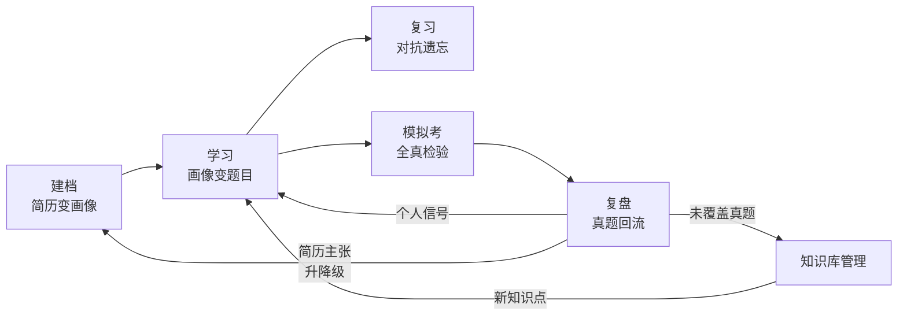
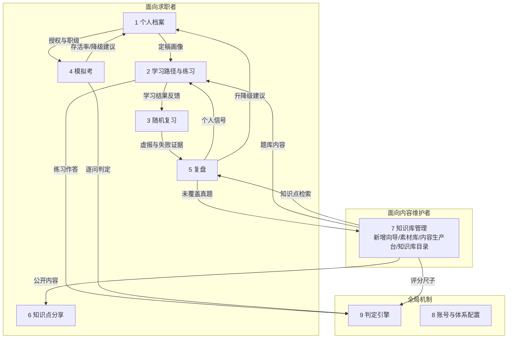

# 知己与知彼 · 核心模块定义

> 本文是产品全局的模块总览：定义产品的用户、主线与全部模块，回答"这个产品有哪些部分、每部分对谁负责、彼此怎么衔接"。每个模块后续各自细化成一份完整 PRD，本文只管全局，不展开单模块的细节设计。文中不出现表、字段、接口、包结构等研发阶段内容，那些随各模块 PRD 产生。

> 重写说明（2026-10-10）：本文为推翻旧版后的重新设计，取代 2026-09-22 旧版《核心模块定义》（旧版已归档为 `20261010-核心模块定义-旧版归档.md`，仅作追溯用，口径一律以本文为准）。重写立场：①模块按产品价值与用户场景切分，不再按后端工程边界切分；②只保留需求与产品规则，全部研发设计后置到各模块 PRD 与开发计划；③产品主线首次完整成文；④领域命名去游戏化——旧版的关卡制/闯关/抽卡/卡池/闪卡等游戏化命名全部退役，替换为学习语境命名（学习路径/学习阶段/学习单元/随机复习/复习池等），领域命名真相源见 6.5，后续 PRD 与建表一律以该表为准。与旧版的模块对应关系见文末附录。

## 一、产品定位与主线

**一句话定位**：把"简历、面试、知识库"三者绑定成一个互相校准的闭环——用户以真实简历为起点备考求职面试，系统用一套人工校对过的面试题知识库驱动日常学习与全真模拟，真实面试的结果再回流校准简历与知识库。产品名"知己与知彼"就是这个闭环：知己是简历主张与真实水平的持续对齐，知彼是题库对真实面试题的持续覆盖。

产品要解决的问题：面试备考者手里有几样互相脱节的东西——一份写得很满的简历、一堆零散的八股文资料、几次真实面试的挫败。简历上写了的未必讲得深，背过的未必被问到，被问倒的下次还犯。市面上的题库产品只管"刷题"，不管这份简历该刷什么、刷到多深；AI 出题产品内容没有人工把关，答案质量不可信。本产品的差异点在于两件事：**主张校准**（简历上写的每一条主张，都对应知识库里一组可检验的知识点，练不住的建议从简历上撤下来）与**内容可信**（题库内容由人从真实面经与资料中加工，AI 只做组织不做裁决，发布前必过人工审核）。

产品主线是一条五段闭环，全部模块都挂在这条线上：



这条线解释了每个模块存在的理由：建档产出"这份简历主张什么"；学习把主张翻译成题目清单并推进掌握；复习对抗遗忘并检验自报的水分；模拟考做全真检验并量化"简历主张存活率"；复盘录入真实面试的结果，向下校准简历主张、向侧补充个人信号、向上为知识库提供生长点；知识库管理保证题库本身持续生长、保持可信。五段与模块的对应：建档 = 个人档案（模块 1）、学习 = 学习路径与练习（模块 2）、复习 = 随机复习（模块 3），模拟考、复盘、知识库管理与模块同名。

产品的两类使用者对应两个端：

- **求职者（C 端）**：付费意愿来自"简历 + 备考 + 模拟"的一体化，核心入口依次是建档、学习路径、随机复习、模拟考。
- **内容维护者（B 端）**：作者本人与少量协作同事，职责是把面经、资料加工成可信的题库。B 端没有商业诉求，只有效率与质量诉求，模块设计以"从编写到入库一条路走到底"为原则。

C 端与 B 端是同一个产品的两个入口，共用同一套题库内容；本文不约定工程实现形态（前后端是否分离、单体还是多服务），留给开发计划。

## 二、使用人群

**求职者**：正在准备后端类技术面试的开发者（以 Java 方向为主场景，题库结构上不写死语言）。三类典型状态对应不同用法：有简历、目标明确的系统备考者走完整主线；快面试了临时抱佛脚的突击者主要用按域集中复习和模拟考；面过几轮想查漏补缺的复盘者主要用复盘录题和弱点加权复习。产品对他们的共同承诺是：题目从你的简历和目标职级来，深度标尺按你的目标职级定，练不下的东西会被诚实指出来。

**内容维护者**：作者本人（管理员角色）与几位以内容维护者身份参与题库生产的同事。他们从真实面经、官方文档、书籍、社区帖子中取材，经生产线加工成带分级评分要点、追问链、职级差异的知识点。后台账号由管理员手工创建，不开放注册；客户与后台人员的账号体系完全分开，两边的登录入口、数据权限互不相通。

**内容红线**：题库是产品的核心资产，全局内容（题面、答案、追问链、资料讲解）与个人数据（简历、作答记录、复盘信号）严格分离，任何个人内容不进公共题库；题库内容的原始素材出处要可追溯，加工成稿必须经过审核才能上线。

## 三、模块总览

模块是后续 PRD 拆分的原子单位。划分原则：**一个模块 = 一个独立可细化的 PRD**；同一段用户工作流里的连续页面合并为一个模块，跨场景复用的能力独立成模块。

| # | 模块 | 面向 | 一句话职责 | 状态 |
|---|---|---|---|---|
| 1 | 个人档案 | 求职者 | 简历与对话变成技能画像、备考计划、项目素材，全产品的个人上下文锚点 | 未开工 |
| 2 | 学习路径与练习 | 求职者 | 按画像把题库组织成学习阶段，逐单元推进，日常主入口 | 未开工 |
| 3 | 随机复习 | 求职者 | 随机复习与随机检验：到期复测、弱点加权、自报验伪，碎片时间入口 | 未开工 |
| 4 | 模拟考 | 求职者 | 全真模拟面试：轮转组卷、判定驱动追问、量化报告 | 未开工 |
| 5 | 复盘 | 求职者 | 真实面试真题录入，向下校准简历、向上补充题库 | 未开工 |
| 6 | 知识点分享 | 求职者 | 单个知识点的公开分享页，产品的传播出口 | 未开工 |
| 7 | 知识库管理 | 内容维护者 | 内容团队的全部工作台：新增向导（一次走完编写到入库）+ 素材库（素材仓库，内部保留）+ 内容生产台（可视化合并、审核放行）+ 知识库目录（组织维护巡检） | 未开工 |
| 8 | 账号与体系配置 | 双端 | 账号认证、人员管理、系统参数、用量与成本可见性 | 未开工 |
| 9 | 判定引擎 | 能力模块 | 把自由作答对齐到预制的评分尺子上，输出结构化判定 | 未开工 |

两个说明：①旧版的"生成关卡"不再是独立模块——它没有用户入口，组织规则并入学习路径（见 4.2）；②旧版"素材库 / 候选池 / 知识地图"三段页面与成稿、校对动作，全部并入"知识库管理"一个模块，其内部以收集箱、内容生产台、知识库目录三个页面组织（见第五节）；旧版"支撑能力"（模型接入、文档解析、调度）属纯技术底座，不进产品模块文档，其中产品可见的部分（限额、用量、连通性）归入"账号与体系配置"。

**建设顺序建议**：知识库管理 → 判定引擎 → 个人档案 → 学习路径与练习 → 随机复习 → 模拟考 → 复盘 → 知识点分享。内容是根——先让题库立起来，C 端各模块才有可挂的内容；判定引擎独立于两端模块先行，因为学习与模拟考都消费它。

## 四、面向求职者的学习闭环

### 4.1 个人档案

进入产品的第一站，也是全产品个人数据的顶层归属。每个用户最多维护 3 份简历档案，档案之间进度完全隔离——用户可以同时以"Java 后端 + ES 方向"和"转 Go 方向"两份档案备考，切换档案即切换全部上下文。

建档过程围绕一个问题：你的简历主张是什么。有简历就上传解析，没有简历就跟 AI 对话补齐（年限、岗位、技术栈、做过的项目）。AI 从简历与对话中起草技能条——一段简历措辞 + 它背后对应的题库知识点集合，用户逐条拍板：不熟的删掉、漏掉的加上、措辞不准的改掉。拍板完成的技能条集合就是"简历主张清单"，它是后续一切个人化推导的源头。对话中聊到的项目细节（背景、数字、冲突、结果）沉淀为项目素材，供项目叙事练习与模拟考追问使用。

档案同时承载备考计划：目标岗位与 JD、目标职级、备考周期、每日可投入时间。其中**目标职级**是全产品的深度标尺——学到第几层算通过、模拟考下钻多深、什么内容算必问，全部由它推导。用户没明确说时按工作年限推测缺省值，用户随时可改。

边界：

- 画像有状态机（草稿 → 确认 → 定稿），存在未确认条目时不得定稿；未定稿的画像不参与学习路径生成。
- AI 在这里只做选择与组织：技能条锚定的知识点必须真实存在于题库，对不上的内容直接拒绝，不允许模型编造考点。
- 建档不答题、不摸底，入口永远没有考试——摸底交给后面的学习与模拟考。
- 复盘模块产生的简历主张升降级建议写回这里，且只写回触发它的那份档案。

产品价值：这个模块决定用户对产品的第一信任——"它真的读懂了我的简历"，还是"又是套模板的 AI"。技能条逐条拍板的交互是第一次信任建立点，必须让用户感到每一笔都在自己的控制下。

### 4.2 学习路径与练习

日常学习的主体，分两层：学习路径是全局视图，练习是单元内的学习推进。

**学习路径**回答"我要学什么"。系统把题库按用户的画像组织成有序的学习阶段：每个领域一个学习阶段，阶段内按主题分学习单元，单元内按难度与前置关系排序。组织规则由四路信号取并集——简历主张锚定的知识点（主攻）、目标职级的基线必问集（打底）、备考 JD 命中的内容（定制）、个人复盘信号回流的知识点（查漏）。并集之外的内容不进路径、不留痕。用户主动放弃某道题是唯一的人工裁剪例外：移出单元、进放弃清单、可选填原因，重新生成路径时保留放弃决策。

默认顺序建议为：基础阶段（不分域的职级必问基础，快速过建立节奏）→ JD 相关阶段 → 高频阶段 → 其余。用户可自选先学哪个阶段；跨域有前置依赖时，前置阶段未推进到位，后一阶段的单元保持锁定。

**练习**回答"一个单元怎么学"。每个学习单元是一组题目，单题三分钟量级。题目展示结构全产品统一：先呈现题面自测回忆，再展开标准回答样例（按及格/良好/优秀三档）、追问入口（逐层下钻）、看不懂时展开挂载的资料讲解、目标刻度（"到你目标职级讲到第 N 层算够"）。通过单元有两种节奏用户自选：速览模式——先自测后看答案、自评直接推进，给想快速过一轮拿印象的人；练习模式——闭卷作答，作答经判定引擎驱动下一步（下钻、换角度再问、回退前置），判定通过才算完成。速览是显式的低保障通道：速览通过的题目与自评"我会，跳过"的题目同等待遇，进入随机复习的抽查范围接受复验。

边界：

- 难度不是准入门槛，只是排序属性与颜色标识。同一道题对不同目标职级的用户是同一道，差别只在通过深度（停止点）；禁止按职级过滤难度带——那会结构性漏题。
- 防漏题三道防线：并集准入（不做难度过滤）、复盘兜底（真实被问到的题不在路径里，录题回流后下次生成时纳入）、内容巡检（职级基线与停止点的完整性属知识库管理质量巡检的必检项）。
- 练习纯推进，不设回头与复习调度——复习全部交给随机复习模块，两个模块节奏互不污染。
- 项目叙事的练习归这里：题库提供叙事模板（六要素结构），个人标准故事由档案里的项目素材起草、逐条确认数字与事实，练习形态是看着标准故事练口述。
- 学习路径可整体重新生成（复盘信号回流、简历主张调整之后），重生成只动阶段与单元序列，不动已积累的学习进度。

产品价值：学习路径是把"题库"翻译成"我的备考计划"的地方，它的质量直接决定用户觉得内容"跟我相关"还是"又是通用题库"。双节奏设计是对真实学习行为的尊重——既承认快速过一遍的价值，也用抽查机制堵住自欺。

### 4.3 随机复习

碎片时间的轻入口，也是全部复习机制的承载者，同时是每日回访的默认锚点。复习池来自已通过的学习单元，按三条信号混合抽题：间隔重复到期复测（对抗遗忘的主引擎）、抽查验伪（学习时自评"我会，跳过"或走速览模式的题目，低频弹出复验，虚报打回复测队列并累积证据）、弱点加权（学习时标"我不会"的题目提高抽中概率）。

体验刻意做轻：单题抽取与连续抽取、轻量动效、以自测自评为主；高难度题可选进入判定模式做真检验（复用练习模式的判定流程）。不引入积分、连击、每日任务等数值系统——轻趣味来自随机抽取本身的不确定感，不靠数值绑架。按域集中复习天然支持考前突击：明天面 ES，今晚集中复习 ES 阶段。

随机抽取有两个动态规则，第一版就要有：连续答对的题目在混合抽取中下调抽中概率（只调概率，不碰到期队列——"变没"交给间隔重复）；连续答错达到阈值时掺入少量低难度已学题目，重建正反馈。

边界：

- 随机复习不产生新任务，三条信号全部由练习阶段的学习结果反馈而来；复习结果（复测通过、虚报证据）回流两个下游：弱点影响抽取权重，授权知识点的虚报/失败累积汇入复盘的降级建议。
- 不设正式报告——检验职能归模拟考，随机复习保持轻。

产品价值：随机复习承担产品的日活锚点角色。"今晚随机来几题"是最低成本的打开理由；同时它是诚实机制的第二只手——学习时自报的水分，在这里被检验出来。

### 4.4 模拟考

复习好了来一套的全真检验，也是简历主张的量化考场。每天一次机会（控制判定成本，也让每场考试有分量），有计时、有评分，出题规则贴近真实面试。

组卷由四路信号（同学习路径）推导，不依赖学习进度——没有"考前一周没资格考"的结构性冲突。组卷形态是方向轮转：先横切各技能方向，再对表现好的方向纵深下钻，平行方向乱序抽层防背题；未覆盖的方向进下次优先队列，覆盖度写进报告。

作答流与判定流并行：每答一问判定一次，判定驱动追问——对则下钻、缺则继续钻、错则温和纠正后同层换角度、空则切题。等待判定期间明确告知"面试官在记录"，计时只计作答时长，判定超时不扣作答时间；判定超时或输出不合法时重试一次，再失败解锁自评——判定永远不是单点故障。

考完出三样东西：

- **加权及格率 → 四档总评**（优秀/良好/及格/不及格）：档位由代码里的公式从判定结果算出，模型从不碰分数。"错"是硬否决项——面试里说反概念的挂，讲得浅的过。
- **简历主张存活率**：本场抽到的简历主张知识点里没被打穿的比例。连续两场低于 50%，自动触发简历降级建议——这是"简历和知识库互相校准"最硬的落点。
- **教练总评**：AI 只写叙述与归因（元弱点是什么、下周该练什么），不给分。

边界：

- 判定可申诉：结果页固定"我有异议"入口，用户可对判定结果提交标记申诉，附判定引用的用户原话；申诉标记照常落库，复核确认后人工改判为不计入档位。改判权留在人手里，救济通道从第一天存在（复核队列的自动化可后置）。
- 中途喊停的场次照常出报告，标"未完成不评级"；连着两场喊停，考前说明给提醒。
- 跨场趋势比单场评级值钱：断在第几层、扛了几层、深度分布的演变，是报告页的重点。
- 单知识点档位规则、聚合权重公式全部代码写死，规则变更走版本管理不走模型。

产品价值：这是产品可信度的试金石。模拟考的价值在于它敢给用户看真话——存活率低于 50% 就建议你把这条主张从简历上撤下来。这个诚实是产品口碑的根。

### 4.5 复盘

真去面了，回来把被问到的题录进去。体量小、杠杆大：这是全产品唯一由真实世界驱动的环节，也是"题库不是建完的、是长出来的"的入口。

录题后系统做匹配：能对上已有知识点的，写成个人复盘信号——它是频率信号里权重最高的一路，作为学习路径重排的最优先输入；对不上的真题进素材库，成为知识库的生长点。匹配结果由用户确认，不做静默归并——归并错了会污染权重最高的个人信号。

复盘同时触发档案侧的更新：练不住的主张从简历降级（与模拟考存活率机制汇合），练深了的知识点反过来建议写成简历亮点。所有建议写回触发它的那份档案。

边界：

- 个人复盘信号是隐私资产，只属于用户自己，随面试次数累积；公共的库级频率信号只含面经信号与人工标定，两者分开存放、互不混合。
- 录题的前提是用户能搜到知识点：知识点搜索的易用性是这个模块的前置条件（命中不中的体验决定录题成本）。
- 本模块横跨"录题回流"与"简历升降级"两条链路，PRD 里两条链路都要完整设计。

产品价值：复盘让产品与用户的真实求职过程绑定。用户每面一次，产品对他的了解就深一层、题库就长一点——这是留存与内容飞轮共同的引擎。

### 4.6 知识点分享

单个知识点的公开传播出口。用户在练习、随机复习、模拟考三处（共用同一套题目展示结构）可以把当前知识点生成一张分享图（题面 + 难度色 + 领域标签 + 追问层数提示 + 产品水印）加一条公开只读链接，接收者无需登录即可查看答案、展开追问链与资料讲解。

边界：

- 分享内容只含题库公共内容，绝不含任何个人数据；公开页只输出已上线状态的内容，未上线的统一当不存在；公开页不渲染目标刻度（无个人职级语境）；素材出处等内部生产信息不外露。
- 零 AI 调用；不做接收端答题，不做分享计数。
- 这是产品在社区（CSDN、小红书等引流渠道）的自然传播物料，分享图的信息密度与观感按"值得被转发"的标准设计。

产品价值：获客组件。每张分享图都是一次低成本曝光，且曝光的正是产品最硬的部分——结构化的、有深度的、可信的内容。

## 五、知识库管理（内容团队的工作台）

### 5.1 新增向导与素材库

一切内容从两个入口进来：**新增向导**负责"一次走完从编写到入标准库"的完整流程，**素材库**负责"先囤着、以后再加工"。两者共用同一套 AI 辅助能力，素材基本单位统一为**素材**——一段待加工的内容（手写的题目、导入的文档、抓取的页面）；多主题的素材经拆分变成多条子素材，其余环节对素材与子素材一视同仁。

**新增向导（多步骤引导式页面，主通道）** → 一个向导页面引导维护者依次完成四步，**中间过程不需要单独保存，一个新增流程搞定**：

1. **编写**：Markdown 编辑器录入内容，或粘贴/导入文本；**AI 改写**按钮待命（清洗排版噪音、统一 Markdown 结构、给出面试题/文章定类建议），产物回编辑器由人继续调整。
2. **拆分**（可选，仅多主题素材需要）：人工划定切分边界，支持 1 拆多——一次拆出多条子素材；AI 一键拆分按标题锚点预填，逐条可调（增、删、改、合并、重划）。
3. **概述、难度与分类**：每条素材配 100 字内概述（AI 生成或人工填写）、选定难度——初级/中级/高级/资深四档，AI 给建议值、人工拍板（**概述与难度齐备才能进标准库**）；分类支持 AI 建议（在所选领域内推荐主题位置，仅供采纳或无视）与完全手动两种方式。
4. **入标准库**：确认领域与主题位置，提交即进入标准库的审核队列（见 5.2）；素材子素材成组提交到同一主题，一键完成。

**素材库（素材仓库，辅通道）** → 支持新增（手写）、导入（txt、md 及打包图片资源的压缩包，图片落盘并与正文引用关联）、URL 抓取（抓取正文转 Markdown，失败回退空稿人工补；典型来源如 GitHub 仓库文档、微信公众号文章），其他模式预留。素材在库里可先行做轻量整理（编辑、AI 改写、拆分、概述都可提前完成），**每个素材条目有一个"进标准库"按钮，点击后引导该素材进入新增向导**——已就绪的步骤直接跳过（如概述与分类已完成则直达确认步），走完剩余流程。这个通道服务于"先囤内容、攒够了再加工"的节奏：抓回来的文章先躺在素材库里，想入库时再进向导。素材在库内的生命周期：待加工 → 已入库 / 已放弃。**素材入库后保留不删**：素材库是 B 端的内部数据资产——溯源、对照、二次加工都可能回头用到，已入库素材连同原文长期保留，仅不对任何外部用户开放（版权红线的落点从销毁原文调整为隔离原文，见 6.2 红线 5）。

三个说明：①领域在两个入口都人工点选（清单见 5.3），且 AI 分类只在领域内进行——这是有意的精度设计：领域数量少、语义清晰，由人划准领域，AI 在小范围内做主题归类最准，放开跨领域则误差随领域增长而放大；登记一句话来源备注（URL 自动带入），服务版权追溯，不做渠道分类管理；②反推出题在向导与素材库都可发起：文章类素材可对勾选的段落用 AI 反推面试问法，产出面试题素材，这是素材利用率的重要补充；③标准库内容与素材之间进门即断联（标准库独立红线，见 6.2 红线 7），溯源记录只留在素材侧。

边界：

- **没有自动流转**：向导由人一步一步走，素材库由人点按钮；AI 只以按钮形式存在（改写、一键拆分、生成概述、分类建议、反推出题），按了才工作，产物永远回到人手里。
- **概述是入库门槛**：没有概述的素材不得进入标准库——保证目录与同位管理始终有可读摘要。
- **领域是人工选的，不是 AI 猜的**：领域清单固化且可配置（见 5.3）；AI 分类建议只在所选领域内给出，跨领域的素材退回人工处理。
- **AI 的角色边界**：改写、拆分预填、概述、分类建议、反推都可以做；用不用由人、位置由人定、提交由人确认。
- 素材的图片资产随素材管理，删除素材连带清理其图片；标准库内容不受素材删除影响——进门即快照、进门即独立（见 6.2 红线 7）。

产品价值：新增向导把"编写 → 改写 → 分类 → 入库"收进一次不间断的流程，写一道题几分钟就能提交落库；素材库承接批量收料与网页抓取，攒一批、挑一个、送一个。AI 在每个步骤待命，但节奏始终在人手里。

### 5.2 标准知识库（内容的家）

标准内容的家：经新增向导提交的内容从这里进门，标准化的内容从这里被最终使用。**进门先过审核门，进门即分流**：内容按定类分流为两套标准内容实体，数据分开存放、维护分开、发布规则不同——

- **知识点（面试题线）**：同位语料合并重写生成。数据结构为题面与问法变体、叙述框架、追问链（逐层下钻，每层有稳定身份与所属方向）、**分级评分要点（得分逻辑，判定引擎的尺子）**、三档回答样例、难度（初级/中级/高级/资深四档）、职级要求与下钻停止点（目标职级的深度标尺）、前置依赖（学习维度的先修关系）、频率信号。它是学习、判定、模拟考的主线实体，处理要求最高——评分要点必须可判定。
- **资料讲解（文章线）**：文章稿直接资产化或入库后挂载生成。数据结构为讲解正文（Markdown 快照）、难度（同四档）与来源溯源，无评分要求、无追问链，挂载到知识点即发布（挂载动作即人工发布决策）。它是题目"看不懂"时的展开层，不直接参与学习主线。

**难度规则（全内容统一四档）**：知识点与资料讲解的难度统一为**初级 / 中级 / 高级 / 资深**四档。难度在**新增向导第 3 步**由 AI 给建议值、人工拍板确定——难度属于标准内容的属性，素材库阶段不定级；审核时复核难度标注是否合理。难度与职级要求仍是两个正交维度（见 6.2 红线 6）：难度描述"这道题有多难"，职级要求描述"目标职级的人要不要会、会到多深"。

**进门后的标准化线（内容的诞生）**：

- **同位去重与合并（去重即成稿，可视化合并页）** → 入库后，同题、同主题的内容天然位于同一主题位置之下，重复一眼可见，无需算法。提供**可视化合并页**（内容生产台的同位管理入口进入）：**最多同时勾选三份**同位内容，页面上以三栏并排展示各份的题面与要点结构，便于逐项对照；两个合并方式——**AI 一键合并**（把勾选的 N 份语料合并生成一份标准产物：面试题线生成知识点全结构（题面收敛、问法变体、叙述框架、追问链、分级评分要点、三档回答样例、职级差异），文章线生成标准讲解；多源矛盾点单列不阻断、事后逐条裁决），或**人工参照手写**（看着并排内容自己写一份新的，页面上方即可编辑）。合并完成后旧内容做**逻辑删除**——标记废弃但数据保留，日后需要回溯或再利用时可以恢复；新产物走审核通过后替换更新既有知识点。合并与成稿是同一个动作：**去重即成稿，成稿即去重**。同位位置继续承接新入库的同类素材，随时可再次发起合并。
- **审核（进门质量门，不校不上线）** → 新增向导提交与同位合并重写的产物都先进审核队列，审核通过才转为可用（available）并对用户可见。审核做强制校验，至少四项：技术正确性、评分要点可判定性（面试题线）、**侵权检查**（与已知受版权保护来源的显著雷同）、**内容质量**（结构完整、无明显 AI 痕迹、题目与内容相符）。审核一期以人工为主（审核页提供用户侧题目展示预览，所见即用户所得）；后续可加定时 LLM 自动预审，预审结果只做分级提示，**放行决定始终在人**。审核不通过的内容退回处理或废弃，留痕可回溯。上线后的内容有复核到期机制，到期回审核队列复检。

**直达新建（并入新增向导）** → 已经成熟、不需要加工的内容同样走新增向导：第 1 步直接写成品、跳过拆分、补概述与分类后提交——省掉的是加工与拆分，**不豁免审核**：评分要点可判定性这类审核项对作者本人同样值钱，"不校不上线"一视同仁。向导因此同时服务三种素材：毛坯稿（全流程走完）、多主题长文（拆分步展开）、成熟内容（跳步直达）。

**知识库管理的页面结构**：三种工作节奏形态不同，拆为三个前端页面、同属一个模块——

- **新增向导**（引导式流程页，见 5.1）：编写 → 拆分 → 概述与分类 → 入标准库，一次走完；素材库条目点击"进标准库"后也进入此向导接续。
- **内容生产台**（待办队列形态）：审核队列（强制校验与放行）、同位管理（废弃/合并重写）、复核到期队列。打开它的理由是"有事要做"，按待办量组织。
- **知识库目录**（资产家底形态）：领域 → 主题 → 知识点/资料讲解的目录树浏览与检索，内容编辑、组织结构改名与调整、质量巡检入口都在这里。打开它的理由是"要看家底"，按目录结构组织。

另有**素材库**页面作为素材仓库（见 5.1），与上述三页同属知识库管理模块。

**知识库本体维护线（内容的常驻管理）**：

知识点与资料讲解的日常编辑、状态推进、挂载关系维护都在这里；知识点本体是本产品内容模型的核心（结构见上）。

**组织结构的可见与可改**：主题的名字允许前端展示（知识卡分享、资料讲解等场景用户能看到主题名），因此主题名按"给用户看"的标准命名，支持人工随时改名；人工可随时变更归类——把内容挪到其他主题、调整主题的领域归属、合并主题，调整即时生效于目录视图。组织结构调整只动"位置"，不动内容本身。

**层级命名与举例**（第一层领域、第二层主题、叶子是内容）：

```
领域：Java 语言与虚拟机                 ← 进料时人工点选，管"这是哪个领域"
└── 主题：JVM                          ← 目录分组节点，名字用户可见、可改名
    ├── 知识点：HashMap 的底层实现与扩容机制      ← 面试题线的叶子
    ├── 知识点：G1 垃圾回收器的回收流程
    └── 资料讲解：《一文读懂 G1》                ← 文章线的叶子，挂载在知识点下
└── 主题：并发编程
    ├── 知识点：synchronized 的锁升级过程
    │   └── 追问链：偏向锁 → 轻量级锁 → 重量级锁   ← 追问层是知识点内部的下钻，不是目录层级
    └── ...
```

命名逐一定义：**领域（Domain）**——第一层，人工点选的顶层桶，固化清单见 5.3；**主题（Topic）**——第二层，领域内的目录分组节点，承载名字与位置、不承载内容；**知识点**——面试题线的叶子，具体的一问一答；**资料讲解**——文章线的叶子，讲解资产。同题的素材在提交前聚合在素材库的工作位上，成稿后产物落为知识点，目录树上只看到知识点。追问层是知识点内部结构，不构成目录层级。目录树上任何一个位置的移动都只改变组织关系，不改动内容本身。

边界：

- 概念边界是本模块最容易守错的地方：追问层是知识点内嵌结构，主题是组织单位，前置依赖是学习维度——三者两两正交，互不推导；难度与职级要求同样正交（题可以难但不是职级必问，也可以简单但人人必问）。
- 追问层的身份一经分配永不复用、永不修改，层的增减走"新增/停用"，停用的身份不再分配——这是支撑历史判定记录可回溯的红线。
- 下线两种形态：弃用（直接下线）与合并下线（变体并入目标知识点）；下线后的知识点全链路封死——不能再作为合并目标、前置依赖或挂载对象。
- 频率信号三来源：人工标定、面经信号（复盘模块回流）、覆盖度（合并重写时由覆盖源数转入）。
- 质量巡检：复核到期内容的巡检入口在这里；职级基线与停止点的完整性抽查也归这里（对应学习路径防漏题的第三道防线）。
- 知识点模糊搜索在本模块提供，同时服务复盘录题（C 端侧消费同一能力）。

产品价值：知识库管理是内容资产的长期账本，也是"标准"二字的执行地——进门靠审核门，成型靠这里的去重成稿，出门靠审核放行。工位会变、参与的人会换，但题库结构要能承载数年尺度的生长而不失序——这就是领域-主题-内容三层与各正交概念存在的意义。

### 5.3 领域清单（种子定义，待拍板）

领域即第一层分类的种子清单，进料时人工点选，LLM 在领域内做下级归类。判据沿用"稳定的技术领域"：顶层桶要少而稳，具体技术产品不与顶层桶平级。清单做成配置化（B 端可维护），但变更应慎重——领域承载 LLM 分类的边界，频繁增删会让历史分类漂移。草案（7 个）：

| 领域 | 收录范围 | 典型主题举例 |
|---|---|---|
| Java 语言与虚拟机 | 语言核心、集合、并发、JVM、主流框架（Spring 等） | 并发编程、JVM、Spring 生态 |
| 数据库 | 关系型与非关系型数据库、缓存 | MySQL、Redis、MongoDB、分库分表 |
| 中间件与搜索 | 消息队列、搜索引擎、注册与配置中心 | 消息队列、Elasticsearch |
| 分布式与架构 | 分布式理论、微服务、高并发架构、系统设计 | 分布式事务、服务治理、秒杀架构 |
| 计算机基础 | 操作系统、网络、数据结构与算法 | 网络、操作系统 |
| Go 语言 | Go 语言生态（预留第二语言主场景） | Goroutine 与调度、GMP 模型 |
| 工程素养 | 工程实践、DevOps、项目叙事 | CI/CD、线上问题排查 |

三点说明：ES、Redis、MySQL 这类具体技术落主题层不立领域（否则领域清单随技术爆炸，AI 领域内分类的前提就塌了）；Go 独立成领域是给多语言主场景留的口子，一期题库建设仍以 Java 侧为主；清单最终数量与命名在新增向导开工前拍板（待决事项已登记）。

## 六、全局机制与无界面模块

### 6.1 判定引擎

无界面的全局能力模块，产品可信度的根。它解决的问题：用户自由作答怎么被公正地评价。答案是把评价拆成两半——知识库里预制的评分要点是"尺子"，判定引擎只负责把用户的回答"对齐"到尺子上；对齐用 AI，裁决规则全部在代码。

三条硬规则：

- **答况四分流**：每次判定输出对/缺/错/空四值之一，"空"是独立值（没答就是没答，不用空内容代替）；答况驱动下一步动作（下钻/换角度再问/回退前置/切题）。
- **引用强制**：判定命中某个要点，必须同时给出用户原话作为依据，引不出原话算未命中——这条规则大幅压缩模型"看起来在认真评"的糊弄空间。
- **档位公式**：单知识点四档（优秀/良好/及格/不及格）与全场总评全部由代码公式从命中分布计算，模型从不碰分数。

配套机制：每次判定保存评分要点集的全量快照（含未命中项），保证内容改版后历史档位可重算；判定范围以目标职级的停止点为界，停止点之下的层不参与档位；超时与输出不合法走"重试一次 → 解锁自评"的降级路径。

消费方只有两处：学习的练习模式、模拟考逐问判定（随机复习里高难度题进入的判定模式复用练习流程）。消费方少，但规则是全局尺子，归属任何业务方都会让规则随业务漂移，因此独立成模块。

### 6.2 知识库的公共约定

以下是跨模块的领域红线，任何模块的 PRD 不得与之冲突：

1. **分是公式算的**：AI 从不产生任何分数、档位、评级；判定规则只存在于判定引擎。
2. **追问层身份永久**：追问层的稳定身份一经分配永不复用、永不修改。
3. **库/态分离**：全局内容进题库，个人数据进个人空间；用户独一无二的内容（简历、作答、叙事故事、复盘信号）绝不进公共题库。
4. **不审不上线**：未过审核的题库内容不许进用户路径；审核做强制校验（技术正确性、评分要点可判定性、侵权、内容质量），放行决定在人；审核只重写内容，不碰用户进度。
5. **原文隔离**：素材原文仅在素材库内保留，素材库不对任何外部用户开放；标准库成品保留出处、必经改写与审核——版权红线。
6. **难度与职级正交**：难度（初级/中级/高级/资深）只描述内容本身的深浅，职级只表达深度标尺与必问与否；禁止任何按职级过滤难度档的逻辑。
7. **标准库独立（进门即断联）**：内容经新增向导提交进入标准库后即为独立实体，此后的一切增删改查都在标准库内进行，不关联、不回写、不追溯素材库的素材行；素材库内的溯源记录不进入标准库。标准库内容的新版本只能由标准库内的同位语料再次合并重写或人工编辑产生。

### 6.3 账号与体系配置

双端共用的底座模块，四块职责：

**账号认证**：产品首版即以小规模公开服务运行（公网部署、社区引流），注册登录从第一天就是硬前置——陌生用户上传的是真实简历。客户侧开放注册（用户名 + 口令 + 图形验证码，不做短信/邮箱验证，防滥用靠验证码、接口限流、单用户 AI 用量硬熔断三道闸）；注册成功即创建默认档案直接进建档。客户与后台人员两套账号完全分立：登录入口分开、会话互不通用、权限各自校验。v1 无找回密码（管理员重置）、无第三方登录、无注销（停用即可）。

**人员管理**：管理员在后台创建员工账号（不经公开路径），指定角色；停用/启用处理离职与滥用，口令重置走管理员。不做账号删除，不做可配置角色矩阵。

**体系配置**：AI 调用的限额与模型路由等运行参数在后台可配、改动即生效，不写死在代码。限额只落在 C 端单用户维度（名下全部档案共享配额，含合计硬熔断）；B 端生产类调用不设限额——人工触发本身就是节流阀，用量靠观测管理。模型服务商的密钥只走运行环境配置，不进任何界面与数据表。

**用量与观测**：AI 调用按入口与天计数，后台提供连通性自检与用量视图——B 端看总量、C 端看单用户异常；这是成本治理与滥用发现的主手段。

### 6.4 面试辅助 AI 的边界

AI 在本产品中的全部用途枚举（各模块 PRD 引用此清单，新增用途须在此登记）：建档起草技能条、AI 改写（清洗排版、统一结构、定类建议）、拆分边界预填（AI 一键拆分）、概述生成（人工触发，单条粒度）、分类建议（领域内挑选主题位置）、难度建议（向导内建议四档难度）、反推面试问法、同位语料合并（最多三份，可视化合并页内）、变体现场改写、练习/随机复习/模拟考三类判定、教练总评、叙事故事起草。语义去重与相似度匹配不做，同位去重靠同位人工判断；分类建议仅供采纳或无视。AI 在每个用途里都只做组织、起草或对齐，**永远不做终局裁决**：分数在公式里、上线在人手里、进门在人手里、改判在人手里。

### 6.5 领域命名表（真相源）

领域命名的唯一口径。所有模块 PRD、界面文案与后续数据设计（含表名、状态值）一律以本表的标准命名为准；"参考英文"仅作概念对照，最终英文命名随数据设计定稿。游戏化命名（关卡、关卡组、闯关、过关、抽卡、卡池、闪卡、翻牌等）已全部退役，任何新文档不得回用；旧版文档中出现的上述词汇一律按下表对译。

**个人侧**

| 标准命名 | 参考英文 | 一句话定义 |
|---|---|---|
| 简历档案（档案） | Profile | 个人备考上下文的顶层归属，每用户最多 3 份，档案间进度隔离 |
| 技能条 | Skill Claim | 一段简历措辞 + 其锚定的知识点集合，简历主张的载体，建档时逐条确认 |
| 简历主张 | Claim | 全部技能条的整体语义，用户简历上主张的能力；存活率与升降级的作用对象 |
| 备考计划 | Plan | 目标岗位与 JD、目标职级、备考周期、每日可投入时间 |
| 项目素材 | Case | 建档对话沉淀的项目细节（背景、数字、冲突、结果） |
| 目标职级 | Target Level | 全产品的深度标尺，五档（初级/中级/高级/资深/专家），推导停止点与必问集 |

**题库侧**

| 标准命名 | 参考英文 | 一句话定义 |
|---|---|---|
| 知识点 | Knowledge Point | 题库原子单元：题面、问法变体、追问链、评分要点、回答样例的整体 |
| 问法变体 | Variant | 同一知识点的不同问法，同位研判时并入目标知识点的措辞集合 |
| 追问层 | Follow-up Layer | 知识点内嵌的逐层下钻结构，每层有永久身份与所属方向 |
| 评分要点 | Scoring Point | 判定引擎的对齐尺子，分级可判定，判定时留存全量快照 |
| 回答样例 | Answer Sample | 标准回答的三档示范（及格/良好/优秀） |
| 资料讲解 | Doc | "看不懂"时展开的讲解资产，挂载于知识点，含出处溯源 |
| 领域（第一层） | Domain | 目录树第一层：人工点选的顶层桶，固化清单见 5.3，LLM 在领域内做下级归类 |
| 主题（第二层） | Topic | 目录树第二层：领域内的分组节点，名字前端可见、可人工改名，不承载内容 |
| 前置依赖 | Prerequisite | 知识点间的先修关系，学习维度的锁定依据 |
| 频率信号 | Frequency Signal | 知识点的热度信号，三来源：人工标定、面经信号、覆盖度 |
| 素材 | Source Item | 素材库的基本单位：一段待加工内容及其加工记录；入库后长期保留，不对任何外部用户开放 |
| 子素材 | Sub-item | 多主题素材经拆分产出的更小粒度素材，承接概述、难度、分类与入库的全部后续流程 |
| 素材概述 | Item Summary | 素材的百字内摘要：人工填写或 AI 代填，概述齐备是提交进入标准库的前置条件 |
| 内容难度 | Difficulty | 知识点与资料讲解的统一四档：初级/中级/高级/资深；新增向导内 AI 建议、人工拍板 |
| 拆分弹窗 | Split Dialog | 人工划定切分边界的操作弹窗，支持 1 拆多，AI 一键拆分只做预填、结果可调 |
| 分类建议 | Classification Suggestion | AI 在领域内为素材挑选归类位置的建议，仅供采纳或无视 |
| 入库（提交） | Submission | 素材进入标准库的人工门：向导确认领域与主题后提交，进门即过审核、与素材库断开关联 |
| 审核 | Review | 标准库的进门质量门：强制校验（技术正确性、评分要点可判定性、侵权、内容质量），通过才可用 |
| 合并页 | Merge View | 可视化同位合并页面：最多三份并排对照，支持 AI 一键合并或人工参照手写，旧内容逻辑删除 |
| 新增向导 | Creation Wizard | 多步骤引导式新增页面：编写 → 拆分 → 概述难度分类 → 入标准库，一次流程走完，中间不单独保存 |
| 素材库 | Source Library | 素材仓库页面：手写、导入、URL 抓取的素材暂存与轻量整理，条目点击"进标准库"进入向导接续；入库素材长期保留，不对外部用户开放 |
| 内容生产台 | Production Desk | 知识库管理的待办队列页面：审核队列、同位管理、复核到期 |
| 知识库目录 | Knowledge Catalog | 知识库管理的资产页面：目录树浏览、内容编辑、直达新建、组织调整、质量巡检 |

**学习与复习**

| 标准命名 | 参考英文 | 一句话定义 |
|---|---|---|
| 学习路径 | Learning Path | 个人学习序列整体，由学习阶段组成，可整体重生成而不动学习进度 |
| 学习阶段 | Stage | 以领域为单位的学习包（基础阶段跨域），阶段间有默认顺序与依赖锁定 |
| 学习单元 | Unit | 阶段内以主题为界的推进单位，一组题目 |
| 知识点学习状态 | Learning State | 知识点的个人掌握状态与复习参数，学习与复习共用的数据源 |
| 速览模式 | Quick Review | 先自测后看答案、自评直接推进的低保障通道（原"闪卡快过"） |
| 练习模式 | Practice | 闭卷作答经判定引擎判定的扎实通道，判定通过才算完成 |
| 复习池 | Review Pool | 已通过学习单元的知识点集合，随机复习的抽题来源 |
| 随机复习 | Random Review | 从复习池混合抽题的复习与检验入口（原"抽卡"） |
| 抽查范围 | Spot-check Scope | 复习池中需验伪的题目子集：自评"我会，跳过"与速览通过的题目 |
| 复盘信号 | Interview Signal | 真实面试真题回流的个人频率信号，权重最高，隐私资产 |
| 场次 | Attempt | 一次模拟考的完整作答与判定记录，每天限一次 |

**判定与检验**

| 标准命名 | 参考英文 | 一句话定义 |
|---|---|---|
| 判定 | Judgment | 一次自由作答对齐到评分要点的结构化结论 |
| 答况 | Verdict | 判定的四值结论：对/缺/错/空，"空"是独立值 |
| 停止点 | Stop Level | 目标职级对应的下钻深度界，判定范围与"算够"的刻度 |
| 档位 | Grade | 单知识点四档：优秀/良好/及格/不及格，公式计算 |
| 总评 | Overall Grade | 全场四档评级，由加权及格率映射 |
| 存活率 | Claim Survival Rate | 模拟考中简历主张知识点未被打穿的比例，连续两场低于 50% 触发降级建议 |

## 七、模块协作总览



图中箭头表示数据或产物的流向。三条说明：随机复习不回写学习路径——复测与验伪只更新自己的复习状态，虚报与失败证据流向复盘侧参与简历主张的降级判断；复盘对知识库的依赖是"搜得到才录得进"，知识点检索能力由知识库管理向复盘提供；判定引擎与账号配置处于被依赖端，不依赖任何业务模块。模块内部：新增向导提交的素材经审核进入知识库目录成为标准内容，素材库与标准库之间没有反向关联（红线 7）。PRD 细化时保持：复盘信号回流学习路径走登记的数据信号衔接，互不直接修改对方的数据。

## 八、分期与待决事项

**一期（核心闭环）**：知识库管理、判定引擎、个人档案、学习路径与练习、随机复习、模拟考、复盘。交付标准：一位真实用户能走完"建档 → 学习 → 模拟 → 复盘 → 简历降级建议"的完整循环，题库含至少三个领域的有效覆盖。

**一期后置项**（有价值但不阻塞闭环，各模块 PRD 内登记细节）：定时 LLM 自动预审（一期人工审核，预审只做分级提示）、申诉复核队列的自动化（一期人工处理申诉标记）、内容复核到期的自动扫描（一期列表筛选人工巡检）、语音作答与转写（一期纯打字）、叙事练习的口述形态、建档年限→职级缺省映射的标定、学习路径信息密度的专项优化、成就系统。

**待决事项**（重写后需要拍板，避免带着模糊进 PRD）：

1. 领域清单（第一层分类）的最终定稿：草案见 5.3（7 个领域），确认数量、命名与收录范围，在新增向导开工前定（涉及种子数据、向导表单与 AI 分类边界）。
2. 单用户 AI 限额的具体数值：旧版给过一组默认值（判定类 200 次/天、变体改写 20 次/天、合计硬熔断 300 次/天），重写后保留量级但最终数值在体系配置上线前按真实成本核算。
3. 模拟考计时长度与题量的基线：贴近真实面试（45-60 分钟量级）还是压缩版（30 分钟内），影响组卷规则与判定成本，模拟考 PRD 开工前定。
4. 公网合规清单：隐私政策、用户协议、简历数据的存储与删除承诺，公网上线前完成（登记为一期上线门槛）。

## 九、附录：与旧版模块的对应关系

重写不改产品内核，改的是模块的切法与文档的边界。下表"旧版模块"列为历史名称（含旧版的游戏化命名），保留原样仅供追溯；"新版去向"为当前口径：

| 旧版模块 | 新版去向 |
|---|---|
| 建档 | 个人档案（4.1） |
| 生成关卡 | 学习路径与练习的组织规则段（4.2），不再独立成模块 |
| 闯关 | 学习路径与练习（4.2），练习推进部分 |
| 抽卡 | 随机复习（4.3） |
| 模拟考 | 模拟考（4.4） |
| 复盘 | 复盘（4.5） |
| 知识卡分享 | 知识点分享（4.6） |
| 素材库 | 知识库管理的素材库页面（5.1），收集箱概念更名为素材库 |
| 候选池 | 知识库管理素材库的拆分与概述环节（5.1），候选概念退役为素材/子素材 |
| 知识地图 | 知识库管理内容生产台的同位去重与合并重写（5.2） |
| 校对流转 | 知识库管理内容生产台的审核与放行（5.2） |
| 知识点管理 | 知识库管理（5.2） |
| 资料讲解 | 两处拆分：资产挂载管理归知识库管理（5.2），供给逻辑（题目"看不懂"展开层）在学习路径与练习的题目展示结构段（4.2） |
| 账号认证 / 账号管理 | 账号与体系配置（6.3） |
| 系统配置 | 账号与体系配置（6.3） |
| 判定引擎 | 判定引擎（6.1） |
| 支撑能力（llm / docparse / scheduler） | 不再是产品模块：AI 能力清单并入 6.4 的用途枚举，产品可见部分（限额、用量、连通性）归 6.3，其余属纯技术底座，随开发计划处理 |

同时移出本文的内容（旧版曾压在同一份文档里）：表归属矩阵、枚举契约、判定输出契约、包依赖与接口归属——全部属研发阶段产物，后续随各模块 PRD 与开发计划重新产生；旧版这些内容仅在归档文件中可查，且不作为新设计的输入。

## Tags

- tags: [产品, 面试, 模块定义, v2]
- date: 2026-10-10
- source: ai-conversation
- project: 知己与知彼
