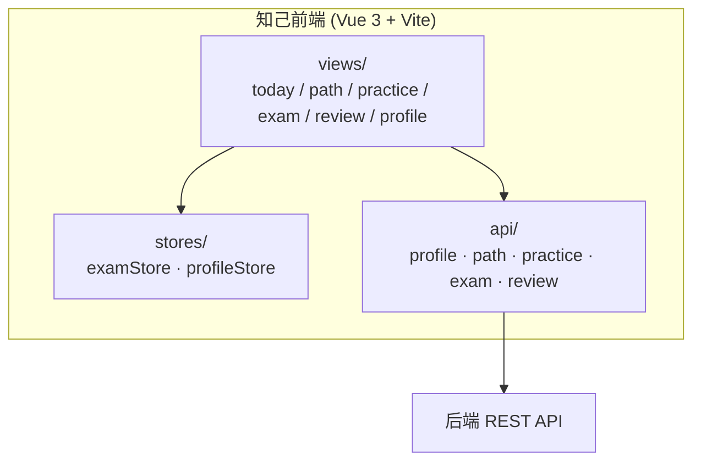
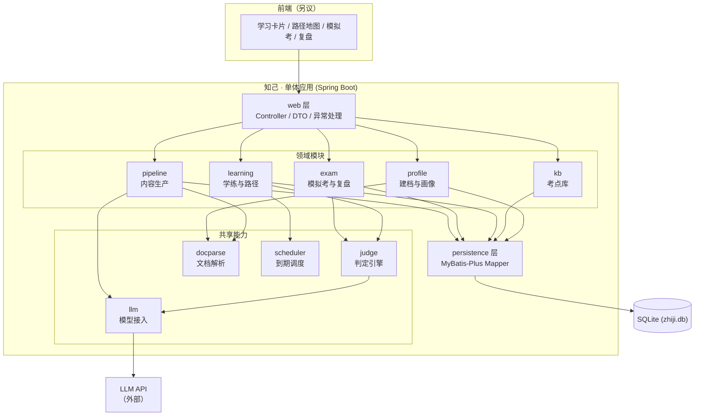
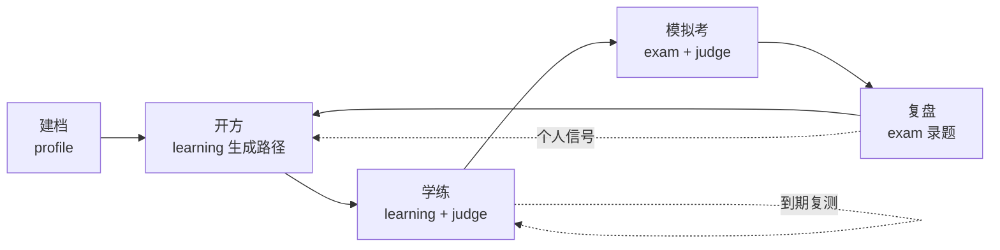
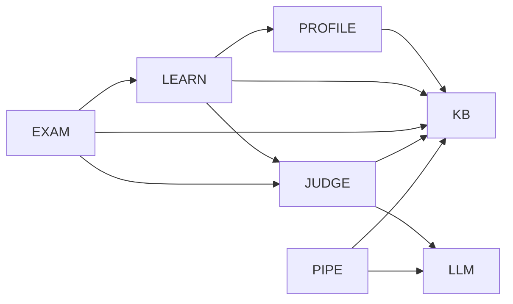
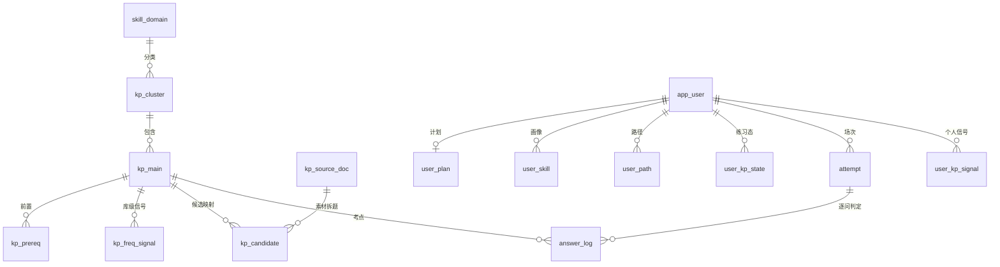
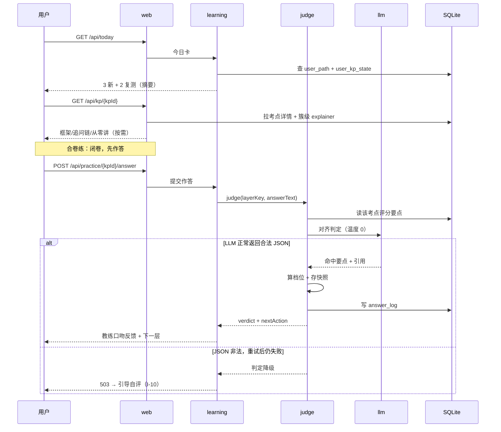
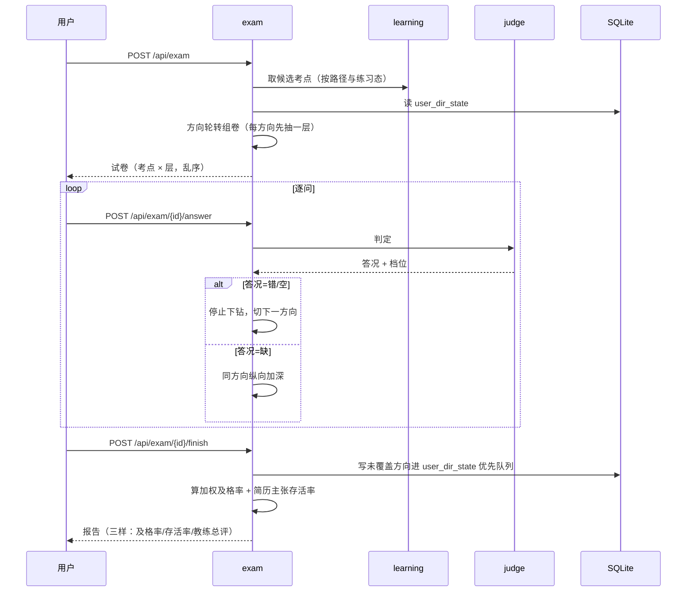
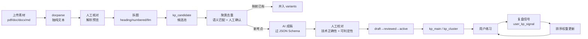

# 知己 · 系统架构设计

> 上游产物是 [00-项目企划书](00-项目企划书.md) 与 [考点库设计](考点库设计.md)。本篇回答的是"怎么搭起来"：模块怎么分、边界在哪、接口长什么样、数据库怎么落地、前端选什么、将来怎么拆。
> 定位是单人自用验证全流程，所以刻意选最简的形态：单体、无 Redis、SQLite 单文件。所有"将来可以更好"的地方都写成演进路径，不在初版付成本。
>
> 技术栈基线：**JDK 21 + Spring Boot 3.x + SQLite + Vue 3**。数据库选 SQLite（单文件、零运维、原生支持 CHECK 约束与 JSON 函数），缓存用 Caffeine 本地缓存。二者均已在本机 zhiji 工程实测通过，结论与陷阱见 6.2。

## 一、设计总览

### 1.1 目的与范围

本篇覆盖知己产品的**后端服务架构**：模块划分、模块间接口契约、数据落地方式、关键流程的运行时编排，以及单体向微服务演进的拆分路径。

明确不覆盖：

- 前端实现的详细页面设计（选型见 2.1，页面结构沿用两个 HTML 原型验证过的交互）；
- LLM 的具体 prompt 文本（属于内容资产，随考点评分要点一起管）；
- 考点内容本身的生产（那是 [考点库设计](考点库设计.md) 第五节的管道，本篇只定义它落在哪个模块）。

### 1.2 上游需求追溯

| 设计目标 | 来源 |
|---|---|
| 建档 → 开方 → 学练 → 模拟考 → 复盘五环节闭环 | 企划书 三、核心流程 |
| 学练小循环：看资料 → 追问 → 合卷练 → 隔天复测 | 企划书 `三、每个考点怎么学` |
| 闭卷强制、先作答后自评，UI 层拦住"只看不练" | 企划书 三点说明 |
| LLM 只做对齐判断、不做知识判断；分是公式算的 | 企划书 `AI 怎么判答案、怎么出分` |
| 判定不是单点故障（重试一次、降级为自评） | 企划书 工程上三件事 |
| 考点库/用户态分离、19 张表、四档规则、分级制 | 考点库设计 三、四、2.8 |
| 内容生产管道七环节 + 状态机 | 考点库设计 五、2.11 |
| 复盘信号回流，驱动路径与简历更新 | 企划书 五、复盘 |

### 1.3 设计目标与约束

功能目标：把企划书的五个环节（含单考点小循环、模拟考判定、复盘回流）用一套后端服务跑通。

非功能约束：

| 约束 | 来源 / 性质 |
|---|---|
| 目标规模：单用户（我自己），内测 5~10 人 | [Data-backed]（企划书 五、分几步做） |
| 单次判定 LLM 调用，一场 4~6 次 | [Data-backed]（企划书 工程上三件事） |
| 技术栈固定：Java + Spring Boot + SQLite，不引 Redis（本地缓存） | [Data-backed]（本次指定） |
| 版本基线：JDK 21、SQLite（sqlite-jdbc 3.49） | [Data-backed]（本次指定） |
| 形态固定：单体优先，为将来拆分预留边界 | [Data-backed]（本次指定） |
| 备考节奏：每天 2 小时、6 周一轮 | [Data-backed]（企划书 一） |
| 内容可公开、个人数据需隔离 | [Expert judgment]（考点库设计 三） |

规模量级推断：单用户下日活请求是几十次量级，题库目标 50~500 条考点。据此推断不需要缓存、不需要分库分表、不需要消息队列 [Hypothesis]——这是本架构"能这么简单"的前提，规模假设一旦破坏（比如开放注册），第三节的每个简化决策都要重新评估。

### 1.4 术语

| 术语 | 含义 |
|---|---|
| kp | knowledge point，考点；库侧全局内容资产 |
| 用户态 | 每个用户各自的画像、路径、练习状态、作答记录 |
| 判定 | LLM 把自由回答对齐到预制评分要点的动作，产出结构化 JSON |
| 档位 | 由要点命中深度分布算出的四档：优秀/良好/及格/不及格 |
| 合卷练 | 闭卷作答 + 先作答后自评的单考点练习 |
| 演进链 | 设计题的追问链形态，每层条件升级（sub_type=design_chain） |

## 二、技术选型与决策

每个选择都绑定它服务的约束，不做无理由的技术堆叠。

| 决策 | 选择 | 理由 | 证据 |
|---|---|---|---|
| 语言/框架 | JDK 21 + Spring Boot 3.x | 指定；Spring Boot 3 基线是 Java 17，21 是当前 LTS，可用虚拟线程（见 8.1）与 records 简化 DTO | [Data-backed] |
| 架构形态 | 模块化单体（Modular Monolith） | 单用户规模下微服务的运维成本（注册中心、网关、分布式追踪）换不来任何收益；但按业务域分包，为拆分留缝 | [Expert judgment] |
| 数据库 | **SQLite**（xerial sqlite-jdbc），单文件、零运维 | 单人自用场景下不需要独立数据库服务；SQLite **原生支持 CHECK 约束、JSON 函数、递归 CTE、WAL 并发读**，比 MySQL 5.7 更贴合本项目。实测结论与四类特有陷阱见 6.2 | [Data-backed]（已在 zhiji 工程实测） |
| 缓存 | **Caffeine 本地缓存**（进程内），不引 Redis | 考点库是"读多写少、内容稳定"的典型，Caffeine 命中即可；单进程部署下进程内缓存比 Redis 少一次网络往返、少一个运维组件。实测：连续 6 次读同一考点，仅落库 1 次 | [Data-backed]（已在 zhiji 工程实测） |
| ORM | MyBatis-Plus | 复杂查询（路径排序、跨表聚合、JSON 字段读写）用 SQL 表达比 ORM 映射更直观；代码生成省掉大量样板 | [Expert judgment] |
| 迁移管理 | **Spring Boot `schema.sql`**（不引 Flyway） | 实测 `org.flywaydb:flyway-database-sqlite` 在 Maven 中央仓库**不存在**（404），Flyway 社区版的 SQLite 支持需自行集成。单人项目用 Boot 原生 `spring.sql.init` 足够，且 `schema.sql` 用 `CREATE TABLE IF NOT EXISTS` 天然幂等 | [Data-backed]（实测 404） |
| 调度 | Spring `@Scheduled` | 复测到期、内容复核到期是单机定时任务，单体进程内跑即可，不需要 Quartz / XXL-Job | [Expert judgment] |
| 文档解析 | Apache PDFBox + Apache POI（不引 Tika、不引 OCR） | 素材有 pdf/doc/docx/md，纯 Java 方案零原生依赖、Windows 部署无痛；格式清单封闭（四种），不需 Tika 的重依赖 | [Expert judgment]（见 4.4） |
| LLM 接入 | Spring AI（官方）+ OpenAI 兼容协议，自建 `llm` 模块做 provider 抽象 | 火山方舟 / 智谱 GLM 的 coding plan 均提供 OpenAI 兼容端点，Spring AI 的 `OpenAiApi` starter 可直连；不引 Spring AI Alibaba——它是阿里云生态绑定（DashScope 专用），与本次选定的模型服务商不对口 | [Hypothesis]（协议待实测，见 2.2） |
| 前端 | Vue 3 + Vite + TypeScript + Element Plus | 与作者栈匹配；组合式 API 适合模拟考这种长流程状态；Element Plus 覆盖表单/弹窗/进度条等备考界面常用件 | [Expert judgment] |
| 前端状态 | Pinia | 练习态、模拟考流程跨页面共享，需要一个轻量 store；不引 Vuex | [Expert judgment] |
| 认证 | 初版不做（单用户，固定 user_id） | 登录体系对"验证全流程"没有增量价值；但用户态表已预留 user_id，将来加认证不改表 | [Expert judgment] |
| 接口风格 | REST + JSON | 与前端 Vue 解耦；不引 GraphQL | [Expert judgment] |

关于不做的事：不引入 Redis、不引入 MQ、不引入注册中心、不做分库分表、不做多租户隔离。这些都是内测规模下没有收益的复杂度 [Expert judgment]。

### 2.1 前端选型说明

选 Vue 3 的理由集中在"这个产品是什么形态"上：它没有复杂的仪表盘和数据可视化，主体是对话流（建档、追问、模拟考）+ 列表卡片（今日卡、路径地图）+ 表单（画像确认、复盘录题）——这正是 Vue 的模板语法最省力的场景，比 React 少写一层脚手架。TypeScript 是必须的，因为接口契约里的枚举（`subType`、`verdictLevel`、`nextAction`、`layerKey`）很多，用类型把后端契约固化到前端，能在编译期挡住大部分字段拼写和取值错误 [Expert judgment]。

Element Plus 覆盖的组件与产品的对应关系：`ElCard`/`ElTag` 对应今日卡与考点卡，`ElProgress` 对应进度条与档位，`ElDialog` 对应"看完整答案"的弹层，`ElInput`/`ElCheckbox` 对应合卷练的作答区与画像逐条拍板。移动端优先——备考的人大概率在通勤和睡前用手机，原型本身也是窄屏布局 [Data-backed]。

状态管理只用 Pinia 的一个 store：模拟考是长流程（组卷 → 逐问作答 → 结束 → 报告），中途跨路由，需要把试卷与当前进度放在 store 而非组件内；建档对话的上下文同理。日常的今日卡/考点详情是纯请求-响应，不需要 store [Expert judgment]。

前端工程结构与后端模块的对应关系是**按页面 vs 按接口**两层：`views/` 按功能页组织（today / path / practice / exam / review / profile），`api/` 按后端模块组织（profile.ts / path.ts / practice.ts / exam.ts / review.ts），把 5.3 的接口清单一一落进去，改后端契约时能快速定位前端受影响面 [Expert judgment]。



### 2.2 关于 LLM 框架的决策说明

这个决策值得单独说，因为它有一个容易踩的坑。

**先说结论**：引入 Spring AI（官方 spring-ai-openai-spring-boot-starter），**不引入 Spring AI Alibaba**；同时自建 `llm` 模块包一层 provider 抽象。

**为什么是 Spring AI 而不是 Spring AI Alibaba**：Spring AI Alibaba 的定位是阿里云百炼（DashScope）生态的 Spring 集成，它的价值在于把通义千问系列模型的特性（多模态、函数调用、RAG 组件）直接映射到 Spring 概念上。而本次选的是火山方舟的 coding plan（后续还计划接 GLM coding plan）——这两家都不是阿里云百炼，Spring AI Alibaba 在这里提供不了额外价值，反而引入一个不对口的依赖 [Expert judgment]。

**为什么 provider 抽象必须自己做**：火山方舟与 GLM 的 coding plan 是面向**编码工具**的订阅套餐（对应用户在 IDE/CLI 里的编码助手场景），它们暴露的是否为标准 OpenAI 兼容协议、是否允许非编码场景的批量调用、有无并发与配额限制，都需要实测确认 [Hypothesis]。Spring AI 的 `ChatClient` 已经是很好的抽象层，但"模型名、base-url、鉴权头、每用途选哪个模型"这层配置编排属于业务决策（判定用便宜模型、总评用好模型），放在自己的 `llm` 模块里，换 provider 只改配置不改业务代码 [Expert judgment]。

**待验证清单**（这几条不确认，llm 模块的接入方式定不下来）：

| 待确认项 | 为什么重要 | 不满足时的退路 |
|---|---|---|
| coding plan 端点是否 OpenAI 兼容（`/v1/chat/completions`） | 决定能否直接用 `spring-ai-openai` starter | 改用对应 SDK 自封装，或换标准 API 计费的模型 |
| 是否允许非编码场景调用 | coding plan 条款可能限定用途 | 换平台标准 API（如方舟的通用推理接入点） |
| 是否支持 `temperature=0` 与 JSON 输出模式 | 判定要求确定性输出与强制 JSON | 用强 prompt 约束 + 本地 Schema 校验兜底 |
| 并发与速率限制 | 模拟考一场 4~6 次调用，需确认不被限流 | 串行化调用 + 失败重试降级（已有设计） |

**与既有设计的关系**：判定"LLM 只做对齐、不做知识判断"的原则不变 [Data-backed]；"失败重试一次、再失败降级为自评"的容错不变 [Data-backed]。Spring AI 只是把 HTTP 调用与 JSON 解析这层标准化了，判定规则（四分流、引用强制、档位公式）仍然在 `judge` 模块自己实现——这一点必须守住，否则换模型就会换掉评分口径 [Expert judgment]。

## 三、系统架构

### 3.1 架构总览

形态是**模块化单体**：一个 Spring Boot 进程，内部按业务域分模块，模块间只通过 Java 接口调用，不共享可变状态。这个选择由两个事实驱动：规模是单机单用户（微服务的运维成本无收益）[Data-backed]，但领域边界本身是清晰的（考点库/用户态分离、五环节闭环）[Expert judgment]——所以用"包边界"先立住领域，等规模真的上来再提升为"进程边界"。



图中四条依赖方向需要说明：

- **web 层只依赖领域模块**，领域模块不反向依赖 web。Controller 只做参数校验和 DTO 转换，业务逻辑全在 service，避免"业务散在 Controller 里"这个单体最常见的腐化路径 [Expert judgment]。
- **judge 与 llm 是被依赖方，不反向依赖业务模块**。学练和模拟考都要判定，所以判定下沉为共享能力；judge 掌握业务规则（档位公式、快照），llm 只负责"把 prompt 发出去、把 JSON 拿回来"，两者的边界是"业务规则 vs 传输"。
- **docparse 也是共享能力**，被 pipeline（题库素材解析）与 profile（简历解析）共同依赖。两处都是"上传文件 → 取出纯文本"，同一件事不该写两遍 [Expert judgment]。
- **scheduler 单向触发 learning**，不参与请求链路。到期复测的生成是从数据库读状态再算，不依赖运行中的请求上下文。

### 3.2 组件职责与边界

| 模块 | 拥有 | 明确不管 | 依赖 |
|---|---|---|---|
| **profile** | 用户、计划、技能画像、建档对话编排 | 不管考点内容、不管练习进度 | kb（读技能域）、llm（整理画像草案） |
| **kb** | 考点/簇/前置/候选池的读写、内容状态机 | 不管内容怎么被生产（那是 pipeline）、不管用户态 | persistence |
| **learning** | 路径生成、练习态、SM-2 调度、今日卡、单考点小循环编排 | 不管判定怎么做、不管模拟考组卷 | kb、profile、judge、scheduler |
| **exam** | 模拟考组卷、方向轮转、综合评定、复盘录题 | 不管单考点练习态、不管考点内容维护 | kb、judge、learning（只读状态） |
| **judge** | 对齐判定的编排、档位公式、要点快照、答况四分流 | 不管 prompt 怎么写、不管模型怎么调 | llm、kb（读评分要点） |
| **llm** | 模型路由、prompt 模板装载、JSON 校验、重试与降级 | 不管业务语义（"判定对不对"不是它的判断） | 外部 LLM API |
| **docparse** | 文件接收、格式识别、文本抽取（pdf/doc/docx/md/txt）、OCR 预留位 | 不管文本怎么被切题（那是 pipeline）、不管文本语义 | 本地文件存储、pipeline/profile（被依赖） |
| **pipeline** | 采集、文档解析编排、拆题、聚类去重、AI 成稿、校对流转、入库 | 不管用户在练什么 | kb、llm、docparse |
| **persistence** | 表映射、事务边界、SQL | 不含业务规则 | SQLite |

单句职责检查（"一句话说不清就是模块做太多"）：上面每个模块的职责都能一句话说清、不含"并且"，边界成立 [Expert judgment]。

### 3.3 主流程与数据流

主流程是企划书五环节的内循环。这里只画请求链路的组件协作，具体时序在第七节展开。



- **建档 → 开方**：profile 产出确认过的技能清单（`user_skill`），learning 据此从 kb 选考点、按难度与前置排 `user_path`。
- **学练**：learning 出今日卡（3 新 + 2 复测，按 `user_plan.daily_minutes` 伸缩），单考点循环里每次作答都经 judge 判定，判定驱动是否继续下钻。
- **模拟考**：exam 组卷（方向轮转）+ judge 逐问判定，收官算加权及格率与简历主张存活率。
- **复盘**：exam 把真实面试被问到的题录成 `user_kp_signal`，回流到 learning 的排序权重。

### 3.4 技术选型落点

技术决策在第二节已给理由，这里说明它们在架构里的落点：**Spring AI 作为 HTTP 与 JSON 解析的底座，被 llm 模块封装**，业务侧只调 llm 模块接口，不直接依赖 Spring AI 的类型（换框架或换 provider 时改动收敛在一个模块内，见 2.2）；模型路由配置由 llm 模块持有（只改配置不改代码）；**docparse 的 PDFBox/POI 依赖也收在模块内**，业务侧只见 `ParsedDoc`（见 4.4）；Flyway 管理 19 张表的版本（见 6.2）；Spring `@Scheduled` 挂在 scheduler 模块（见 8.2）；MyBatis-Plus 的 JSON 类型处理器负责 `followups`/`rubric` 等列与 Java 对象的互转 [Expert judgment]。前端 `api/` 目录与 5.1 的接口清单一一对应（见 2.1）。

## 四、模块设计

### 4.1 模块分层

每个模块内部分四层，方向自上而下，禁止跨层反向调用：

```
module/
├── api/       对外接口定义（供其他模块或 web 层调用，Java interface + DTO）
├── service/   业务编排（事务边界在这一层）
├── domain/    领域对象与规则（档位公式、状态机流转、SM-2 计算）
└── repo/      MyBatis-Plus Mapper（只被本模块 service 使用）
```

跨模块调用只允许走对方的 `api`；`repo` 不出模块。这条纪律是"将来能拆"的前提——拆的时候把 `api` 提升为 HTTP/RPC 契约即可，`repo` 私有保证了数据归属不模糊 [Expert judgment]。

### 4.2 依赖方向



依赖图无环 [Expert judgment]。需要留意的两点：

- **learning ← exam 是单向的**：exam 只读 learning 的练习态（判断某个考点练没练过），learning 不感知 exam 的存在。模拟考不影响日常练习态，只写自己的 `attempt`/`answer_log`。
- **profile 不被 exam 依赖**：复核画像的活由 learning 在路径生成时完成，exam 不需要直接读画像。

### 4.3 各模块设计要点

**profile · 建档与画像**

职责是编排建档对话并产出确认过的技能清单。输入是用户对话消息，输出是 `user_skill` 确认清单 + `user_plan`。关键设计：画像的"逐条拍板"是状态机（草稿 → 用户确认 → 定稿），未定稿的画像不参与路径生成 [Expert judgment]。建档对话里的项目素材（数字、冲突、结果）落 `user_case`，供后续项目叙事使用。

**kb · 考点库**

职责是维护全局内容资产。三个要点：写入必须过状态机（draft → reviewed → active，未 reviewed 不进用户路径）[Data-backed]（考点库设计 2.11）；前置关系写入时在同一事务内校环；`unique(cluster_id, slug)` 作为去重的数据库层兜底。kb 不感知用户，只回答"有哪些考点、结构是什么"。

**learning · 学练与路径**

职责是生成个性化路径并驱动单考点小循环。关键设计：路径与练习态分表（`user_path` vs `user_kp_state`），重开方只重写路径、不动练习进度 [Data-backed]（考点库设计 4.9）。今日卡的数量按 `user_plan.daily_minutes` 伸缩，不再硬编码 3+2 [Expert judgment]。到期复测由 scheduler 定时触发 learning 计算 `next_review <= today` 的考点。

**exam · 模拟考与复盘**

职责是组卷、编排判定、算综合评定、回收复盘信号。关键设计：组卷用方向轮转（`user_dir_state` 驱动，先扫广度再打弱点），未覆盖方向标未覆盖并进优先队列 [Data-backed]（考点库设计 2.9）；中途喊停的场次照常出报告并标 `aborted`。复盘录题写 `user_kp_signal`（权重最高）而不写全局信号表 [Data-backed]。

**judge · 判定引擎**

职责是把一次作答对齐到评分要点并算档位。它持有全部判定规则：答况四分流（对/缺/错/空）、引用强制（命中要点必须附用户原话引用，引不出算未命中）、档位公式、要点快照（`layer_key + level + 文本`）[Data-backed]（企划书 + 考点库设计 2.8）。它**不做知识判断**——不判断技术内容对不对，只判断"用户的回答有没有命中预制要点"，这是整套设计的核心原则 [Data-backed]。

**llm · 模型接入**

职责是屏蔽模型差异：按用途路由模型（判定用便宜模型温度 0、总评用好模型）、装载 prompt 模板、校验返回 JSON、失败重试一次、再失败降级为"AI 看不准，解锁自评按钮" [Data-backed]（企划书 工程上三件事）。它不解释业务语义。底座用 Spring AI（官方 `spring-ai-openai` starter 接 OpenAI 兼容端点），但**业务侧只见本模块接口**——这样从火山方舟切到 GLM、或从 Spring AI 换到别的方式，改动不出这个模块 [Expert judgment]（见 2.2）。

**pipeline · 内容生产**

职责是七环节管道：采集素材 → 文档解析与拆题 → 聚类去重 → 成稿 → 校对 → 入库 → 演化。关键设计：文件进来先经 docparse 抽成纯文本、**人工核对解析预览**，再拆成单题候选（见 4.4）；成稿阶段的 JSON 必须过 Schema 校验，防 AI 生成时键名漂移 [Data-backed]（考点库设计 4.15）；去重时先在 `kp_candidate` 语义匹配，人工确认边界 case，入库时再被唯一约束兜一道。

### 4.4 文档解析能力（docparse）

**为什么单独成模块**：题库素材有 pdf / doc / docx / md 多种格式，而"把文件变成纯文本"这件事**建档的简历解析也要用**（简历同样是 pdf/doc）。同一能力被两处消费，就该下沉为共享模块，而不是在 pipeline 和 profile 各写一遍 [Expert judgment]。

**技术选型**

| 格式 | 方案 | 理由 | 证据 |
|---|---|---|---|
| md / txt | 直读，无需依赖 | 本身就是文本 | — |
| pdf（文本版） | **Apache PDFBox** | 纯 Java、无原生依赖、Windows 部署零负担；文本版 PDF 用它能直接抽文字层 | [Expert judgment] |
| doc（老版二进制） | **Apache POI `HWPF`** 或先转 docx | POI 是 Java 生态读写 Office 的事实标准，避免引入系统级 Office/LibreOffice 依赖 | [Expert judgment] |
| docx | **Apache POI `XWPF`** | 同上，且能顺带抽取标题层级（有利于后续拆题） | [Expert judgment] |
| 统一入口 | **Apache Tika**（可选） | 如果不想自己按扩展名分发，Tika 用统一 API 识别并抽取所有上述格式；代价是引入较重的依赖树 | [Expert judgment] |

**推荐组合**：先按扩展名自己分发（md/txt 直读、pdf→PDFBox、docx→POI），**不引 Tika**。理由是依赖可控、每种格式的异常行为自己清楚；Tika 的价值在"格式极多且不想维护分发逻辑"，本项目的格式清单是封闭的（就四种），引 Tika 属于用重锤敲小钉 [Expert judgment]。若后续格式膨胀（如要支持 ppt、html、epub），再切 Tika，改动收敛在 docparse 内部。

**关于 OCR**：本次确认收集到的 PDF **基本都是文本版**，因此初版**不引 OCR**。意义在于规避两处麻烦：一是 Tesseract 在 Windows 上要装原生库、部署不干净；二是视觉大模型 OCR 有成本与稳定性问题。docparse 里留一个 `ScannedPdfException` 的识别分支——当 PDFBox 抽出的文本为空或极少时，明确报"疑似扫描件，暂不支持"而不是静默返回空串 [Expert judgment]。将来真需要 OCR，再作为独立能力补进来（见第九节开放问题）。

**输入输出的契约**

- 输入：文件字节流 + 原始文件名（用扩展名判类型，不用 Content-Type——上传时浏览器给的 MIME 常不准）[Expert judgment]。
- 输出：`ParsedDoc { text: String, pages: int, sourceType: pdf|doc|docx|md|txt, warnings: List<String> }`。
- 边界：docparse **不做语义理解、不拆题、不判断内容质量**。拆题是 pipeline 的职责（因为它要结合考点库做语义匹配），docparse 只负责"文件 → 干净的纯文本" [Expert judgment]。
- 错误：加密 PDF、损坏文件、扫描件三类分别抛不同异常，前端要能区分提示（"这个 PDF 有密码"和"这个 PDF 是扫描件"对用户是两件事）。

**文件存储**：初版用本地目录（如 `data/uploads/{yyyyMM}/{uuid}.{ext}`），路径存库、文件不存库（把几百份 PDF 塞进 BLOB 会让库文件臃肿且拖慢查询）[Expert judgment]。存储目录与数据库一起纳入备份范围——**素材原始文件是可重建题库的源材料，不能只备库不备文件**。

## 五、接口设计

接口分两类：**对前端暴露的 REST 接口**（web 层），以及**模块间的 Java 接口**（`api` 包）。这里给前端接口清单与关键契约，模块间接口在契约里标注归属。

### 5.1 接口清单

| 编号 | 方法 | 路径 | 用途 | 归属模块 |
|---|---|---|---|---|
| I-01 | POST | `/api/profile/conversation` | 建档对话一轮（含项目素材采集） | profile |
| I-02 | GET | `/api/profile/skills` | 取画像草案/定稿 | profile |
| I-03 | PUT | `/api/profile/skills` | 逐条确认技能清单 | profile |
| I-04 | POST | `/api/plan` | 设置目标岗位/JD/备考周期/每日时间 | profile |
| I-05 | POST | `/api/path/generate` | 开方：生成路径骨架 | learning |
| I-06 | GET | `/api/path` | 路径地图（按层级分组） | learning |
| I-07 | GET | `/api/today` | 今日卡（新学 + 复测） | learning |
| I-08 | GET | `/api/kp/{kpId}` | 考点详情（框架/追问链/从零讲/完美答案） | kb |
| I-09 | POST | `/api/practice/{kpId}/answer` | 提交一次作答并判定 | learning + judge |
| I-10 | POST | `/api/practice/{kpId}/self-assess` | 降级路径：自评 | learning |
| I-11 | POST | `/api/exam` | 开始一场模拟考（组卷） | exam |
| I-12 | POST | `/api/exam/{attemptId}/answer` | 模拟考作答并判定 | exam + judge |
| I-13 | POST | `/api/exam/{attemptId}/finish` | 结束并出综合评定 | exam |
| I-14 | GET | `/api/exam/{attemptId}/report` | 取报告 | exam |
| I-15 | POST | `/api/review` | 复盘录题（真实面试被问到的题） | exam |
| I-16 | POST | `/api/kb/candidates` | 录入候选题（手工单题入口） | pipeline |
| I-17 | POST | `/api/kb/{kpId}/review` | 校对流转（draft→reviewed→active） | pipeline |
| I-18 | POST | `/api/doc/upload` | 上传素材文件（pdf/doc/docx/md/txt），返回解析结果 | docparse |
| I-19 | POST | `/api/doc/{docId}/split` | 把解析文本拆成单题候选，入候选池 | pipeline |
| I-20 | GET | `/api/doc/{docId}` | 取解析结果与拆题状态（人工核对） | docparse |

### 5.2 关键契约

**I-05 开方：`POST /api/path/generate`**

| 字段 | 值 |
|---|---|
| 用途 | 按确认过的画像与计划，选考点、排顺序、分三层 |
| 认证 | 无（单用户固定 user_id） |
| 请求体 | `dailyMinutes` (int, 可选, ≥15，缺省读 `user_plan`) |
| 成功响应 | `200`；`{ pathId, total, baseline: n, main: n, drop: n, generatedAt }` |
| 错误码 | `409 SKILLS_NOT_CONFIRMED`（画像未定稿）；`409 PLAN_MISSING`（缺计划）；`503 KB_EMPTY`（无 active 考点） |
| 幂等 | 是——重开方只重写 `user_path`，`user_kp_state` 不动 |

**I-07 今日卡：`GET /api/today`**

| 字段 | 值 |
|---|---|
| 用途 | 返回今天要学的卡片（新学 + 复测），数量按每日时间预算伸缩 |
| 请求参数 | `date` (date, 可选, 缺省今天) |
| 成功响应 | `200`；`{ newKps: [{kpId, title, subType, difficulty, clusterId}], reviewKps: [{kpId, title, dueDate, lastLevel}], dropNote: [...] }` |
| 错误码 | `404 PATH_NOT_FOUND`（未开方） |
| 说明 | 卡片只带摘要，详情点开才拉 I-08（按需加载） |

**I-09 学练作答：`POST /api/practice/{kpId}/answer`**

| 字段 | 值 |
|---|---|
| 用途 | 提交一次作答，触发判定，返回下一动作 |
| 请求体 | `layerKey` (string, 必填，对应 followups 的稳定键)；`answerText` (string, 可空)；`isBlank` (bool, 缺省 false)；`src` (`text` \| `voice`, 缺省 text)；`attemptId` (long, 可选，合卷练场次) |
| 成功响应 | `200`；`{ verdict: { verdictLevel, hits: [{layerKey, level, pointText, quote}], appealAllowed }, nextAction: "next_layer" \| "same_layer_variant" \| "stop_and_correct" \| "regress_prereq" }` |
| 错误码 | `400 LAYER_KEY_INVALID`；`404 KP_NOT_FOUND`；`409 KP_NOT_ACTIVE`；`503 JUDGE_UNAVAILABLE`（判定失败已降级，前端转自评） |
| 说明 | `nextAction` 由答况四分流决定；`503` 是降级信号而非错误，前端应引导到 I-10 |

**I-15 复盘录题：`POST /api/review`**

| 字段 | 值 |
|---|---|
| 用途 | 把真实面试被问到的题录进个人信号，驱动后续排序 |
| 请求体 | `rawTitle` (string, 必填)；`matchedKpId` (string, 可选，能对上已有考点就传)；`company` (string, 可选)；`interviewDate` (date, 必填)；`note` (string, 可选) |
| 成功响应 | `200`；`{ signalId, matched: true, kpId }` 或 `{ candidateId, matched: false }`（对不上则进候选池） |
| 错误码 | `400 INTERVIEW_DATE_REQUIRED` |
| 说明 | 对上考点写 `user_kp_signal`（权重最高）；对不上写 `kp_candidate`（来源=复盘） |

**I-18 素材上传：`POST /api/doc/upload`**

| 字段 | 值 |
|---|---|
| 用途 | 上传一份素材文件，返回抽取出的纯文本，供人工核对 |
| 认证 | 无（单用户） |
| 请求体 | `multipart/form-data`；`file` (file, 必填, 单文件 ≤ 20MB)；`source` (`面经` \| `开源仓库` \| `人工`，缺省 `人工`) |
| 成功响应 | `200`；`{ docId, sourceType: "pdf", pages: 12, chars: 23840, textPreview: "前 500 字…", warnings: [] }` |
| 错误码 | `400 UNSUPPORTED_FORMAT`（扩展名不在白名单）；`413 FILE_TOO_LARGE`；`422 PDF_ENCRYPTED`（有密码）；`422 SCANNED_PDF_UNSUPPORTED`（抽不出文字，疑似扫描件）；`500 PARSE_FAILED`（文件损坏） |
| 幂等 | 否——同一文件重复上传会生成新的 `docId`，由用户自行去重（内容去重发生在 I-19 拆题入库阶段） |
| 说明 | 上传只做解析，不自动拆题；用户先看 `textPreview` 确认解析质量，再调 I-19。**解析质量要先让人看一眼**——PDF 抽错行、doc 丢表格很常见，直接自动拆题会污染候选池 |

**I-19 拆题入池：`POST /api/doc/{docId}/split`**

| 字段 | 值 |
|---|---|
| 用途 | 把一份解析好的文本拆成单题候选写入候选池 |
| 请求体 | `strategy` (`heading` \| `numbered` \| `llm`，缺省 `numbered`)；`dryRun` (bool, 缺省 false，true 则只返回拆出的题不落库) |
| 成功响应 | `200`；`{ docId, splitCount: 37, candidates: [{candidateId, rawTitle, confidence}], unmapped: 3 }` |
| 错误码 | `404 DOC_NOT_FOUND`；`409 DOC_NOT_PARSED`（尚未解析）；`422 NO_QUESTION_FOUND`（没拆出题，通常是解析质量差，提示回 I-18 看预览） |
| 说明 | 拆题策略三档：`heading` 按标题层级切（适合结构化 md/docx）；`numbered` 按题号正则切（适合"1. 2. 3."编号的面经）；`llm` 交 LLM 切（适合无编号散文，最贵也最不可控，作为兜底）。**默认 `numbered` 先跑 `dryRun` 看效果**，ok 了再落库。落库的候选与 I-16 手工录入的是同一张表 `kp_candidate`，`source=面经/开源仓库` |

**I-09 的判定返回示例**（用于对齐前端与 judge 的契约）：

```json
{
  "verdict": {
    "verdictLevel": "good",
    "hits": [
      {"layerKey": "capacity", "level": "基础", "pointText": "带宽数量级推算", "quote": "10万乘100KB是10个G每秒"},
      {"layerKey": "capacity", "level": "中级", "pointText": "CDN 卸载", "quote": "静态资源走CDN"}
    ],
    "appealAllowed": true
  },
  "nextAction": "next_layer"
}
```

注意 `quote` 是引用强制规则的落点：命中要点必须附用户原话，引不出来该条不计命中 [Data-backed]。这也是 `appeal` 机制的入口——`verdictLevel=fail` 时前端可引导申诉（口误/转写错误）。

### 5.3 接口一致性

I-08 的 `subType` 取值必须是 `default` / `design_chain` / `narrative` 三者之一（与 `kp_main.sub_type` 的 CHECK 一致）[Data-backed]；I-09 的 `layerKey` 必须能在该考点 `followups[].layer_key` 里找到，且与 `answer_log.layer_key` 落库值一致 [Data-backed]。这两处是接口与数据模型最容易漂移的地方，已写进校验。

## 六、数据设计

### 6.1 实体归属与表映射

19 张表按模块归属如下，模块边界与数据归属一一对应——这是将来拆分时不产生"共享表"的关键 [Expert judgment]。

| 模块 | 表 | 归属性质 |
|---|---|---|
| kb | `kp_cluster`、`kp_main`、`kp_prereq`、`kp_freq_signal` | 全局内容资产 |
| pipeline | `kp_candidate`、`kp_source_doc`、`skill_domain` | 全局内容资产 |
| profile | `app_user`、`user_plan`、`user_skill` | 用户态 |
| learning | `user_path`、`user_kp_state`、`user_kp_private`、`user_dir_state`、`user_narrative` | 用户态 |
| exam | `attempt`、`user_case`（建档写入侧在 profile，读取侧在 exam）、`user_kp_signal` | 用户态 |
| judge | `answer_log`（写入方，读取方是 exam/learning） | 用户态 |

`skill_domain` 放 pipeline 是因为它是内容字典（考点分域用），不随用户变；profile 只引用它，不拥有它 [Expert judgment]。`answer_log` 由 judge 写、被 learning/exam 读，归属判给 judge，因为它的结构由判定规则定义（`layer_key`、`verdict`、`score_level`）[Expert judgment]。`user_narrative` 归 learning，因为叙事的练习循环（看标准故事 → 合卷讲 3 分钟 → 复测）由 learning 的学练模块驱动；AI 起草故事时读的是 profile 的建档素材，但故事本身存在 learning 侧 [Expert judgment]。

`kp_source_doc` 是一处**表归属与文件读写分离**的例子：表由 pipeline 拥有（它管整个内容生产管道），但文件的接收与解析动作归 docparse（它是共享能力）。这样 docparse 保持无业务状态，pipeline 保持数据所有权清晰 [Expert judgment]。



（完整字段见 [考点库设计](考点库设计.md) 第四节；本图只表达归属与基数。）

### 6.2 从 PostgreSQL 到 SQLite 的方言适配

考点库设计的 DDL 是 PostgreSQL 口径，落到 SQLite 需要逐条改写。**这次换库是划算的**：SQLite 原生了 MySQL 5.7 缺的三样能力，同时也带来四类新陷阱。以下结论来自 zhiji 工程实测（非推断）[Data-backed]。

**基础类型映射**

| PG 写法 | SQLite 写法 | 说明 |
|---|---|---|
| `jsonb` | `TEXT`（存 JSON 字符串） | SQLite 无 JSON 类型；列声明为 TEXT，**JSON 函数可用**（`json_extract`、`json_set`，3.9+ 内置），实测 `json(...)` 校验函数也能用 |
| `timestamptz` / `datetime(3)` | `TEXT`（ISO8601）或 `INTEGER`（epoch 毫秒） | SQLite 无日期类型；**统一存 UTC 的 ISO8601 字符串**（`datetime('now')` 生成），可读性优先，便于人工查库 |
| `bigserial` / `bigint auto_increment` | `INTEGER PRIMARY KEY AUTOINCREMENT` | SQLite 的自增写法；`AUTOINCREMENT` 防 rowid 复用，实测正常 |
| `text primary key` | `TEXT PRIMARY KEY` | **无需定长**——SQLite 没有 MySQL 那种索引长度限制，这是净收益 |
| `smallint` / `numeric` / `boolean` | `INTEGER` / `REAL` / `INTEGER(0/1)` | SQLite 只有 5 种存储类：NULL/INTEGER/REAL/TEXT/BLOB，类型是"亲和性"而非强约束 |
| `check (x in (...))` | **同 MySQL 8.0 写法，直接可用** | 实测生效：非法值返回 `SQLITE_CONSTRAINT_CHECK` |

**SQLite 相比 MySQL 5.7 白拿的三样**

| 能力 | MySQL 5.7 | SQLite | 影响 |
|---|---|---|---|
| CHECK 约束 | 解析但忽略 | **真正生效**（实测） | 上一版为 5.7 设计的"应用层兜底 + 触发器"方案可省——DDL 里的 CHECK 就是第一道防线 |
| JSON 列默认值 | `json` 列不能设默认值 | TEXT 列可写 `DEFAULT '[]'` | 上一版落差 B 的整套兜底方案作废 |
| 递归 CTE | 8.0 才有 | **支持**（3.8.3+） | 前置 DAG 校环可用一条 `WITH RECURSIVE` 完成，不必只依赖应用层内存遍历（见 6.4） |

**SQLite 的四类特有陷阱（实测踩到或必须预防）**

| # | 陷阱 | 后果 | 应对 |
|---|---|---|---|
| A | **不自动创建数据库文件的父目录** | 实测启动直接失败：`path to './data/zhiji.db': 'D:\javaApp\zhiji\.\data' does not exist` | 在 `main()` 里先 `Files.createDirectories()`；放在 main 是因为它早于 DataSource 初始化 |
| B | **约束异常不被 Spring 归类** | 实测 SQLite 驱动抛约束异常时 **SQL state 为 null**，Spring 转成 `UncategorizedSQLException` 而非 `DataIntegrityViolationException`；不接住就是 500 | 全局异常处理器**显式接 `UncategorizedSQLException`**，按消息里的 `SQLITE_CONSTRAINT_CHECK`/`_UNIQUE`/`_FOREIGNKEY` 翻译成 400/409（见 6.4） |
| C | **默认不开启外键** | 每次连接都需 `PRAGMA foreign_keys=ON`，否则 FK 形同注释 | 连接串加 `foreign_keys=on`（实测生效） |
| D | **单写锁 + 弱类型** | 写操作串行；`INTEGER` 列可能存进字符串（亲和性不强制） | 开 `journal_mode=WAL` 允许"多读一写"并发（实测生效）；类型正确性靠应用层（Bean Validation）保证 |

**连接串（实测可用）**

```
jdbc:sqlite:./data/zhiji.db?journal_mode=WAL&foreign_keys=on&busy_timeout=5000
```

三个参数各司其职：`journal_mode=WAL` 允许读写并发（不设则读写互斥）；`foreign_keys=on` 开启外键（不设则 FK 失效）；`busy_timeout=5000` 写锁等待 5 秒再报错，避免瞬时并发直接失败 [Data-backed]。

**为什么单人场景下 SQLite 优于 MySQL**（顺带记录这个判断的依据）：省掉一个独立数据库服务的安装、启动、备份、端口管理；数据库就是一个文件，复制即备份；WAL 模式下读并发完全够用。**唯一要认清的边界**：SQLite 适合"单机单写入进程"，一旦将来部署成多实例（见 8.5 拆分），必须换回 PostgreSQL/MySQL——那时表的定义可以平移，只是连接与建表脚本要重写 [Expert judgment]。

### 6.3 JSON 存储与索引策略

考点库设计把 `followups`/`rubric`/`verdict` 等留在 JSON 列，依据是"整体读写、不按子结构查询"[Data-backed]。换到 SQLite 后这条判据更宽松了，因为 SQLite 的 JSON 处理方式与 PG/MySQL 都不同：

1. **JSON 存为 TEXT，函数照常可用**：SQLite 的 `json_extract(col, '$.path')` 能直接查询 JSON 内部字段，不需要 PG 的 GIN 索引、也不需要 MySQL 的生成列。**但要注意**：对 JSON 内部字段查询**无法走索引**，是全表扫描——所以"按 JSON 子字段做条件查询"依然要避免 [Expert judgment]。
2. **需要聚合的字段已提成实列**：`answer_log.dir`、`answer_log.layer_key`、`answer_log.score_level` 都是实列（考点库设计 4.13），方向聚合、深度定位、档位趋势都走这些列，不碰 JSON [Data-backed]。**这一条在任何数据库下都是关键**——它保证核心指标查询不依赖 JSON 索引。
3. **真要按 JSON 子字段查，用"生成列 + 索引"**（SQLite 3.31+ 支持 `GENERATED ALWAYS AS ... VIRTUAL/STORED`）：

```sql
-- SQLite：虚拟列即可（与 MySQL 5.7 不同，5.7 必须 stored 才能建索引）
ALTER TABLE kp_main
  ADD COLUMN dir_gen TEXT GENERATED ALWAYS AS (json_extract(followups, '$[0].dir')) VIRTUAL;
CREATE INDEX idx_kp_dir ON kp_main (dir_gen);
```

**这是升级路径，初版不做** [Hypothesis]。另需注意：JSON 列不要用 `null` 与空数组混用——统一成 `'[]'`，否则 `json_extract` 的行为差异会污染生成列（SQLite 可用 `json_valid()` 在写入时校验）。

### 6.4 一致性与完整性规则

- 事务边界在模块 `service` 层，一条业务动作一个事务；跨模块调用不共享事务，只能靠状态机与最终修复 [Expert judgment]。
- 前置 DAG 的校环与插入在**同一事务**内完成。SQLite 支持递归 CTE，可用一条 `WITH RECURSIVE` 检测环路；**但初版仍建议用应用层遍历**——几百条边的规模下内存遍历更快，且错误信息可读（能告诉用户"与哪个考点形成环"）[Expert judgment]。
- **约束的执行分工（双层防护，实测两层都生效）**：应用层（Java 枚举 + Bean Validation）是第一道防线，负责给出**可读的中文错误**；数据库 CHECK/UNIQUE/FK 是第二道防线，防住绕过应用的写入（如手工 SQL、将来的批处理）。**两道都要有**——只靠应用层，手工 SQL 就能写脏数据；只靠数据库，用户看到的是无法理解的约束报错 [Data-backed]（实测：`subType` 非法被 DB CHECK 拦成 400，`difficulty=9` 被 Bean Validation 拦成 400）。
- **约束异常必须翻译**：SQLite 的约束异常 SQL state 为 null，Spring 归为 `UncategorizedSQLException`。全局异常处理器必须显式接住并翻译成 4xx，否则用户看到 500（实测踩到，见 6.2 陷阱 B）。
- `kp_main` 的自引用 `superseded_by` 在实例上是"被合并到哪条"，迁移在途用户态读它 [Data-backed]。
- **外键需显式开启**：SQLite 默认关闭外键，连接串必须带 `foreign_keys=on`。19 张表的 FK 全部保留，但**前提是参数生效**——这是一处很容易静默失效的地方 [Data-backed]。
- 建表顺序按考点库设计 4.1 的依赖安全顺序（`kp_cluster` 先于 `kp_main`、`kp_source_doc` 先于 `kp_candidate`），由 `schema.sql` 的语句顺序保证；建表脚本用 `CREATE TABLE IF NOT EXISTS` 保证幂等（可重复启动）[Expert judgment]。
- **备份只需复制文件**：SQLite 是单文件，备份 = 复制 `zhiji.db`（WAL 模式下需同时复制 `-wal`/`-shm`，或先执行 `PRAGMA wal_checkpoint(TRUNCATE)`）。**但文件目录仍要一起备**——`kp_source_doc` 只存路径，原件在 `data/uploads/` [Expert judgment]。

## 七、关键流程设计

### 7.1 单考点学练循环（含判定与降级）

这是最高频的路径，也是"判定不能是单点故障"的落点。



要点：判定失败时返回 `503 JUDGE_UNAVAILABLE` 并解锁自评按钮，产品不因 LLM 不可用而卡死 [Data-backed]（企划书）。闭卷是前端职责——后端在详情接口里不区分"是否合卷练"，由前端在合卷练态收起资料（机制级强制在 UI 层）[Data-backed]。

### 7.2 模拟考与方向轮转



要点：判定驱动追问（对则下钻、缺则加深、错/空则切题）[Data-backed]；未扫到的方向标未覆盖并进下次优先队列，覆盖度进报告 [Data-backed]。中途 `aborted` 的场次照常出报告、不评级 [Data-backed]。

### 7.3 内容生产管道



要点：解析与拆题之间**插一步人工核对**——PDF 抽错行、doc 丢表格很常见，不核对直接拆会污染候选池 [Expert judgment]；去重是生命线，入库时被 `unique(cluster_id, slug)` 再兜一道 [Data-backed]；成稿必须过 JSON Schema 校验防键名漂移 [Data-backed]；校对的核心是"评分要点可判定性"（不可判定的要点必须改写）[Data-backed]；`parsed_text` 只是过程材料，**成品必须经 AI 重写，不进 `kp_main`**（版权边界，见 [考点库设计](考点库设计.md) 五）。

## 八、非功能设计

### 8.1 性能

单用户量级下不设缓存，性能策略集中在三处 [Expert judgment]：

- **列表页只拉摘要**：今日卡、路径地图、报告都只返回轻量结构，考点详情（含大 JSON 列）点开才拉，避免一次查询搬运大字段。这是"展示永远只有两级"的落地 [Data-backed]。
- **LLM 调用是唯一慢点**：单次判定秒级。初版用同步调用 + 超时（建议 15~20s）+ 降级；若体感差，升级为异步任务 + 轮询/SSE，不改接口语义 [Hypothesis]。
- **JDK 21 虚拟线程**：LLM 调用是阻塞型 I/O，虚拟线程能让"并发多个判定"时不必为线程池大小伤神。开启方式是一行配置（`spring.threads.virtual.enabled=true`，或对特定 `Executor` 换虚拟线程），代价接近于零。**但要克制**：单用户场景下并发放大就是同时判 4~6 问，真实收益有限；它的价值主要在将来内测 5~10 人时不用改代码 [Expert judgment]。注意 `synchronized` 块会固定（pin）载体线程，JDK 21 对这点仍有约束，LLM 客户端若内部大量用 `synchronized`，虚拟线程收益会被吃掉——这一点在接入 Spring AI 后需实测（JDK 24 才缓解 pin 问题）[Hypothesis]。

### 8.2 可靠性

| 风险 | 对策 |
|---|---|
| LLM 调用失败/超时 | 重试一次 → 再失败降级为自评解锁 [Data-backed] |
| LLM 返回非法 JSON | Schema 校验拦截，同重试链路 |
| 判定漂移 | 判定记录 `verdict_model`，可按模型分组回看 [Data-backed] |
| 服务重启丢调度 | 复测调度状态在 `user_kp_state.next_review`（持久化），重启后 `@Scheduled` 扫表恢复，不依赖内存 |
| 数据损坏 | SQLite 单文件备份（定期复制 `zhiji.db`，WAL 模式下先 `PRAGMA wal_checkpoint(TRUNCATE)`）；题库可通过 `pipeline` 重建，用户态必须靠备份 |

调度用 `@Scheduled` 单机跑，前提是单实例部署；将来多实例时要换成分布式调度或加互斥，这是已知的拆分触点 [Hypothesis]。

### 8.3 安全与隐私

- 初版无认证，**仅限本机/内网使用**；一旦暴露到公网必须补认证，用户态表已预留 `user_id`，不改表 [Expert judgment]。
- 库侧内容（`kp_*`）与用户态（`user_*`）物理分表，备份策略可分开：库可公开、用户私有 [Data-backed]。
- LLM 调用会把用户作答文本发给外部模型，隐私上需要留意两点：一是选明示不留存、不用于训练的 API 通道；二是 coding plan 通常是**面向编码工具的订阅套餐**，其条款是否允许拿个人数据进行此类调用需确认（见 2.2 待验证清单）[Hypothesis]。这一条是本项目隐私上最需要注意的地方。

### 8.4 可观测性

- 结构化日志：判定链路记录 `attempt_id`/`kp_id`/`layer_key`/`verdict_model`，便于按作答回溯 [Expert judgment]。
- 指标先不做（单用户），需要时加 Spring Boot Actuator + 简单埋点 [Hypothesis]。
- 判定质量靠"判定数据反过来暴露评分要点质量问题"这条闭环（管道第八环节）观察，不靠独立监控 [Data-backed]。

### 8.5 向微服务演进的拆分路径

初版是模块化单体，拆分不是重写，而是把已立好的模块边界提升为进程边界。拆分按"模块 → 服务"映射，触发条件写清楚，不到条件不拆 [Expert judgment]：

| 现在（模块） | 将来（服务） | 拆分触发条件 | 拆分成本 |
|---|---|---|---|
| kb + pipeline | 内容服务 | 内容生产与用户访问互相干扰，或内容团队独立 | 低（无用户态） |
| profile + learning | 学习服务 | 用户量增长需独立扩缩容 | 中（共享 user 态） |
| exam + judge | 考核服务 | 判定调用量大，需独立资源池 | 中 |
| llm | 模型网关 | 多模型/多业务复用 | 低（本就无状态） |
| 前端（Vue 3 构建产物） | 独立静态站点 | 前后端分别部署、走 CDN | 低（前后端已靠 REST 解耦，见 2.1） |

拆分的两个前置条件：一是模块间调用已全部走 `api` 接口（现在已满足）；二是跨模块事务已消除（现在依赖状态机而非分布式事务，基本满足）。因此第一刀可以切"内容服务"（kb+pipeline），因为它与用户态完全解耦、共享最少 [Expert judgment]。

前端虽然初版与后端同仓（便于联调），但它只通过 REST 通信，随时可以把构建产物抽成独立静态站点部署到 CDN——这是成本最低的一次"拆分"，不涉及后端 [Expert judgment]。

### 8.6 环境验证记录（zhiji 工程）

第一轮不做业务，只把技术栈跑起来，验证结论如下。工程位置 `d:\javaApp\zhiji`，Maven 项目，已实测通过。

**技术与版本（实测可用）**

| 组件 | 版本 / 选型 | 实测结论 |
|---|---|---|
| JDK | 21.0.4 LTS | 编译与运行正常，虚拟线程开启项已配置 |
| Spring Boot | 3.5.16 | 启动 4 秒级，`spring.sql.init` 自动执行 `schema.sql` |
| MyBatis-Plus | 3.5.17 | 需用 `mybatis-plus-spring-boot3-starter`；Mapper 必须放在 `@MapperScan` 覆盖的包下（**实测踩坑**：放错包导致启动失败） |
| SQLite JDBC | xerial 3.49.1.0 | 正常；连接串三参数（WAL / foreign_keys / busy_timeout）实测生效 |
| Caffeine | 随 Boot 管理 | 本地缓存实测命中：连续 6 次读同一考点，仅落库 1 次 |
| 构建 | Maven 3.9.9 | — |

**实测通过的验证项**

| # | 验证项 | 结果 |
|---|---|---|
| 1 | SQLite 建表（`schema.sql` 自动执行） | 通过，WAL 模式生成 `.db` / `-wal` / `-shm` 三文件 |
| 2 | 写入 + 读回，中文正确 | 通过（UTF-8 正常，控制台乱码只是终端显示问题） |
| 3 | CHECK 约束生效 | **通过**——非法 `subType` 返回 `SQLITE_CONSTRAINT_CHECK`，被翻译为 `400 CHECK_VIOLATION` |
| 4 | 唯一约束生效 | **通过**——重复 `bizId` 返回 `SQLITE_CONSTRAINT_UNIQUE`，被翻译为 `409 DUPLICATE_KEY` |
| 5 | Bean Validation 生效 | **通过**——`difficulty=9` 返回 `400 VALIDATION_FAILED`（带字段级错误信息） |
| 6 | 本地缓存命中 | **通过**——6 次读落库 1 次；清缓存后落库计数 +1 |
| 7 | 分层结构（api / service / domain / repo） | 通过，为后续按模块扩展预留了结构 |

**实测踩到的三个坑（已修，都记在 6.2）**

1. **SQLite 不自动创建父目录** → 启动直接失败，需在 `main()` 里建目录；
2. **Mapper 包路径必须匹配 `@MapperScan`** → 否则 `No qualifying bean` 启动失败，顺带把 demo 重构成四层结构；
3. **SQLite 约束异常是 `UncategorizedSQLException`**（SQL state 为 null）→ 默认返回 500，需显式接住并翻译。

**当前工程结构**

```
zhiji/
├── pom.xml
├── .gitignore            # data/ 与 uploads/ 不入库
├── data/zhiji.db         # SQLite 单文件（含 WAL）
└── src/main/
    ├── java/com/zhiji/
    │   ├── ZhijiApplication.java        # 启动类 + SQLite 目录预创建
    │   ├── config/
    │   │   ├── CacheConfig.java         # Caffeine 本地缓存
    │   │   └── GlobalExceptionHandler.java  # 约束异常翻译（SQLite 必需）
    │   └── demo/                        # 环境验证用，后续替换为真实模块
    │       ├── api/       DemoController.java
    │       ├── service/   DemoKpService.java
    │       ├── domain/    DemoKp.java
    │       └── repo/      DemoKpMapper.java
    └── resources/
        ├── application.yml              # SQLite 连接串、缓存、虚拟线程
        └── db/schema.sql                # 演示表 + CHECK 约束
```

**下一轮该做什么**：把 `demo` 包换成真实模块（kb 先行），把 19 张表的 SQLite 版建表脚本落到 `schema.sql`，跑通"考点入库 → 今日卡 → 作答判定"链路。

## 九、范围外与开放问题

初版明确不做：认证与多租户、分布式调度、消息队列、分库分表、LLM prompt 内容管理、**扫描件 OCR、doc 格式的完美还原（表格/公式）**。缓存初版只用 Caffeine 进程内缓存，不做分布式缓存。

需要后续确认的开放问题：

| 问题 | 影响 | 当前假设 |
|---|---|---|
| 火山方舟 / GLM 的 coding plan 端点是否 OpenAI 兼容 | Spring AI 是否能直连 | 按兼容处理用 `spring-ai-openai` starter；不兼容则自封装或换标准 API 计费模型 [Hypothesis] |
| coding plan 条款是否允许非编码场景调用 | 合规与可持续性 | 按允许设计；不允许则换平台标准推理接入点 [Hypothesis] |
| 是否支持 `temperature=0` 与 JSON 输出模式 | 判定确定性与强制 JSON | 按支持设计；不支持则强 prompt + 本地 Schema 校验兜底 [Hypothesis] |
| 单次判定延迟能否接受同步调用 | 交互体感 | 按同步 + 超时 + 降级设计，不行再异步 [Hypothesis] |
| 素材规模增长后 SQLite 是否够用 | 是否需要迁到 PostgreSQL | 按单机单写入进程设计；题库 500 条 + 单用户完全够用。多实例部署时必须迁移（见 8.5）[Hypothesis] |
| 现有 PG 口径 DDL 是否一次改到 SQLite | 建表返工量 | 按 6.2 适配表逐条改写，不保留 PG 语法 [Hypothesis] |
| 素材里是否真出现扫描件 PDF | 是否需要补 OCR | 按"基本是文本版"设计，遇扫描件明确报错不静默；若实测占比高，再补 OCR（Tesseract 或视觉模型）[Hypothesis] |
| `doc`（老二进制格式）的实际占比 | 是否值得做 POI HWPF 适配 | 按支持设计；若实测极少，可只支持 docx 并提示用户另存为 docx [Hypothesis] |

## Tags

- tags: [产品, 面试, 架构, springboot, mysql]
- date: 2026-09-22
- source: ai-conversation
- project: 知己
