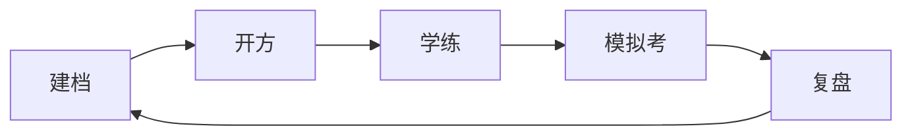
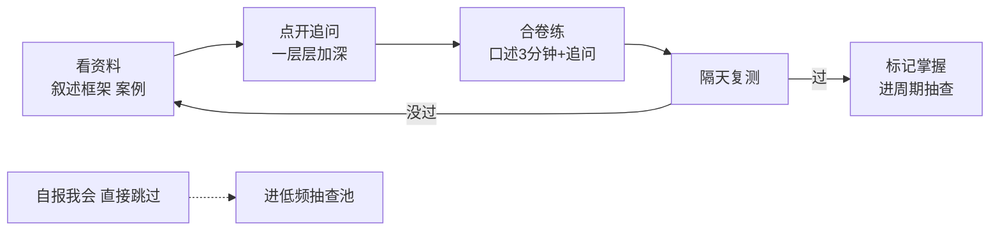

# 知己 · 面试陪练 项目企划书

> 这份文档写给我自己，用我自己的话把项目说清楚。名字已定：知己——产品同时做两件事，知己（用练习照出真实水平）和知彼（追问链就是面试官视角的考点网）。定位是给我自己做的工具，商业化不在当前考虑范围。

## 一、这个项目是干嘛的

举个例子：小王，5 年 Java，想跳槽。他把简历粘进网站，贴上目标岗位 JD，说"我每天晚上只有 2 小时，能复习 6 周"。没有简历的人也不用慌，直接跟 AI 聊几句——年限、做什么的、用过什么，聊完一样建档。然后他确认了一份技能清单，拿到三样东西：

1. **一份技能画像**：AI 从简历和对话里整理出来的技能条目，他逐条拍板——"这条我其实不熟，删了""这条你没提到，加上"。确认过的清单是后面一切的地基。
2. **一条渐进式学习路径**：全量考点库按难度从易到难排好，从最简单的开始看；想深入就点开追问问题，一层层往下走；哪些明确不用学（放弃清单），单独放着并写明原因。
3. **一个陪练**：随时可以喊 AI 面试官按追问链往深了问，问崩的地方记进度，第二天接着练。

一句话：把"拿着大而全的题库从头瞎刷"换成"只练自己简历会被问到的、自己又讲不出来的"。

方法论的底气是我自己：我 2 个月在职备考就是这么干的，整套体系在 [15-面试复习](../../15-面试复习/Java面试全景图.md) 里已经跑成原型了。这个项目就是把这套东西从"我自己会用"变成"别人也能用"。

## 二、为什么我觉得有机会

市面上三类产品，各有一个我没法忍的问题：

| 类型 | 代表 | 问题 |
|---|---|---|
| 刷题网站 / 开源题库 | 牛客、JavaGuide、面试鸭 | 大而全，没人为我裁剪。8 年经验的人刷 HashMap 底层纯属浪费时间 |
| AI 生成题目 | Final Round AI、OfferGenie（[2025 年评测](https://beyz.ai/blog/top-10-ai-interview-assistants-in-2025-tested-by-users)，定价 29~148 美元/月） | 简历+JD 生成一堆问答对，生成完就完了。没有"练没练会"的追踪，没有复习计划，本质是套壳 |
| 面试实时辅助 | Cluely 之类 | 考场作弊器，不碰 |

缺的那个位置：**能跟着我练 6 周、知道我哪会哪不会、每次面完试还能更新的"教练"**。生成题库这件事大家都会，跟练和修正没人做。

## 三、产品长什么样（核心流程）

一个总原则先立住：**入口永远没有考试**。测量不做成环节，藏在日常练习里。



五个环节，转圈而不是一次生成：

1. **建档**：传简历，没有简历就直接跟 AI 聊——年限、岗位、做什么、用过什么。AI 整理出一份技能画像草案，用户逐条拍板：不熟的删掉、漏掉的加上、措辞不准确的改掉。全程是对话，不是问答卷。为什么不先答题摸底：面试本来就是面对面聊的开放题，冷启动就让人答题，既测不准又招人烦；而且年限、岗位、技术栈这些事实，用户自己说比测更快更准。对话里顺带聊到的项目细节，后面会变成模拟面试追问的素材。
2. **开方**：基于确认过的画像生成渐进式学习路径——全量考点库按难度从易到难排好，同时保留三层结构：
   - 底线层：不管简历写没写，这个年限的人都会被问的基础，排在最前面快速过；
   - 主攻层：简历上写了的，要扛住三层追问，每条配真实案例；
   - 放弃层：明确不学，不进路径，单独放着并写明为什么可以放弃。
3. **学练**：日常主体。每个考点走"先看资料 → 点开追问加深 → 合卷练 → 隔天复测"的小循环（下面详说）。合卷练是机制级强制：资料真收起、先作答（打字或语音转写）才解锁自评——"想看不想练"在 UI 层拦住，不靠自觉。
4. **模拟考**：阶段末（比如每周一次）来一场完整模拟面试。每答一问就判一次，判定驱动追问：答对往下钻；答得浅（缺数字缺案例）继续钻——追问本身在给他补证据的机会；说错概念立即停，温和教练纠正后同层换角度再问一次，压力面直接切题。问完按"因果链、证据密度、扛追问层数"出综合评定（规则见第四节）。
5. **复盘**：真去面了，回来把被问到的题录进去；路径和简历跟着更新——练不住的主张从简历降级，练深了的考点反过来写成简历亮点。

### 每个考点怎么学：先看，再练，隔天再测

平时打开产品，看到的不是一张考卷，而是今天的学习卡片：3 个新考点（先看简单层讲解，想深入就点开追问）+ 昨天学的 2 个要复测 + 放弃清单的新增说明。学习和练习拌在一起、按考点小步走。

单个考点的循环：



三点说明：

- **"看"是入口不是敌人**：参考叙述框架、追问链、真实案例全摊开，从最简单的看起；设计演进链还能展开簇级完整答案（含核心伪代码）——学的人自己决定看不看，觉得太简单可以不看，看不懂沿前置回退。方法论反对的从来不是"看"，是"只看"——看懂了不算数，合卷讲 3 分钟、扛住两层追问，考点才算过关。
- **自报"我会，跳过"完全允许**：但跳过不等于消失，它进低频抽查池，隔一阵弹一道出来。自报的水分在这里被挤掉：真会的秒过，虚报的反复出现，系统顺势建议"这条从简历上降级"。
- **所有测量都藏在练习里**：没有分数、没有红叉、没有倒计时，反馈是教练口吻——"这三点讲到了，数字没给，下次补上"。画像里自报的"精通/熟悉"只是初始假设，真实水平由练习数据慢慢修正，越用越准。

两个别人没有的东西：

- **告诉你别学什么**：所有竞品都在做加法，减法依赖"职级 x 时间预算"的标定，这是真功夫；
- **简历和考点库互相改**：市面上的简历工具和题库工具互不相通，这里它们是同一个引擎的两端。

## 四、大概怎么实现

核心资产是一个**考点库**（字段定义、概念边界、库/态分离、存储方案、生产管道的完整设计见 [考点库设计](考点库设计.md)）。每个考点长这样：

```json
{
  "考点ID": "es-write-nrt-refresh",
  "题型": "知识点（sub_type=default）",
  "考点": "ES 近实时写入（refresh / Translog / flush）",
  "追问链": [
    "l0 主问题：为什么 ES 是近实时的，refresh 干了什么",
    "l1 追问：refresh_interval 调大调小各影响什么，线上怎么定",
    "l2 追问：translog 设 request 还是 async，压测过吗"
  ],
  "不同职级的要求": {
    "中级": "讲清 refresh 和 Translog 各自的职责",
    "高级": "说清写入吞吐和可见延迟的取舍",
    "资深": "拿压测数据讲生产上怎么选"
  },
  "评分要点": {
    "必须命中": ["refresh 管可见性（生成新段后才可搜）", "flush 管落盘并清 Translog", "Translog 是断电恢复手段，相当于 binlog"],
    "加分项": [
      {"要点": "给出 refresh_interval 具体取值及场景", "类型": "参数"},
      {"要点": "带生产案例或压测数据", "类型": "案例"}
    ],
    "常见错误": [{"错": "把 refresh 说成落盘", "纠正": "refresh 只生成段，落盘是 flush"}],
    "具体性要求": "提到参数必须给参数名，提到调优必须给取舍依据",
    "要点分级": "每个要点标 level——基础（答出算撑住）/ 中级（想到算良好）/ 资深（想到加分、不想到不扣）；八股的「必须命中 + 加分项」即分级制特例，设计演进链全部要点分级，档位由命中要点的深度分布决定",
    "标准回答样例": {
      "及格": "refresh 把内存缓冲区生成新段，段能搜了所以是近实时；flush 才真正落盘并清 Translog。",
      "良好": "及格版 + refresh_interval 调大调小的取舍和线上取值",
      "优秀": "良好版 + translog durability 的压测数字和丢数据边界"
    }
  },
  "从零讲": "写给没基础的：ES 为什么做不到写完立刻能搜（点「这条看不懂」才展开，几百字）",
  "前置考点": ["倒排索引", "段不可变"],
  "主题簇": "ES 写入链路"
}
```

针对基础差的人，每个考点还有第三块内容：「从零讲」。叙述框架假设你大概懂，只帮回忆结构；「从零讲」写给完全没底层的——大白话从"这个技术为什么存在"讲起，几百字一篇，点「这条看不懂」才展开。它按考点挂，不按整篇文章挂：官方文档几十页不能直接甩给用户，而是重写成讲解挂到对应考点，原文以链接放最后。卡在哪条，就沿"前置考点"往回退一级看讲解，退到看懂为止——不用先啃完 30 页教程再回来做题。

生产上不用每题写讲解，按主题簇来：RocketMQ 100 个题大概聚成 10 来个簇（消息模型 / 存储 / 刷盘 / 主从 / 事务消息 / 顺序消息 / 消费模式 / 重试幂等 / 积压 / 调优），每簇一篇 1500 字左右的讲解，簇内考点共享，人工校的量就可控。讲解和题目走同一条管道：AI 基于原始材料重写、人工校、原文链接挂讲解末尾。

数据规则现在定死，做库时不许走样：每个考点挂 0~n 个前置考点（多数 0~2 个，别硬凑链条）；后置考点不存储——把全库的前置字段反查一遍就是后置，两边都存将来一定改出不一致；每个考点归属一个主主题簇（簇是「从零讲」的生产和共享单位，真有跨簇的考点选主簇挂）。将来扫官方文档整理考点库时，题型、难度、前置、簇、评分要点这五个字段和题干答案一起入库，是必填项，不是可选项。

### 场景设计题：演进链（并入知识点模式）

场景题（"设计百万并发商品详情系统"）一开始立了独立题型：五步脚手架 + 平行三板斧 + 维度计分。后来被一个更好的方案取代——**设计演进链**，直接用知识点的追问链结构承载：

- **主问题**：设计百万并发商品详情系统；
- **第 1 层 · 最简版**：一台 DB 一台缓存跑起来——动手前先问约束（澄清训练在这层，外加模拟考里 AI 沉默等你反问）。最简版考的是"不过度设计"的判断力；
- **第 2~5 层 · 条件升级**：QPS 10w 哪里先崩（逼出量级估算 + CDN + 多级缓存 + 静动态分离）→ 大促热点打满单分片（热点探测 + 散片）→ 改价 5 秒可见（binlog 失效链）→ 缓存集群整体挂了（有损降级）。**每层条件升级，逼出一个高端方案**；
- **第 6 层 · 复盘取舍**：为什么不用 X（价格不走静态化、失效不用双写），取舍理由必须成立。

这么做的收益：场景题获得渐进式练习（每层 5 分钟，从最简版起步，新手也能下嘴）；评分回归统一的四档规则（按层要点命中，不需要维度换算）；从零讲有位置（"最简版为什么扛不住"）；知识簇 = 各层 expect 合起来的完美答案。代价的补偿：连续作答的耐力训练转给合卷练（全链连讲 20 分钟，即一场浓缩设计面）+ 模拟考；平行三板斧的拟真转给模拟考乱序抽层（防背题）。

演进链还有一个地基：**知识簇挂一份完美答案**（reference_solution：完整参考架构 + 核心伪代码）——面试官手里那份理想答案，每层的 expect 都是从它按条件切片拆出来的。评分要点因此升级为**分级制**：每个要点标 基础 / 中级 / 资深——基础级答出算撑住，中级想到算良好，资深要点**想到加分、不想到不扣**（没有银弹的取舍全放资深级：本地缓存选型依据、有损服务的边界、反问约束条件）。档位由命中要点的深度分布决定，不再是命中率的唯一逻辑。

追问的方向也要防遗漏：一个答案之后常有几个平级方向（容量 / 一致性 / 容灾），模拟考遍历用**横向轮转**——第一轮每个方向问一层扫广度，判定发现「缺/错」的方向第二轮纵向加深；时间不够没扫到的方向标"未覆盖"，进下次抽查优先队列。**任何方向都不会因为这次选了别的方向而丢失，只会在时间窗口内延后**，覆盖度进报告。

题型最终收敛为一类：**知识点**，差异下沉到 sub_type——**默认八股 / 设计演进链 / 项目叙事**。项目叙事的练法：AI 按建档素材起草标准故事（六要素组织、用户确认事实），合卷讲 3 分钟 + 追问"当时为什么不用 X"，评分按指标清单（数字 / 冲突 / 时长）全命中。

算法手撕 v1 明确不做：显式进放弃层，写明原因和替代方案（LeetCode），不让它沉默缺席。

### AI 怎么判答案、怎么出分

自然语言回答没法用关键词或相似度判对错——embedding 只能判"像不像"，说反了概念照样高分。所以判定原则是 **LLM 只做对齐判断，不做知识判断**：评分要点预制进考点库，LLM 的唯一职责是把用户的自由回答对齐到这把预制的尺子上，输出强制 JSON。这和"AI 只组装和追问、不让大模型现场编知识"是同一条原则——判分标准也是知识。

三条硬规则：

- **引用强制**：每个「命中」要点必须附用户原话的引用，引不出来的算未命中。这一条杀掉大部分"答非所问但模型客气放水"；
- **每答一问判一次，判定驱动追问**：答况分四类——对（下钻下一层）、缺（对但浅，缺数字缺案例，继续钻，追问本身在给补证据的机会）、错（概念反了/混了，停止下钻，温和教练纠正后同层变体再问一次，压力面短纠正直接切题）、空（没答上来，标记切题）。错和空不硬钻：追问链的层级是前置依赖，第 1 层崩了第 2 层的回答和判定都是噪音——练习时卡壳往回退前置考点，模拟考崩了切走，同一个依赖关系的两种出口；
- **分是公式算的，LLM 从不碰分数**：LLM 的结构化判定是原材料，评级走确定性规则。

单考点四档规则（代码写死，不是模型拍脑袋）：

| 档位 | 规则 |
|---|---|
| 优秀 | 必须要点命中 100% + 至少 1 个加分项 + 扛住全部追问层 |
| 良好 | 必须要点命中 100%，或 ≥80% 且全场无「错」 |
| 及格 | 必须要点命中 ≥60% 且无「错」 |
| 不及格 | 出现「错」，或命中 <60% |

「错」是硬否决项——面试里说反概念的挂、讲得浅的过，规则要和现实一致。聚合权重按两个字段推导，不单独存库：主问题 3 分 / 追问层 2 分；简历授权考点 ×1.5，底线层 ×0.8，参数放配置。（上表按"要点命中"定义。评分要点带分级：八股的"必须命中 + 加分项"即分级制特例；设计演进链的档位由**命中要点的深度分布**决定——要点分 基础 / 中级 / 资深 三级，资深级想到加分、不想到不扣；项目叙事的要点全部必须命中——你的项目你就要全部答到，指标清单：数字 / 冲突 / 3 分钟收住。规则详见 [考点库设计](考点库设计.md)。）

一场考完产出三样东西，代替一个百分制分数：

1. **加权及格率** → 四档总评：≥85% 可上战场 / 70~85% 差强人意 / 50~70% 有硬伤 / <50% 缺口太大；
2. **简历主张存活率**：本场抽到的简历授权考点里没被打穿的比例。连续两场 <50%，自动触发简历降级建议——"简历和考点库互相改"从这里变成量化规则；
3. **教练总评**：LLM 只写叙述和归因（元弱点、下周任务），不给分。分数是公式的事，说话是教练的事。

边界情况：中途喊停的场次，已答部分照常判定出报告，本场标"未完成不评级"；连着两场喊停，考前说明里给提醒。跨场趋势比单场评级值钱——证据密度 0.1 → 0.4 → 0.7 这条曲线，就是坚持练下去的最好证据。

工程上三件事：判定用便宜模型（温度 0，一场 4~6 次调用，成本忽略不计），追问变体和总评用好一点的模型；评分漂移用三档标准回答样例压住（作为 few-shot 随判定一起给模型，触发简历降级这类重判定人工复核一眼）；LLM 输出不合法 JSON 重试一次，再失败降级为"AI 看不准，自评按钮解锁"，判定永远不是单点故障。

关键理解：**考点库内容是提前做好的，AI 只负责组装和追问**。用户来的时候，AI 拿他的简历、目标 JD、建档画像去考点库里匹配，组装出他专属的清单；模拟面试时 AI 按追问链往下问。不让大模型现场编知识——JVM 参数这种东西编错一个就害人。

内容从哪来：GitHub 高 star 仓库、面经帖子，只用来判断"哪些考点高频、会被问到什么深度"；正文由 AI 重写、我人工校。不能直接抄——JavaGuide 这类仓库的协议是禁商用的，CSDN 更不能爬正文，只取"哪些题被反复提到"这个信号。

技术栈：后端 **JDK 21 + Spring Boot 3.x + SQLite**（单文件、零运维，缓存用 Caffeine 本地缓存），前端 **Vue 3 + Vite + TypeScript + Element Plus**，大模型走 API（Spring AI 接入，判定与总评分别选模型）。初版做成模块化单体、不引入 Redis——单用户量级下缓存与分布式组件没有收益，只增加维护成本；模块按业务域分包，将来真发展起来可按域拆分微服务（技术选型理由、MySQL 5.7 的方言落差应对、微服务拆分路径见 [系统架构设计](系统架构设计.md) 二、6.2、8.5）。v1 不做 AI 语音评测，但语音转写要接——浏览器 Web Speech API 免费，口述转文字进答案流。"口述 3 分钟"不能变成"打字 3 分钟"，那是跟最大风险（人懒得多开口）对着干。

生成和展示是两件事，分开处理。建档确认后先生成"路径骨架"：从考点库里选出几百个考点、按难度渐进排好顺序——骨架是结构化的，生成快、成本可以忽略。每个考点的具体内容（讲解、追问链、案例）不现场编，从预制考点库按需取用，点开才渲染。展示永远只有两级：平时看"学习卡片"，一次 3-5 张；想看全局才去"路径地图"。几百个考点永远不会一次性铺在屏幕上。

交互原型已做好，浏览器直接打开就能点：[原型-学习路径交互](原型-学习路径交互.html)（学练主循环，案例数据用我自己的简历画像；合卷练已做成机制级闭卷 + 先作答后自评 + 口述转文字），[原型-建档模拟考复盘交互](原型-建档模拟考复盘交互.html)（建档 / 模拟考 / 复盘三段，各带 storyboard，每段标注设计决策和针对的风险）。

## 五、分几步做

| 阶段 | 时长 | 干什么 | 怎么算成了 |
|---|---|---|---|
| 第一步：自己用 | 4-6 周 | 只做 Java 后端、只做文本：粘简历 → 对话建档 → 出路径 → 考点的"看资料-合卷练-复测"循环 | 我自己完整跑一轮备考，产出的东西我自己觉得能用 |
| 第二步：给朋友用 | +4 周 | 找 5-10 个跟我像但不一样的人用 | 下面五条至少三条达标 |
| 第三步：打磨 | +6 周 | 按内测反馈修体验，扩充考点库 | 朋友真的用它备考完一轮 |

内测要验证的五件事（按重要性排）：

1. **愿不愿意被追问**——最重要的一条。人都懒得多开口，只想躺着看资料；如果大家只想看不想练，这个产品的根基就没了。对策现在是组合拳：把"练"做得比"看"还省力（每次 3 分钟、碎片化、语音转写），再用机制拦住"只看不练"（闭卷强制 + 先作答才能自评）。
2. 建档对话的节奏——聊几句正好，几句话起反感；用户会不会觉得"又来一套问卷"。
3. 信不信 AI 出的题和排的顺序。
4. "放弃清单"是觉得值钱还是觉得被糊弄。
5. 面完试愿不愿意回来录题。

## 六、商业化：当前不做

这个项目定位是给我自己做的工具，不设计付费、增长和运营。第二节里竞品的定价只当背景参考。哪天真起了商业化的念头，再回来单独立项讨论，不在这份文档里预设。

## 七、容易死在哪

| 坑 | 怎么防 |
|---|---|
| 版权 | 只取"考什么"的信号，正文 AI 重写 + 人工校，标来源 |
| AI 编错知识 | 知识提前校准进考点库，AI 只组装和追问，不现场编 |
| 用户只想看不想练 | 陪练交互做到比看资料省力；内测第一条就验证这个 |
| 方法论只适合 8 年资深 | 不同年限的基础层内容不一样，做参数化；先只做和我画像像的人，跑通了再扩 |
| 场景题 / 算法没覆盖 | 场景设计并入知识点（`sub_type=design_chain`，演进链）；算法手撕显式进放弃层（`layer=drop` + 放弃理由），不让它沉默缺席 |

## 八、我自己还欠的功课

- 两个交互原型自己先点一周（学练主循环 + 建档/模拟考/复盘），把别扭的地方记下来，重点验证：闭卷机制会不会让人烦、口述转写在目标浏览器里稳不稳
- 考点库 schema 定稿（题型 / 难度 / 前置 / 簇 / 评分要点五个必填），Java 后端域先做 50 个考点，其中 3 个场景题按演进链（`sub_type=design_chain`）出样例
- 判定 prompt 跑通最小闭环：拿 es-write-nrt-refresh 一条考点手工标好评分要点和三档标准回答样例，接一次真调用，看判定 JSON 和追问决策稳不稳
- 内测朋友名单（5-10 个），每人留一份"用前用后"的对比记录
